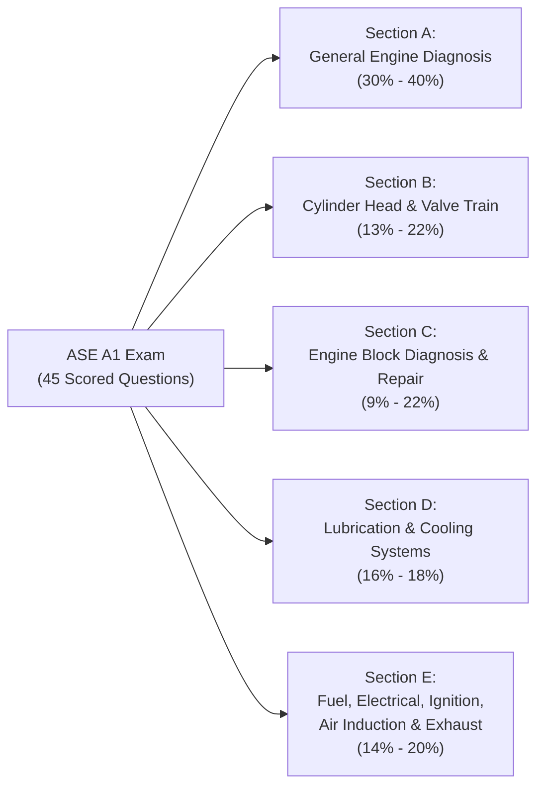

# Comprehensive ASE A1 (Engine Repair) Study Guide & 250-Question Original Practice Test Bank

> [!IMPORTANT]
> **Originality & Anti-Plagiarism Guarantee:** Every question, vehicle scenario, diagnostic data table, and explanation in this guide has been newly authored from the ground up to reflect official ASE A1 task list competencies without copying any commercial or official test items.

---

## Part 1: Understanding the ASE A1 (Engine Repair) Exam

### 1. Exam Format & Structure
The **ASE A1 Engine Repair** certification exam tests practical, hands-on diagnostic and repair knowledge rather than rote textbook definitions.
* **Total Questions:** 55 multiple-choice questions (45 scored questions + 10 unscored research questions distributed invisibly throughout the exam).
* **Time Limit:** 75 minutes (~1 minute and 20 seconds per question).
* **Recertification Exam (A1R):** 23 questions in 30 minutes.

### 2. Content Areas & Blueprint Distribution
The exam is divided into five primary domains:

| Section | Content Area | Core Competencies Tested |
| :--- | :--- | :--- |
| **A** | **General Engine Diagnosis** | Road testing, isolating mechanical vs. electrical/fuel no-starts, engine noises, smoke color diagnosis, vacuum gauge interpretation, wet/dry/running compression tests, cylinder leakage (leak-down) tests, and cylinder power balance tests. |
| **B** | **Cylinder Head & Valve Train** | Head warpage/cracks, MLS gasket surface finish (RA), valve guide wear, valve spring squareness/free height/installed height, seat concentricity, lifter diagnosis, camshaft lobe wear, VVT phasers/OCVs, and timing chain/belt service. |
| **C** | **Engine Block Diagnosis & Repair** | Cylinder bore taper and out-of-round, deglazing/honing crosshatch, piston skirt measurement, ring end gap and side clearance, rod alignment, Plastigage bearing oil clearance, thrust bearing end play, and TTY bolt procedures. |
| **D** | **Lubrication & Cooling Systems** | Oil pressure diagnostics, oil pump clearances, relief valves, PCV vs. ring blow-by, cooling system pressure tests, combustion gas (block) leak tests, water pump cavitation/impeller failure, thermostat testing, and electrolysis. |
| **E** | **Fuel, Electrical, Ignition, Air Induction & Exhaust** | Cranking voltage drop, relative compression waveform analysis, spark plug insulator reading, exhaust backpressure testing (vacuum gauge & pressure gauge at O2 sensor), turbocharger shaft play, and intake manifold vacuum leaks. |

---

### 3. The 4 Classic ASE Question Archetypes (How ASE Asks Questions)

1. **Direct Diagnostic / "MOST Likely" Questions:**
   * Presents a vehicle symptom plus two or three test results (e.g., dry vs. wet compression readings) and asks for the root cause or the next logical diagnostic step.
   * *Strategy:* Match all symptoms simultaneously. Eliminate choices that only explain half the data.
2. **Technician A / Technician B Questions:**
   * Presents two independent statements regarding diagnosis, measurement, or repair procedure.
   * *Strategy:* Evaluate Technician A in complete isolation (True or False?). Then evaluate Technician B in complete isolation (True or False?). Watch out for statements that are partially true but contain one fatal flaw (e.g., using an *outside* micrometer to measure cylinder bore taper).
3. **"EXCEPT" Questions (Negative Stem):**
   * Three of the four options are correct causes or procedures; one is false or inapplicable.
   * *Strategy:* Mentally label each option `(True)` or `(False)` next to A, B, C, and D. Select the lone `(False)` option.
4. **"LEAST Likely" Questions:**
   * All options might be automotive terms, but three directly cause the symptom while one is unrelated or produces the opposite effect.

---

### 4. High-Yield Diagnostic Quick-Reference Tables

#### Intake Manifold Vacuum Gauge Reference (Sea Level; Subtract ~1 in. Hg per 1,000 ft elevation)
| Vacuum Gauge Reading | Engine Condition / Root Cause |
| :--- | :--- |
| **Steady 17–21 in. Hg at idle** | Normal healthy engine |
| **Steady low (10–14 in. Hg) at idle** | Late ignition/valve timing, or large intake manifold vacuum leak |
| **Regular rhythmic drop of 2–4 in. Hg** | Burned, leaking, or localized sticking valve (one cylinder) |
| **Irregular, rapid needle flutter (3–5 in. Hg) at idle** | Worn valve guides or weak valve springs |
| **Starts normal at idle, slowly drops toward 0 at 2,500 RPM** | Restricted exhaust system (plugged catalytic converter or crushed pipe) |
| **Slowly drifts back and forth (4–5 in. Hg) at idle** | Improper idle mixture (too rich or too lean) or minor head gasket leak between cylinders |

#### Cylinder Leakage (Leak-Down) Test Air Escape Reference
| Location Where Escaping Air is Heard / Seen | Component Leaking |
| :--- | :--- |
| **Throttle body / Air intake duct** | Leaking or bent **intake valve** |
| **Tailpipe / Exhaust manifold** | Leaking or burned **exhaust valve** |
| **Oil filler cap / Dipstick tube / PCV port** | Worn/broken **piston rings** or cracked/holed **piston** |
| **Radiator filler neck / Degas bottle bubbles** | Cracked **cylinder head/block** or blown **head gasket** into water jacket |
| **Adjacent cylinder spark plug hole** | Blown **head gasket** between adjacent cylinders |

---

## Part 2: 250 Unique ASE A1 Practice Questions & Detailed Explanations

---

### Section A: General Engine Diagnosis (Questions 1–95)

**1. An inline four-cylinder engine exhibits a rough idle and a misfire code on Cylinder #2. A technician performs a dry and wet cranking compression test with the following results:**
* Cylinder #1: Dry 175 psi / Wet 180 psi
* Cylinder #2: Dry 95 psi / Wet 98 psi
* Cylinder #3: Dry 170 psi / Wet 175 psi
* Cylinder #4: Dry 172 psi / Wet 178 psi

Which of the following is the MOST likely cause of the low reading on Cylinder #2?
* (A) Broken or severely worn piston compression rings on Cylinder #2
* (B) Scored cylinder wall on Cylinder #2
* (C) A burned exhaust valve on Cylinder #2
* (D) A stretched timing chain affecting camshaft phasing

> **Correct Answer: (C)**
> **Rationale:** During a wet compression test, squirting engine oil into the cylinder temporarily seals the piston rings against the cylinder wall. Because the compression on Cylinder #2 remained virtually unchanged (95 psi to 98 psi), the leak is at the top of the cylinder (such as a burned valve or head gasket), not past the piston rings or cylinder wall. A stretched timing chain would affect all cylinders on that bank equally.

**2. During a cylinder leakage (leak-down) test on Cylinder #4 with the piston at top dead center (TDC) on the compression stroke, the gauge shows 38% leakage and air is heard hissing loudly through the throttle body. Which of the following is the MOST likely cause?**
* (A) A burned exhaust valve on Cylinder #4
* (B) A burned intake valve or tight intake lash on Cylinder #4
* (C) Broken piston rings on Cylinder #4
* (D) A leaking head gasket between Cylinders #3 and #4

> **Correct Answer: (B)**
> **Rationale:** Air escaping through the throttle body (intake manifold) indicates air is leaking past the intake valve. Insufficient valve clearance (lash) prevents the intake valve from closing fully against its seat.

**3. A customer complains that their vehicle produces puffs of blue-gray smoke from the tailpipe immediately upon cold morning startup and after idling at a long traffic light, but no smoke is visible during sustained highway cruising. Technician A says worn valve stem seals are a likely cause. Technician B says excessive intake manifold vacuum during idle draws oil down worn valve guides. Who is correct?**
* (A) Technician A only
* (B) Technician B only
* (C) Both Technician A and Technician B
* (D) Neither Technician A nor Technician B

> **Correct Answer: (C)**
> **Rationale:** Both technicians are correct. When an engine is shut off, oil pools on the cylinder head and seeps past worn valve stem seals/guides into the ports, burning off as a blue puff at startup. Similarly, high intake manifold vacuum during closed-throttle idle or deceleration pulls oil past worn intake valve guides and seals.

**4. A technician connects a vacuum gauge to an intake manifold port located below the throttle plate on an engine operating at sea level. At idle, the gauge reads a steady 18 in. Hg. When the engine speed is raised and held at 2,500 RPM, the needle steadily drops toward 4 in. Hg. Which of the following is the MOST likely cause?**
* (A) A leaking brake booster diaphragm
* (B) Late ignition timing
* (C) A burned intake valve
* (D) A melted catalytic converter monolith

> **Correct Answer: (D)**
> **Rationale:** Normal idle vacuum that steadily drops toward zero when engine speed is held at 2,000–2,500 RPM indicates an exhaust restriction (such as a melted or plugged catalytic converter). As exhaust gases cannot escape, cylinder backpressure builds and reduces intake manifold vacuum.

**5. An engine produces a sharp, metallic double-knock that is loudest when idling warm and noticeably diminishes when the fuel injector for Cylinder #5 is disabled with a scan tool. Which of the following is the MOST likely cause?**
* (A) A loose piston pin (wrist pin) in Cylinder #5
* (B) Excessive crankshaft thrust bearing clearance
* (C) A collapsed hydraulic lifter on Cylinder #1
* (D) A cracked flexplate near the torque converter bolts

> **Correct Answer: (A)**
> **Rationale:** A loose wrist pin (piston pin) typically creates a sharp, metallic double-knock at idle as the piston reverses direction at TDC and BDC, and the sound changes or decreases when combustion load is removed from that cylinder by disabling its injector or spark plug.

**6. All of the following steps are required when performing an accurate cranking compression test EXCEPT:**
* (A) Positioning the piston at exact TDC before threading in the gauge
* (B) Blocking the intake throttle plate in the wide-open position
* (C) Removing all spark plugs from the cylinder head ports
* (D) Disabling the fuel injection and ignition systems before cranking

> **Correct Answer: (A)**
> **Rationale:** Positioning a piston at TDC is required for a cylinder leakage (leak-down) test, not a cranking compression test. During a cranking compression test, the engine is cranked through multiple compression strokes (typically 4 to 6 puffs) with the throttle wide open, all spark plugs removed, and fuel/ignition disabled.

**7. During a cranking compression test on a 6-cylinder inline engine, the technician records the following dry pressures:**
* Cyl #1: 165 psi | Cyl #2: 160 psi | Cyl #3: 85 psi | Cyl #4: 80 psi | Cyl #5: 162 psi | Cyl #6: 165 psi

Adding oil to Cylinders #3 and #4 does not raise the compression readings. Technician A says that worn intake valve stem oil seals on Cylinders #3 and #4 are the most likely cause of these low compression readings. Technician B says that performing a cylinder leakage test on Cylinder #3 will likely cause air to exit through the adjacent Cylinder #4 spark plug hole due to a breached head gasket between #3 and #4. Who is correct?
* (A) Technician A only
* (B) Technician B only
* (C) Both Technician A and Technician B
* (D) Neither Technician A nor Technician B

> **Correct Answer: (B)**
> **Rationale:** Technician B is correct: equal, low dry and wet compression readings on two physically adjacent cylinders (#3 and #4) are the classic signature of a head gasket breach across the narrow web between those cylinders, and pressurizing Cylinder #3 will push air out of the Cylinder #4 spark plug hole. Technician A is incorrect: valve stem oil seals control oil consumption down the valve guides and have zero effect on cylinder compression pressure.

**8. A technician performs a running (dynamic) compression test on an engine that lacks power at high RPM. At idle, the running compression on Cylinder #1 is 65 psi. When the throttle is snapped wide open (WOT), the gauge needle rises to only 75 psi instead of reaching ~80% of the cranking compression value. All other cylinders reach 135 psi at WOT. What is the MOST likely cause?**
* (A) A worn intake camshaft lobe on Cylinder #1
* (B) A clogged catalytic converter
* (C) A leaking intake manifold plenum gasket
* (D) Excessive piston ring end gap on Cylinder #1

> **Correct Answer: (A)**
> **Rationale:** During a running compression test, snapping the throttle wide open tests volumetric efficiency (the ability of the cylinder to breathe at higher speeds). A flat or severely worn intake camshaft lobe restricts valve lift on that single cylinder (#1), starving it of airflow at WOT while still allowing near-normal static cranking compression at low cranking speeds.

**9. When monitoring a vacuum gauge at idle, the needle fluctuates rapidly between 14 and 19 in. Hg, and the fluctuation speed increases as engine RPM is slightly raised. Which of the following is the MOST likely cause?**
* (A) A leaking EGR valve pintle
* (B) A cracked vacuum hose to the EVAP purge solenoid
* (C) Retarded camshaft timing by one tooth
* (D) Weak or broken valve springs

> **Correct Answer: (D)**
> **Rationale:** Rapid, erratic needle vibration that increases with RPM indicates valve float or improper valve seating caused by weak/broken valve springs or severely worn valve guides.

**10. An engine exhibits a deep, dull metallic thud primarily when accelerating under heavy load and when first started cold. Disabling individual cylinders one at a time via a scan tool power balance test does not eliminate the noise, though it slightly alters its tone across two adjacent cylinders. What is the MOST likely cause?**
* (A) Excessive main bearing clearance
* (B) A loose rocker arm stud
* (C) Piston slap on a single cylinder
* (D) A sticking hydraulic lash adjuster

> **Correct Answer: (A)**
> **Rationale:** Main bearing knock produces a heavy, low-pitched thud under load. Because a main journal supports the crankshaft between two adjacent connecting rods, disabling a single cylinder rarely stops the knock completely, whereas rod bearing knock typically quiets considerably when its specific cylinder is disabled.

**11. A vehicle arrives on a tow truck with a "cranks but will not start" complaint. While listening to the engine crank, the technician notices the starter spins the engine unusually fast and with a completely even, high-pitched cadence. What should the technician inspect FIRST?**
* (A) Camshaft rotation / timing belt drive
* (B) The fuel pump relay control circuit
* (C) The crankshaft position sensor air gap
* (D) Exhaust system backpressure

> **Correct Answer: (A)**
> **Rationale:** An unusually fast, smooth cranking sound without the normal rhythmic compression pulses indicates a loss of mechanical compression across all cylinders—most commonly caused by a stripped or broken timing belt or chain leaving the valves stationary.

**12. During a cranking compression test on Cylinder #1, the gauge needle rises to only 25 psi on the first puff, 55 psi on the second puff, 90 psi on the third puff, and eventually reaches 145 psi on the sixth puff. Adjacent Cylinder #2 jumps to 105 psi on the first puff and reaches 165 psi by the fourth puff. Technician A says Cylinder #1 likely has worn piston rings allowing compression to leak past on the initial strokes. Technician B says a healthy cylinder should build no more than 10% of its final compression reading on the first compression stroke. Who is correct?**
* (A) Technician A only
* (B) Technician B only
* (C) Both Technician A and Technician B
* (D) Neither Technician A nor Technician B

> **Correct Answer: (A)**
> **Rationale:** Technician A is correct: a slow, stair-stepped climb over many strokes (25 → 55 → 90 → 145 psi) indicates that compression is leaking past worn piston rings. Technician B is incorrect: on a healthy cylinder, the very first compression puff should reach at least 50% to 60% of the final peak reading (as seen on Cylinder #2 jumping to 105 psi on the first puff).

**13. A customer complains of thick, sweet-smelling white clouds of smoke exiting the tailpipe even after the engine is fully warmed up, accompanied by a misfire for the first 15 seconds after a hot restart. Which of the following is the LEAST likely cause?**
* (A) A cracked cylinder head combustion chamber
* (B) Stuck oil control rings on two pistons
* (C) A leaking head gasket fire ring
* (D) A leaking intake manifold coolant crossover passage

> **Correct Answer: (B)**
> **Rationale:** Stuck oil control rings cause blue acrid smoke due to burning engine oil. Sweet-smelling white smoke and hot-soak startup misfires (from coolant seeping into a cylinder under radiator cap pressure after shutoff) are caused by coolant entering the combustion chamber via a head gasket breach, cracked head, or leaking intake coolant crossover.

**14. An engine with a V6 configuration operates smoothly at highway speeds but idles roughly and stalls when coming to a stop. A vacuum gauge connected to the intake plenum reads a steady 12 in. Hg at idle, and Bank 1 and Bank 2 Short-Term Fuel Trims (STFT) are both at +19% at idle, but drop to +2% at 2,500 RPM. What is the MOST likely cause?**
* (A) A large vacuum leak entering the shared upper intake plenum
* (B) A jumped camshaft timing belt affecting Bank 1 cylinders only
* (C) Low fuel pump delivery pressure from the in-tank module
* (D) A partially restricted rear exhaust muffler assembly

> **Correct Answer: (A)**
> **Rationale:** A steady low vacuum reading at idle accompanied by high positive fuel trims (+19%) on both banks at idle that return to near zero (+2%) at 2,500 RPM is the classic signature of an intake manifold vacuum leak. At idle, the throttle plate is closed so the unmeasured air leak represents a huge percentage of total airflow; at 2,500 RPM with the throttle open, the small leak becomes negligible.

**15. While performing a cylinder power balance test on an 8-cylinder engine using a scan tool to deactivate fuel injectors sequentially, disabling seven of the cylinders causes a 120 RPM drop each, while disabling Cylinder #7 causes a 0 RPM drop. All of the following could cause this test result EXCEPT:**
* (A) An open circuit in the Cylinder #7 ignition coil primary winding
* (B) A leaking thermostat stuck in the open position
* (C) A clogged fuel injector nozzle in Cylinder #7
* (D) A burned exhaust valve in Cylinder #7

> **Correct Answer: (B)**
> **Rationale:** When disabling a cylinder produces zero RPM drop, that cylinder is contributing nothing to engine power (a dead cylinder), which can be caused by lack of spark (A), lack of compression (D), or lack of fuel (C). A stuck-open thermostat affects global engine operating temperature and cannot cause a single dead cylinder.

**16. A technician is diagnosing a hollow, bell-like knocking sound from the lower block area that is loudest right after a cold start and disappears completely once coolant temperature reaches 185°F (85°C). Which of the following is the MOST likely cause?**
* (A) Excessive piston-to-wall clearance (piston slap)
* (B) Spun connecting rod bearing shells on two crankshaft journals
* (C) A broken inner valve spring damper inside the valve cover
* (D) Excessive crankshaft thrust bearing axial end-play clearance

> **Correct Answer: (A)**
> **Rationale:** Piston slap produces a hollow, bell-like knock when the engine is cold because the aluminum piston has not yet thermally expanded to fill the cylinder bore. As the piston warms up and expands, the clearance shrinks and the noise disappears. By contrast, rod and main bearing knocks worsen as the engine warms up and the oil thins out.

**17. An engine cranks over at normal speed, has strong spark and proper fuel pressure, but will not start. During cranking, puffs of air vapor blow backward out of the intake throttle body. Technician A says that a clogged fuel filter is causing the engine to blow air backward out of the throttle body. Technician B says that a jumped timing belt/chain or a completely plugged exhaust system can cause air reversion through the intake during cranking. Who is correct?**
* (A) Technician A only
* (B) Technician B only
* (C) Both Technician A and Technician B
* (D) Neither Technician A nor Technician B

> **Correct Answer: (B)**
> **Rationale:** Technician B is correct: if the timing belt/chain jumps significantly (holding intake valves open during the compression stroke) or if the exhaust system is completely blocked (preventing trapped cylinder gases from exiting the tailpipe), positive pressure blows backward out of the intake throttle body. Technician A is incorrect: a clogged fuel filter restricts fuel flow and cannot cause mechanical air reversion out of the intake manifold.

**18. When using a mechanical stethoscope to isolate an abnormal whirring and grinding noise at the front of a transverse V6 engine, what is the safest and most definitive way to verify whether the noise is coming from an accessory drive pulley versus an internal timing chain tensioner?**
* (A) Briefly run the engine with the accessory serpentine drive belt removed
* (B) Spray silicone lubricant onto the serpentine belt ribs while the engine is running
* (C) Hold the stethoscope probe directly against the rotating harmonic balancer bolt
* (D) Increase engine speed to 4,500 RPM while standing over the radiator support

> **Correct Answer: (A)**
> **Rationale:** Removing the serpentine belt and briefly starting the engine (for 10–15 seconds while cold) completely stops the alternator, A/C compressor, power steering pump, idler pulleys, and belt-driven water pump. If the noise disappears, it is in the accessory drive; if it persists, it is internal to the engine/timing drive.

**19. A customer complains of a harsh vibration felt at 60 mph (2,200 RPM) on the highway. When the technician shifts the automatic transmission into Neutral while coasting at 60 mph and lets the engine drop to idle (750 RPM), the vibration completely disappears. When parked in the shop in Neutral and revved to 2,200 RPM, the vibration returns. What does this confirm?**
* (A) The vibration is caused by a bent wheel rim or separated tire tread belt
* (B) The vibration is caused by an out-of-balance rear driveshaft or worn U-joint
* (C) The vibration originates from an engine-speed rotating or reciprocating component
* (D) The vibration is caused by warped rear brake drums rubbing the shoes

> **Correct Answer: (C)**
> **Rationale:** Coasting in Neutral at highway speed separates vehicle-speed drivetrain components (wheels, tires, axle shafts, driveshaft) from engine-speed components (crankshaft, harmonic balancer, flywheel/flexplate, torque converter, accessory pulleys). Because the vibration disappears at 60 mph when engine RPM drops to idle and returns at 2,200 RPM while stationary in Park/Neutral, the fault is isolated to an engine-speed component.

**20. During a cranking compression test on Cylinder #4, the compression gauge reads 225 psi, whereas Cylinders #1, #2, and #3 all read 155–160 psi. Which of the following is the MOST likely cause of the abnormally high reading in Cylinder #4?**
* (A) A leaking head gasket between Cylinder #4 and a coolant passage
* (B) A cracked piston skirt in Cylinder #4
* (C) Excessive valve guide wear on the exhaust valve of Cylinder #4
* (D) Heavy carbon buildup on Cylinder #4's piston crown and chamber

> **Correct Answer: (D)**
> **Rationale:** Heavy carbon deposits on the piston crown and cylinder head chamber physically reduce the clearance volume of the combustion chamber, raising the static compression ratio and resulting in an abnormally high cranking compression reading on that cylinder.

**21. Technician A says that black exhaust smoke accompanied by a strong raw fuel odor and soot-fouled spark plugs indicates an overly rich air-fuel mixture. Technician B says that an engine burning excessive amounts of automatic transmission fluid through a ruptured vacuum modulator will produce thick black exhaust smoke. Who is correct?**
* (A) Technician A only
* (B) Technician B only
* (C) Both Technician A and Technician B
* (D) Neither Technician A nor Technician B

> **Correct Answer: (A)**
> **Rationale:** Technician A is correct: black smoke and dry, fluffy soot on spark plugs result from incomplete combustion of an overly rich fuel mixture. Technician B is incorrect: automatic transmission fluid drawn into an intake manifold burns with dense white or bluish-white smoke, not black smoke.

**22. A technician is performing a cylinder leakage test on a 4-cylinder engine with a firing order of 1-3-4-2. When Cylinder #1 is brought to TDC on its compression stroke and compressed air (100 psi) is applied, the crankshaft suddenly spins half a turn. What caused the crankshaft to rotate?**
* (A) The radiator pressure cap was left installed on the filler neck
* (B) The intake valve in Cylinder #3 was stuck in the open position
* (C) The cylinder leakage tester air pressure regulator was set too low
* (D) The Cylinder #1 piston was not at exact TDC before applying air

> **Correct Answer: (D)**
> **Rationale:** If the piston is even a few degrees before or after TDC when high-pressure air is introduced into the cylinder, the downward force on the piston acts on the offset connecting rod journal and forcefully rotates the crankshaft toward BDC.

**23. A vehicle with a 2.4L DOHC engine has a rough idle and low power. A vacuum gauge connected to the intake manifold shows a steady reading of 11 in. Hg at idle (normal is 18–20 in. Hg). Spraying propane and carb cleaner around the intake manifold gaskets and vacuum hoses produces no change in engine RPM or STFT. What should the technician check NEXT?**
* (A) Camshaft-to-crankshaft timing marks
* (B) The radiator cap pressure relief spring
* (C) Crankcase end play with a dial indicator
* (D) The oil pressure sending unit resistance

> **Correct Answer: (A)**
> **Rationale:** A steady, low vacuum gauge reading across all cylinders with no external intake vacuum leaks is a hallmark of late (retarded) camshaft/valve timing—such as a timing belt or chain that has jumped one or two teeth.

**24. When interpreting a cylinder leakage test gauge, a reading of 8% leakage on an engine with 75,000 miles indicates:**
* (A) The cylinder requires immediate boring and oversized pistons
* (B) Normal ring and valve sealing needing no teardown
* (C) A blown cylinder head gasket
* (D) The leak-down tester orifice is plugged

> **Correct Answer: (B)**
> **Rationale:** Any cylinder leakage reading below 10–15% on an in-service engine is considered normal, healthy sealing (some air always escapes past the piston ring end gaps even in a new engine). Generally, leakage above 20% warrants further repair investigation.

**25. An engine makes a sharp rattling or pinging sound (detonation/spark knock) only when climbing a steep grade in high gear under moderate-to-heavy throttle. All of the following conditions can cause this noise EXCEPT:**
* (A) An inoperative (stuck-closed) EGR valve
* (B) Excessive carbon buildup inside the combustion chambers
* (C) Retarded ignition timing
* (D) Engine overheating or a cooling system hot spot

> **Correct Answer: (C)**
> **Rationale:** Overly advanced ignition timing causes spark knock (detonation), whereas retarded ignition timing reduces peak cylinder pressure and decreases the likelihood of detonation. Inoperative EGR, carbon buildup (increasing compression ratio and creating hot spots), and engine overheating all promote detonation.

**26. A technician is diagnosing a heavy metallic knock that occurs primarily at 2,200 RPM under light load ("float" condition) and disappears when the engine is decelerating in gear. When the spark plug lead on Cylinder #2 is grounded, the knock drops significantly in volume. What is the MOST likely cause?**
* (A) A loose camshaft drive sprocket retaining bolt at the front cover
* (B) A cracked cast-iron exhaust manifold collector flange
* (C) Excessive connecting rod bearing oil clearance on Cylinder #2
* (D) A worn accessory belt-driven water pump shaft bearing

> **Correct Answer: (C)**
> **Rationale:** Connecting rod bearing noise is notoriously loud at "float" (light load around 2,000–2,500 RPM where combustion pressure and reciprocating inertia forces alternate rapidly) and quiets dramatically when the affected cylinder's spark or fuel injector is disabled.

**27. During a road test on an engine with a newly installed serpentine belt and verified proper tensioner load, a customer demonstrates a rhythmic chirping sound once per belt revolution that increases with engine RPM. When the technician mists a small amount of plain water onto the ribbed side of the belt, the chirping stops immediately and returns 30 seconds later. What is the MOST likely cause?**
* (A) Misaligned accessory drive belt pulleys
* (B) A failing internal oil pump rotor
* (C) A spun camshaft journal bearing
* (D) Excessive piston pin interference fit

> **Correct Answer: (A)**
> **Rationale:** When spraying water on a serpentine belt temporarily quiets a rhythmic chirp, the noise is typically caused by pulley misalignment forcing the belt ribs to enter the pulley grooves at an angle. (By contrast, if spraying water makes a squeal louder, it indicates belt slip due to low tension).

**28. Technician A says that ultraviolet (UV) fluorescent dye added to the engine oil will glow brightly under a black light at the point where oil exits the engine block. Technician B says that before adding UV dye, the exterior of the engine should be degreased and cleaned so old oil trails do not obscure the true origin of the leak. Who is correct?**
* (A) Technician A only
* (B) Technician B only
* (C) Both Technician A and Technician B
* (D) Neither Technician A nor Technician B

> **Correct Answer: (C)**
> **Rationale:** Both technicians are correct. Degreasing the engine first and then adding oil-soluble UV dye and inspecting with a UV lamp is the industry-standard procedure to pinpoint the exact source of a seep before airflow blows the oil across the undercarriage.

**29. An engine has a rhythmic ticking sound coming from the right valve cover area. The frequency of the tick is exactly half of crankshaft RPM. Which of the following components rotates or actuates at half of crankshaft speed?**
* (A) The harmonic balancer
* (B) The flywheel ring gear
* (C) The connecting rod big-end journal
* (D) A camshaft lobe and valve lifter

> **Correct Answer: (D)**
> **Rationale:** In a four-stroke cycle engine, the camshaft rotates at exactly half (1/2) of crankshaft speed. Therefore, valvetrain noises (lifters, rocker arms, cam lobes) occur at half crankshaft speed, whereas lower-end noises (pistons, rods, flexplate, balancer) occur at full crankshaft speed.

**30. A technician connects a vacuum gauge to an engine at idle and observes that the needle hangs steady at 19 in. Hg for several seconds, then drops sharply to 15 in. Hg on a regular, repeating beat, and immediately returns to 19 in. Hg. What is the MOST likely cause?**
* (A) A clogged positive crankcase ventilation (PCV) orifice
* (B) A chipped or burned valve face on one cylinder
* (C) Worn piston rings across all cylinders
* (D) An overfilled crankcase

> **Correct Answer: (B)**
> **Rationale:** A sharp, rhythmic drop of several inches of mercury every time one particular cylinder's intake event occurs is the classic vacuum gauge indication of a single leaking, chipped, or burned valve.

**31. When performing a snap-throttle vacuum test (quickly opening the throttle to 2,500 RPM and snapping it closed), what should a vacuum gauge needle do on a mechanically healthy engine with good piston rings?**
* (A) Rise to 25 in. Hg on snap-open, drop to 0 in. Hg on close, and stay at 5 in. Hg
* (B) Drop to ~2 in. Hg on open, spike to 24 in. Hg on close, and settle at 19 in. Hg
* (C) Remain completely stationary at 18 in. Hg regardless of throttle plate movement
* (D) Drop to 10 in. Hg on snap-open and never rise above 15 in. Hg on snap-close

> **Correct Answer: (B)**
> **Rationale:** When the throttle is snapped open, manifold pressure equalizes with atmospheric pressure (vacuum drops near 2 in. Hg). When the throttle is snapped shut at 2,500 RPM, the rapidly descending pistons pull against a closed throttle plate, spiking vacuum to 23–25 in. Hg (about 5 in. Hg higher than normal idle). If the rings are worn, the needle will fail to spike above ~20 in. Hg on snap-close.

**32. A 4-cylinder engine has a severe vibration only at idle and low speeds, even though cranking compression is 175 psi on all four cylinders and all four cylinders show an equal RPM drop during a cylinder power balance test. The timing belt and balance shaft belt were replaced yesterday. What is the MOST likely cause?**
* (A) The secondary ignition spark plug firing order was accidentally reversed
* (B) The intake valves on Cylinders #2 and #3 were bent during belt installation
* (C) One or both balance shafts are timed out of phase with the crankshaft
* (D) The multi-layer steel cylinder head gasket was installed upside down

> **Correct Answer: (C)**
> **Rationale:** Many large-displacement 4-cylinder engines use counter-rotating balance shafts to cancel secondary reciprocating forces. If the balance shafts are timed out of phase during timing belt service, engine compression and power balance remain completely normal, but a severe mechanical vibration occurs.

**33. A customer complains of a loud metallic clanking or rattling sound coming from the rear of the engine near the transmission bellhousing at idle in Park, which changes pitch when shifted into Drive with the foot brake applied. All of the following should be inspected EXCEPT:**
* (A) Cracks radiating around the flexplate-to-crankshaft mounting holes
* (B) Loose or backing-out torque converter-to-flexplate bolts
* (C) Broken starter drive bendix gear teeth
* (D) Excessive valve stem-to-guide clearance on Cylinder #1

> **Correct Answer: (D)**
> **Rationale:** A cracked flexplate or loose torque converter bolts produce a loud metallic knock/rattle from the bellhousing area that changes when load is applied in Drive. Valve stem-to-guide clearance at the front of the cylinder head will not produce a bellhousing knock that changes when shifting from Park to Drive.

**34. During a cylinder leakage test on a V8 engine, the technician observes air bubbles rising continuously through the upper radiator filler neck while Cylinder #6 is pressurized at TDC on the compression stroke. Technician A says this indicates that compressed air is leaking past the Cylinder #6 piston oil control ring into the oil pan. Technician B says this indicates a breach between the Cylinder #6 combustion chamber and the cooling jacket caused by a failed head gasket, cracked cylinder head, or cracked cylinder wall. Who is correct?**
* (A) Technician A only
* (B) Technician B only
* (C) Both Technician A and Technician B
* (D) Neither Technician A nor Technician B

> **Correct Answer: (B)**
> **Rationale:** Technician B is correct: air bubbles appearing in the radiator neck during a cylinder leak-down test confirm that compressed air from Cylinder #6 is entering the engine's cooling water jacket via a blown head gasket, cracked head, or cracked cylinder wall. Technician A is incorrect: air leaking past piston rings enters the crankcase (heard at the oil filler cap or dipstick tube), not the cooling radiator.

**35. An engine exhibits excessive crankcase pressure (blow-by) that pushes the dipstick partially out of its tube under heavy highway acceleration, even after replacing the PCV valve and verifying that all PCV hoses and passages are clear and unrestricted. What is the MOST likely cause?**
* (A) Worn or broken compression rings allowing blow-by into the crankcase
* (B) Leaking exhaust valve stem oil seals allowing oil into the exhaust ports
* (C) Low engine coolant level inside the radiator overflow reservoir
* (D) A worn camshaft thrust plate increasing axial camshaft end play

> **Correct Answer: (A)**
> **Rationale:** When the PCV system is clean and functional, excessive positive crankcase pressure under load is caused by combustion gases blowing past worn, stuck, or broken piston compression rings (or a cracked piston) into the crankcase faster than the PCV system can evacuate them.

**36. A customer brings in a 4-cylinder pickup truck that was driven through deep standing water and stalled immediately. Now the starter clicks once and the engine will not crank. A technician attempts to rotate the crankshaft damper bolt clockwise with a 1/2-inch breaker bar, and the crankshaft stops solidly after turning 45 degrees. Turning it counterclockwise allows it to rotate nearly one full revolution before stopping solidly again. What should the technician do FIRST?**
* (A) Replace the starter motor and starter solenoid assembly
* (B) Remove all spark plugs and crank the engine to expel liquid from the bores
* (C) Connect a battery booster pack in series to supply 24 volts to the starter motor
* (D) Remove the oil pan to inspect for a spun main bearing shell

> **Correct Answer: (B)**
> **Rationale:** When an engine stalls in deep water and the crankshaft can be barred backward slightly before hitting a hard mechanical stop in both directions, a cylinder has ingested water (hydrostatic lock) and the piston is stopping against the incompressible liquid on its compression stroke. Removing all spark plugs allows the trapped water to be safely expelled before inspecting for a bent connecting rod. Attempting to force the engine over with extra battery voltage (C) will bend or break a connecting rod, and the ability to rotate backward rules out a seized main bearing (D) or bad starter (A).

**37. After a 4-cylinder engine ingests water while driving through a deep puddle and the water is cleared from the cylinders, the engine starts and runs but exhibits a slight misfire at idle on Cylinder #3. A technician performs a dry and wet cranking compression test and records: Cylinder #1 (Dry 185 psi / Wet 190 psi), Cylinder #2 (Dry 182 psi / Wet 188 psi), Cylinder #3 (Dry 135 psi / Wet 138 psi), and Cylinder #4 (Dry 184 psi / Wet 189 psi). A cylinder leakage test on Cylinder #3 at TDC shows only 6% leakage, and valve lash/camshaft lift are within specification. What is the MOST likely cause of the low compression on Cylinder #3?**
* (A) A warped intake valve head on Cylinder #3 preventing full seating
* (B) Broken compression rings on Cylinder #3 caused by hydraulic water pressure
* (C) A slightly bent connecting rod on Cylinder #3 lowering piston height
* (D) A blown cylinder head gasket fire ring between Cylinders #2 and #3

> **Correct Answer: (C)**
> **Rationale:** A slightly bent connecting rod caused by partial hydrostatic lock pulls the piston lower in the cylinder bore at TDC, increasing clearance volume and lowering the static compression ratio (causing low cranking compression of 135 psi that does not improve with oil), even though the rings, valves, and head gasket seal completely normally (only 6% leak-down). If the rings (B), valve (A), or head gasket (D) were leaking, the cylinder leakage test would show high leakage percentages.

**38. A technician is performing a dry and wet cranking compression test on a V6 engine with a warm rough idle. The test results are: Cyl #1 (Dry 160 psi / Wet 165 psi), Cyl #2 (Dry 158 psi / Wet 164 psi), Cyl #3 (Dry 162 psi / Wet 166 psi), Cyl #4 (Dry 90 psi / Wet 152 psi), Cyl #5 (Dry 155 psi / Wet 160 psi), and Cyl #6 (Dry 160 psi / Wet 164 psi). Which of the following is the MOST likely cause of the test results on Cylinder #4?**
* (A) A burned exhaust valve seat on Cylinder #4
* (B) Worn or broken piston compression rings on Cylinder #4
* (C) A cracked cylinder head between the intake and exhaust ports on Cylinder #4
* (D) A broken valve spring on Cylinder #4

> **Correct Answer: (B)**
> **Rationale:** Squirting a teaspoon of engine oil into Cylinder #4 caused the compression reading to jump dramatically from 90 psi (dry) to 152 psi (wet). The heavy oil temporarily seals the radial clearance between the piston rings and cylinder wall, proving that compression was escaping past worn or broken piston rings rather than through the top end (valves or cylinder head).

**39. Technician A says that when evaluating cranking compression test results on a modern 4-cylinder gasoline engine, a 60% variation between the highest cylinder (180 psi) and the lowest cylinder (70 psi) is considered normal and acceptable. Technician B says that if an engine is severely flooded with raw gasoline during cold-start attempts, the liquid gasoline coats the cylinder walls and raises cranking compression by 50 psi across all cylinders. Who is correct?**
* (A) Technician A only
* (B) Technician B only
* (C) Both Technician A and Technician B
* (D) Neither Technician A nor Technician B

> **Correct Answer: (D)**
> **Rationale:** Neither technician is correct. Industry and OEM standards require cylinder-to-cylinder cranking compression variation not to exceed 15%–25% (the lowest cylinder must be at least 75%–80% of the highest cylinder), so 70 psi vs. 180 psi indicates a major mechanical fault. Furthermore, severe fuel flooding ('cylinder washdown') strips the lubricating oil film off the cylinder walls, causing cranking compression to drop significantly across all cylinders rather than rise.

**40. A technician connects a vacuum gauge to an intake manifold port on a mechanically healthy V8 engine operating at a repair shop in Denver, Colorado (elevation 5,300 feet above sea level). Which of the following idle vacuum readings should the technician expect to see?**
* (A) Rapidly fluctuating between 8 and 18 in. Hg
* (B) Steady between 18 and 22 in. Hg
* (C) Steady between 12 and 16 in. Hg
* (D) Steady between 23 and 26 in. Hg

> **Correct Answer: (C)**
> **Rationale:** Because atmospheric pressure decreases with altitude, normal intake manifold vacuum drops by approximately 1 in. Hg for every 1,000 feet of elevation above sea level. Since a healthy engine reads 17–21 in. Hg at sea level, at 5,300 feet elevation (~5 in. Hg reduction) a normal steady reading is approximately 12–16 in. Hg.

**41. During a running (dynamic) compression test on a 4-cylinder engine, the technician records the following readings with the Schraeder valve in the gauge hose functioning normally: Cylinder #1 (Idle 65 psi / WOT Snap 138 psi), Cylinder #2 (Idle 64 psi / WOT Snap 135 psi), Cylinder #3 (Idle 20 psi / WOT Snap 132 psi), and Cylinder #4 (Idle 66 psi / WOT Snap 140 psi). Static cranking compression was 165 psi across all four cylinders. Which of the following is the MOST likely cause of the running compression readings on Cylinder #3?**
* (A) A worn intake camshaft lobe on Cylinder #3 restricting high-speed lift
* (B) A restricted exhaust manifold pipe affecting all four cylinders
* (C) Broken piston compression rings on Cylinder #3 allowing blow-by
* (D) An intermittently sticking valve or minor seat leak on Cylinder #3

> **Correct Answer: (D)**
> **Rationale:** Cylinder #3 has poor running compression at slow idle speed (20 psi, when time-per-stroke is long enough for pressure to bleed past a sticking or slightly leaking valve) but recovers to normal volumetric efficiency (132 psi) during a wide-open throttle (WOT) snap when airflow velocity and cylinder pressure slam the valve shut. A worn camshaft lobecauses the exact opposite effect—near-normal idle running compression that fails to rise during a WOT snap.

**42. A customer complains that an engine runs smoothly at idle and low speeds, but misfires and loses power above 3,800 RPM. Cranking compression is 175 psi on all cylinders. When performing a running compression test and revving the engine to 4,000 RPM, the vacuum gauge needle begins vibrating rapidly and Cylinder #5 shows an erratic drop in dynamic pressure. All of the following could cause this condition EXCEPT:**
* (A) Excessive piston skirt-to-cylinder wall clearance on Cylinder #5
* (B) A broken inner valve spring damper on Cylinder #5
* (C) A pumped-up hydraulic valve lifter on Cylinder #5 due to a weak plunger return or aerated oil
* (D) A weak or heat-fatigued valve spring on Cylinder #5

> **Correct Answer: (A)**
> **Rationale:** Misfires and dynamic compression loss that occur only at high RPM while low-speed cranking compression is normal (175 psi) are caused by high-RPM valvetrain control issues such as valve float from weak/broken valve springs (D) and (B) or hydraulic lifter pump-up holding a valve off its seat (C). Excessive piston skirt clearance (A) causes cold piston slap at low speeds, not high-RPM valve float.

**43. During a cylinder leakage (leak-down) test on a V8 engine with Cylinder #2 positioned at TDC on the compression stroke, the gauge reads 45% leakage. The technician removes the oil filler cap, radiator cap, and air cleaner duct, and listens at the tailpipe, but hears the loudest rushing air sound coming out of the oil dipstick tube and PCV breather port. What is the MOST likely cause?**
* (A) A burned exhaust valve face on Cylinder #2
* (B) A bent intake valve stem in Cylinder #2
* (C) A cracked piston crown or worn compression rings in Cylinder #2
* (D) A blown cylinder head gasket into an adjacent coolant passage

> **Correct Answer: (C)**
> **Rationale:** When pressurized air introduced into the combustion chamber during a leak-down test escapes into the crankcase (exiting via the oil filler cap, dipstick tube, or PCV breather), the leak path is past the piston assembly—either worn/broken piston rings, a scored cylinder wall, or a cracked/holed piston crown.

**44. A technician is preparing to perform a cylinder leakage test on Cylinder #5. Technician A says the cylinder leakage tester regulator must be adjusted so the leakage percentage gauge reads 85% before connecting the quick-coupler to the spark plug adapter hose. Technician B says the engine should be at normal operating temperature before performing the test so that pistons and rings are thermally expanded to normal working clearances. Who is correct?**
* (A) Technician A only
* (B) Technician B only
* (C) Both Technician A and Technician B
* (D) Neither Technician A nor Technician B

> **Correct Answer: (B)**
> **Rationale:** Technician B is correct: performing leak-down tests at normal operating temperature ensures normal thermal expansion of pistons, rings, and valve seats. Technician A is incorrect: before connecting the tester to the cylinder adapter hose, the regulator must be calibrated to 0% on the leakage scale (100% source pressure) with shop air applied—not 85%.

**45. A technician connects a vacuum gauge to an intake manifold port on an engine with a rough, hunting idle. At idle, the vacuum needle drifts slowly back and forth between 13 and 17 in. Hg in a smooth, wave-like motion. Which of the following is the MOST likely cause?**
* (A) An improper idle air-fuel mixture causing fuel trim hunting
* (B) A broken exhaust valve spring on one cylinder
* (C) A seized idler pulley bearing on the accessory belt drive
* (D) Excessive connecting rod bearing oil clearance

> **Correct Answer: (A)**
> **Rationale:** A slow, rhythmic drifting or "hunting" of the vacuum gauge needle over a 4–5 in. Hg range at idle is characteristic of an improper idle air-fuel mixture (or an air/fuel control system oscillating between rich and lean). By contrast, a broken valve spring causes rapid, high-frequency needle flutter, and bearing or pulley defects do not cause slow vacuum oscillation.

**46. While diagnosing a "no-crank, no-start" complaint where a loud single click is heard from the starter solenoid when the key is turned to START, what should the technician do to quickly determine whether the engine is mechanically locked up versus having a starter/electrical circuit failure?**
* (A) Replace both positive and negative battery cables along with the starter relay
* (B) Remove the cylinder head assembly to inspect the pistons and valves for contact
* (C) Attempt to bar the crankshaft 360 degrees by hand with a socket and breaker bar
* (D) Perform a compressed-air cylinder leakage test on all six cylinders

> **Correct Answer: (C)**
> **Rationale:** Barring the engine over by hand at the crankshaft damper bolt with a breaker bar immediately separates mechanical engine seizure/hydrolock from electrical/starter system faults without unnecessary teardown or parts replacement.

**47. An inline 6-cylinder engine cranks over slowly for half a revolution and then stops completely. When the technician removes all six spark plugs, raw liquid gasoline sprays forcefully out of the Cylinder #5 spark plug hole when cranked. Which of the following is the MOST likely cause?**
* (A) A stuck-open fuel injector pintle on Cylinder #5 flooding the bore
* (B) A blown cylinder head gasket between Cylinder #5 and the water jacket
* (C) A saturated evaporative emissions (EVAP) charcoal canister purge line
* (D) An open signal circuit inside the magnetic crankshaft position sensor

> **Correct Answer: (A)**
> **Rationale:** Raw gasoline filling a single cylinder (#5) and causing fuel hydrolock is caused by that cylinder's fuel injector leaking or sticking open (either mechanically stuck open under residual rail pressure or held open by a shorted injector driver circuit grounded in the harness/PCM).

**48. A technician is performing a cylinder power balance test on a 90-degree V6 engine with a firing order of 1-2-3-4-5-6 and a split-plenum intake manifold where Cylinders #1, #3, and #5 are fed by the right plenum runner and Cylinders #2, #4, and #6 are fed by the left plenum runner. Disabling Cylinders #1, #3, or #5 causes only a 15 RPM drop each, whereas disabling Cylinders #2, #4, or #6 causes a 110 RPM drop each. Which of the following is the MOST likely cause?**
* (A) A jumped timing belt or restricted pre-cat converter on Bank 1
* (B) A broken crankshaft journal located between Cylinders #3 and #4
* (C) A weak electric fuel pump assembly inside the vehicle fuel tank
* (D) A skewed engine coolant temperature (ECT) sensor signal to the PCM

> **Correct Answer: (A)**
> **Rationale:** Because Cylinders #1, #3, and #5 comprise one entire bank (Bank 1) and share one side of the split intake plenum, a fault that weakens all three cylinders on Bank 1 while leaving Bank 2 (#2, #4, #6) strong points to a bank-specific failure—such as a large vacuum leak on the Bank 1 plenum runner, a jumped Bank 1 camshaft, or a plugged Bank 1 pre-cat converter. A weak fuel pump (C) or bad ECT sensor (D) would affect both banks equally.

**49. Technician A says that during a cylinder power balance test on an engine with a waste-spark ignition system, pulling a spark plug wire off one coil tower without grounding it can disrupt the spark delivered to its companion cylinder. Technician B says that using a scan tool to disable a fuel injector during a power balance test dumps raw unburned gasoline into the catalytic converter. Who is correct?**
* (A) Technician A only
* (B) Technician B only
* (C) Both Technician A and Technician B
* (D) Neither Technician A nor Technician B

> **Correct Answer: (A)**
> **Rationale:** Technician A is correct: on a waste-spark ignition system, two companion cylinders share a single secondary coil winding wired in series, so opening one plug wire disrupts both cylinders. Technician B is incorrect: disabling a fuel injector stops fuel spray completely (preventing raw fuel from entering the exhaust), whereas disabling spark while leaving the injector firing is what dumps raw unburned fuel into the catalytic converter.

**50. A customer complains of a sharp, light metallic ticking noise from the upper engine that occurs right after starting the engine when it has sat overnight for 12 hours, and disappears completely after 5 to 8 seconds of idling. Oil pressure on the dash gauge builds normally within 3 seconds. What is the MOST likely cause?**
* (A) Excessive crankshaft main bearing journal taper on the center web
* (B) A hydraulic valve lifter (lash adjuster) bleeding down while parked
* (C) A cracked second piston ring land on the major thrust side
* (D) A loose flywheel-to-crankshaft mounting flange bolt

> **Correct Answer: (B)**
> **Rationale:** A hydraulic valve lifter or lash adjuster with a slightly worn internal check ball will bleed down its trapped oil reservoir when parked overnight if that cylinder stops with the cam lobe pressing on the lifter. Upon startup, it ticks at 1/2 crankshaft speed for a few seconds until pressurized engine oil refills the lifter plunger cavity.

**51. A technician is diagnosing a heavy, rhythmic knocking sound from the bottom end of a V8 engine that gets louder as the engine reaches full operating temperature (205°F) and engine oil thins out. All of the following are true statements regarding rod bearing knock versus piston slap EXCEPT:**
* (A) Rod bearing knock generally increases in loudness as the engine warms up and oil viscosity decreases
* (B) Piston slap occurs at half (1/2) of crankshaft RPM, whereas rod bearing knock occurs at full crankshaft RPM
* (C) Rod bearing knock is typically most pronounced at light load ("float") around 2,000–2,500 RPM or upon initial tip-in acceleration
* (D) Piston slap is generally loudest when the engine is cold and diminishes or disappears as the piston warms up and expands

> **Correct Answer: (B)**
> **Rationale:** The statement claiming that piston slap occurs at 1/2 crankshaft speed while rod bearing knock occurs at 2x crankshaft speed is false (making it the correct answer for an EXCEPT question). Both piston slap and connecting rod bearing knock are lower-end/reciprocating assembly noises that occur at full crankshaft speed (or twice per revolution at TDC/BDC turnaround), whereas valvetrain noises occur at 1/2 crankshaft speed.

**52. An engine with a manual transmission produces a low-pitched clunking sound from the lower block whenever the driver engages and disengages the clutch pedal at idle. Using a dial indicator mounted to the engine block with its plunger resting against the face of the crankshaft pulley, the technician measures 0.022 in. (0.56 mm) of fore-and-aft crankshaft movement when the clutch pedal is depressed (specification is 0.002–0.007 in.). What is the MOST likely cause?**
* (A) Excessive piston wrist pin-to-connecting rod bushing clearance
* (B) A stretched primary camshaft timing chain and worn guide rail
* (C) A worn crankshaft thrust bearing and thrust journal surface
* (D) A collapsed hydraulic valve lifter on the #1 exhaust valve

> **Correct Answer: (C)**
> **Rationale:** Depressing the clutch pedal applies axial (fore-and-aft) force directly against the rear of the crankshaft via the clutch release bearing and pressure plate fingers. Excessive axial crankshaft end play (0.022 in. vs. 0.007 in. max) accompanied by a clunk when working the clutch indicates a severely worn crankshaft thrust bearing.

**53. A customer reports that their turbocharged 4-cylinder sedan emits thick clouds of bluish-gray smoke from the tailpipe continuously under boost and during deceleration, and the engine has consumed 2 quarts of oil in 1,000 miles. Dry cranking compression is 170–175 psi across all four cylinders, and cylinder leak-down is under 8% on all cylinders. When the technician removes the lower charge-air cooler (intercooler) hose, half a cup of liquid engine oil pours out. What is the MOST likely cause?**
* (A) A leaking cylinder head gasket between a bore and the cooling jacket
* (B) A leaking turbocharger shaft seal or restricted turbo oil drain tube
* (C) Worn piston compression rings on Cylinders #2 and #3
* (D) A cooling system thermostat stuck in the wide-open position

> **Correct Answer: (B)**
> **Rationale:** Healthy cranking compression (170–175 psi) and low leak-down (<8%) rule out worn piston rings. Heavy liquid engine oil pooling inside the charge-air cooler (intercooler) plumbing confirms that oil is pushing past the turbocharger compressor shaft seal (often caused by excessive turbo shaft play or a kinked/coked turbo oil return drain line) and being ingested into the intake manifold.

**54. A technician connects a sensitive water manometer (or low-range inches-of-water pressure/vacuum gauge) to the dipstick tube with the engine idling at normal operating temperature to evaluate the Positive Crankcase Ventilation (PCV) system. On a healthy engine with a properly functioning PCV system and good piston rings, what should the gauge indicate?**
* (A) Alternating pressure pulses of +15 psi to -15 psi
* (B) Positive crankcase pressure of 8 to 12 psi
* (C) Intake manifold vacuum of 18 to 21 in. Hg
* (D) Crankcase vacuum of 1 to 3 inches of water (in. H2O)

> **Correct Answer: (D)**
> **Rationale:** A properly functioning PCV system uses regulated intake manifold vacuum to draw blow-by gases out of the crankcase at a rate slightly greater than normal ring blow-by, maintaining a slight negative pressure (vacuum of 1–3 in. H2O) inside the crankcase at idle to prevent oil seal leaks.

**55. While testing crankcase pressure with a water manometer connected to the dipstick tube at hot idle, the gauge reads a positive pressure of +4.5 in. H2O, and oil is seeping past the valve cover gaskets. When the technician removes the PCV valve from the valve cover with the engine idling and places a finger over the end of the PCV valve, strong vacuum suction is felt and the valve snaps shut properly. What is the MOST likely cause of the positive crankcase pressure?**
* (A) Excessive ring blow-by or a plugged valve cover PCV breather baffle
* (B) A leaking power brake booster vacuum check valve on the firewall
* (C) An engine oil level that is one quart low on the dipstick
* (D) A defective radiator pressure cap vacuum relief valve

> **Correct Answer: (A)**
> **Rationale:** If the PCV valve itself has strong manifold vacuum applied to it and is functioning properly, positive pressure remaining inside the crankcase means the volume of combustion gas blow-by escaping past worn piston rings exceeds the flow capacity of the PCV orifice (or sludge inside the valve cover baffle is blocking the gases from reaching the PCV valve).

**56. A technician performs a dry and wet cranking compression test on an inline 4-cylinder engine that has a persistent misfire on Cylinder #1. The readings are: Cylinder #1 (Dry 0 psi / Wet 0 psi), Cylinder #2 (Dry 170 psi / Wet 175 psi), Cylinder #3 (Dry 168 psi / Wet 172 psi), and Cylinder #4 (Dry 172 psi / Wet 176 psi). Which of the following is the MOST likely cause of the 0 psi reading on Cylinder #1?**
* (A) Worn piston compression rings on Cylinder #1 allowing normal blow-by
* (B) A camshaft timing belt that has jumped backward by one tooth
* (C) A broken valve spring, stuck-open valve, or holed piston on #1
* (D) Heavy carbon deposits accumulated on the Cylinder #1 piston crown

> **Correct Answer: (C)**
> **Rationale:** A complete zero (0 psi) compression reading on a single cylinder that does not build any pressure wet or dry indicates a massive, unobstructed leak path—such as an intake or exhaust valve held off its seat by a broken valve spring/dropped rocker arm/bent stem, or a catastrophic hole through the piston crown. Worn rings (A) still produce partial compression (e.g., 70–100 psi) that rises when oil is added.

**57. A V8 engine exhibits a rough idle and misfire codes on two physically adjacent cylinders on the left bank: Cylinder #3 and Cylinder #5 (cylinders on that bank are numbered 1-3-5-7). A cranking compression test yields: Cyl #1: 165 psi | Cyl #3: 90 psi | Cyl #5: 92 psi | Cyl #7: 168 psi. When the technician performs a cylinder leakage test on Cylinder #3 at TDC on its compression stroke, air is heard whistling loudly out of the intake manifold throttle body, and no air exits the Cylinder #5 spark plug hole. When Cylinder #5 is tested at TDC, air also whistles out of the throttle body. What should the technician inspect NEXT?**
* (A) A leaking cooling system thermostat housing crossover gasket
* (B) A breached cylinder head gasket fire ring between Cylinders #3 and #5
* (C) Worn piston oil control rings on both Cylinders #3 and #5
* (D) A shared valvetrain component (rocker shaft or cam lobe) for #3 and #5

> **Correct Answer: (D)**
> **Rationale:** Although equal low compression on two adjacent cylinders (#3 and #5) often suggests a blown head gasket between them, the cylinder leakage test proved that no air passed between Cylinders #3 and #5; instead, air escaped out of the intake manifold throttle body on both cylinders. This pinpoints leaking intake valves on #3 and #5 (such as an improperly torqued shared rocker shaft/bridge or tight intake valve lash).

**58. Technician A says that during a static cranking compression test, the Schraeder check valve must be removed from the tip of the compression gauge hose so the needle drops back to 0 psi after each compression stroke. Technician B says that during a running (dynamic) compression test at idle, a healthy cylinder should read higher psi than its static cranking compression reading. Who is correct?**
* (A) Technician A only
* (B) Technician B only
* (C) Both Technician A and Technician B
* (D) Neither Technician A nor Technician B

> **Correct Answer: (D)**
> **Rationale:** Neither technician is correct. During a static cranking compression test, the Schraeder check valve MUST be installed in the tip of the gauge hose to trap peak cylinder pressure over consecutive strokes. Conversely, during a running compression test at idle, the closed throttle plate restricts airflow (high manifold vacuum), so normal running idle compression is much lower (~55–70 psi) than static cranking compression (~150–180 psi).

**59. A technician is diagnosing a complaint of sluggish highway passing acceleration on a V6 sedan. At idle, the intake manifold vacuum gauge reads a steady 19 in. Hg. When the technician raises engine speed to 2,500 RPM and holds the throttle steady, the vacuum gauge initially rises to 21 in. Hg, then gradually creeps downward to 8 in. Hg over 15 seconds. Disconnecting the upstream oxygen sensor (O2S11) from the exhaust manifold restores normal vacuum at 2,500 RPM. What is the MOST likely cause?**
* (A) A plugged Bank 1 catalytic converter
* (B) A leaking intake manifold lower gasket
* (C) Worn valve guides on Bank 1
* (D) A weak fuel pressure regulator spring

> **Correct Answer: (A)**
> **Rationale:** Removing the upstream oxygen sensor creates an open vent hole ahead of the catalytic converter, relieving exhaust backpressure. Because removing the upstream O2 sensor immediately cured the vacuum drop at 2,500 RPM, the catalytic converter downstream of that sensor is restricted.

**60. All of the following conditions will cause a lower-than-normal, steady reading on an intake manifold vacuum gauge at idle EXCEPT:**
* (A) Late (retarded) camshaft valve timing
* (B) Late (retarded) ignition timing on a distributor-equipped engine
* (C) A dirty, partially restricted engine air filter element
* (D) An intake manifold gasket leak below the throttle plate

> **Correct Answer: (C)**
> **Rationale:** Because the engine air filter is located upstream of the throttle plate, a dirty air filter does not reduce intake manifold vacuum at idle when the throttle plate is already nearly closed (it only restricts airflow at high RPM/wide-open throttle). By contrast, retarded valve timing (A), retarded ignition timing (B), and manifold vacuum leaks below the throttle plate (D) all cause a low, steady vacuum reading at idle.

**61. A recently rebuilt engine cranks normally when cold, starts, runs for 10 minutes, and then stalls; if the driver tries to restart it immediately while hot, the starter groans and draws 430 amps while barely turning the engine over. Attempting to rotate the hot crankshaft by hand with a breaker bar requires over 140 lb-ft of torque, yet after cooling down for 45 minutes it rotates easily at 35 lb-ft. What is the MOST likely cause?**
* (A) Excessive valve stem-to-guide clearance on the exhaust valves
* (B) A partially restricted inline fuel filter starving the fuel rail at high temperature
* (C) An open circuit inside the engine coolant temperature (ECT) thermistor
* (D) Insufficient piston-to-wall or bearing clearance causing hot thermal binding

> **Correct Answer: (D)**
> **Rationale:** Because barring the engine over by hand with a breaker bar requires excessive mechanical torque (>140 lb-ft) when hot and returns to normal (35 lb-ft) when cool, the binding is internal to the engine's rotating/reciprocating assembly—specifically insufficient piston-to-cylinder wall clearance, tight piston ring end gaps, or tight bearing clearances that bind as the metal expands thermally.

**62. A technician is performing a cylinder leakage test on a 4-cylinder overhead-cam engine. With Cylinder #1 at TDC on the compression stroke, the leakage gauge reads 65% and air is heard rushing out of the tailpipe. To determine whether the exhaust valve is being held slightly open by tight valvetrain lash/clearance versus having a burned or bent valve face, what should the technician do NEXT?**
* (A) Squirt 10W-30 motor oil into the spark plug hole and repeat the leak-down test
* (B) Check exhaust valve lash (or back off the adjuster) to see if leakage drops
* (C) Remove the cylinder head immediately and send it out for valve seat grinding
* (D) Rotate the crankshaft 180 degrees to Bottom Dead Center and retest leakage

> **Correct Answer: (B)**
> **Rationale:** Checking valve clearance (or backing off the adjuster/tapping the valve tip with a soft mallet to unseat a piece of carbon) while air pressure is applied immediately verifies whether insufficient valve lash or a sticking valve is holding the exhaust valve off its seat before committing to cylinder head removal. Adding oil (A) only tests piston rings, not valves.

**63. A customer complains of dense white exhaust smoke under acceleration and a brake warning light that comes on every few weeks due to low brake fluid in the master cylinder reservoir, even though all four brake calipers, wheel cylinders, and steel brake lines are completely bone-dry. What is the MOST likely cause?**
* (A) Worn exhaust valve stem oil seals allowing crankcase oil into the tailpipe
* (B) Brake fluid leaking past the ABS hydraulic modulator into the fuel return line
* (C) A blown cylinder head gasket between Cylinder #1 and the cooling water jacket
* (D) A leaking brake master cylinder rear seal allowing fluid into the vacuum booster

> **Correct Answer: (D)**
> **Rationale:** When the rear piston seal of the brake master cylinder leaks, brake fluid pools inside the attached vacuum power brake booster shell. Intake manifold vacuum then draws the brake fluid through the booster vacuum hose directly into the intake plenum, where it burns in the cylinders as dense white smoke with zero external brake fluid drips on the ground.

**64. Technician A says that when using a mechanic's stethoscope to isolate an internal main bearing knock, probing the center of a thin stamped-steel valve cover provides more accurate localization than probing solid cast bosses on the engine block web. Technician B says that thin stamped-steel oil pans and valve covers often act like speaker diaphragms, resonating and amplifying noises that actually originate elsewhere in the engine. Who is correct?**
* (A) Technician A only
* (B) Technician B only
* (C) Both Technician A and Technician B
* (D) Neither Technician A nor Technician B

> **Correct Answer: (B)**
> **Rationale:** Technician B is correct: thin sheet-metal covers (oil pans, timing covers, valve covers) resonate like drumheads and amplify noises from distant parts of the engine. Technician A is incorrect: to accurately isolate a bearing or piston noise, the stethoscope probe must be placed against rigid cast structural bosses on the engine block close to the bearing webs.

**65. A technician is diagnosing a sharp, rhythmic tapping noise from the top of a pushrod V6 engine that occurs at half (1/2) crankshaft RPM at all temperatures. Removing the left valve cover reveals that one rocker arm has 0.125 in. (3.2 mm) of free play even when its hydraulic roller lifter is on the base circle of the camshaft and the lifter plunger is completely firm (not collapsed). All of the following could cause this excessive clearance EXCEPT:**
* (A) A severely worn (wiped) camshaft lobe
* (B) A bent pushrod or mushroomed pushrod ball end
* (C) A pulled-out press-fit rocker arm stud or worn rocker arm pivot ball
* (D) A spun connecting rod bearing shell on that cylinder

> **Correct Answer: (D)**
> **Rationale:** A spun connecting rod bearing shell (D) affects piston stroke height at the bottom end and has zero effect on valvetrain lash between the camshaft base circle, lifter, pushrod, and rocker arm. By contrast, a wiped cam lobe (A), bent/worn pushrod (B), or pulled rocker stud/worn pivot (C) directly increases valvetrain clearance.

**66. A customer complains of a harsh vibration felt through the floorboard and seat between 1,800 and 2,200 RPM whether the vehicle is driven on the highway or revved in Park. A visual inspection of the crankshaft harmonic balancer (torsional vibration damper) while the engine is idling shows the outer pulley ring wobbling back and forth by 3/16 inch, and cracked chunks of black elastomer rubber are protruding from between the inner hub and outer inertia ring. Technician A says the harmonic balancer must be replaced immediately because the outer inertia ring could separate or cause crankshaft torsional fatigue failure. Technician B says the timing mark painted on the outer inertia ring can still be trusted to check ignition timing accurately with a timing light. Who is correct?**
* (A) Technician A only
* (B) Technician B only
* (C) Both Technician A and Technician B
* (D) Neither Technician A nor Technician B

> **Correct Answer: (A)**
> **Rationale:** Technician A is correct: when the bonded elastomer layer deteriorates, the outer inertia ring slips and wobbles, failing to damp crankshaft torsional vibrations and risking catastrophic separation. Technician B is incorrect: once the elastomer bond fails, the outer ring slips radially relative to the inner crankshaft hub, rendering any timing marks on the outer ring completely inaccurate.

**67. During a cranking compression test on a 4-cylinder engine, the technician forgets to block the throttle plate wide open (or leaves the electronic throttle body closed). How will a closed throttle plate affect the compression test results?**
* (A) All cylinders will show abnormally high compression readings above 230 psi
* (B) All cylinders will read slightly lower than normal and climb more slowly
* (C) Only Cylinder #1 will read low while Cylinders #2, #3, and #4 read normal
* (D) The compression gauge check valve will burst from excessive air velocity

> **Correct Answer: (B)**
> **Rationale:** Restricting incoming airflow with a closed throttle plate reduces the mass of air drawn into all cylinders during each intake stroke, resulting in slightly lower and slower-building compression readings across all cylinders. However, because it restricts all cylinders equally, cylinder-to-cylinder balance will still be relatively uniform.

**68. A technician is diagnosing a V6 engine that has a P0300 (Random/Multiple Cylinder Misfire) and P0171/P0174 (System Too Lean Bank 1 and Bank 2) codes at idle. When the technician pulls the engine oil dipstick or attempts to remove the oil filler cap with the engine idling, a loud whistling noise is heard and it takes considerable force to pull the oil filler cap off against strong suction inside the valve cover. Once the oil filler cap is pulled off, the engine stumbles violently. What is the MOST likely cause?**
* (A) A ruptured PCV regulator diaphragm applying full manifold vacuum to the block
* (B) Severely worn piston compression rings on all six cylinders pressurizing the oil pan
* (C) A melted three-way catalytic converter substrate blocking exhaust gas exit
* (D) A leaking cylinder head gasket between the oil drain-back gallery and water jacket

> **Correct Answer: (A)**
> **Rationale:** Modern engines frequently use a spring-loaded diaphragm PCV regulator/oil separator valve to limit crankcase vacuum to a few inches of water. When that internal diaphragm tears, full intake manifold vacuum (18–20 in. Hg) is applied directly to the crankcase (pulling the oil filler cap down hard and sucking unmetered air past crankshaft seals or the breather port, causing lean codes P0171/P0174 and a whistling noise).

**69. When performing a cylinder power balance test on an inline 4-cylinder engine (firing order 1-3-4-2) that has a blown cylinder head gasket between adjacent Cylinders #2 and #3, what RPM drop pattern is MOST likely to be observed when each fuel injector is disabled one at a time?**
* (A) Engine idle speed increases by 200 RPM whenever Cylinder #2 or #3 is disabled
* (B) All four cylinders produce an identical 150 RPM drop when their injectors are disabled
* (C) Cylinder #1 shows a 0 RPM drop while Cylinders #2, #3, and #4 show a 150 RPM drop
* (D) Cylinders #1 and #4 drop ~150 RPM, while #2 and #3 drop only ~20–40 RPM

> **Correct Answer: (D)**
> **Rationale:** Because a head gasket breach between Cylinders #2 and #3 causes mutual compression loss in both adjacent cylinders, neither Cylinder #2 nor Cylinder #3 is producing normal power. Consequently, disabling either #2 or #3 causes very little RPM drop compared to the healthy outer cylinders (#1 and #4).

**70. A technician connects a cooling system pressure tester to the radiator filler neck of a cold engine that has a suspected combustion-to-coolant head gasket leak. Before the engine even warms up, the technician starts the engine and snaps the throttle twice. What gauge behavior confirms that cylinder combustion pressure is leaking directly into the cooling jacket?**
* (A) The pressure gauge needle drops into a 10 in. Hg vacuum when the throttle is snapped open
* (B) The gauge needle pulses upward on throttle snaps and climbs past 18 psi while cold
* (C) The pressure gauge remains at 0 psi until the thermostat opens at 195°F and then rises slowly to 12 psi
* (D) The radiator hoses collapse flat as soon as the engine is started

> **Correct Answer: (B)**
> **Rationale:** On a normal cold engine, cooling system pressure builds gradually over 10–15 minutes only as the liquid coolant heats up and thermally expands. If the pressure tester needle jumps or pulses upward immediately after a cold start or throttle snap, high-pressure combustion gas is being pumped directly from a cylinder into the water jacket through a breached head gasket or cracked casting.

**71. A technician is diagnosing a rhythmic knocking noise on a 4-cylinder engine that sounds very similar to a connecting rod knock at idle, occurring at crankshaft speed from the front lower area of the engine. However, disabling each of the four fuel injectors one at a time with a scan tool produces zero change in the volume or tone of the knock. When the technician removes the serpentine accessory drive belt and restarts the engine briefly, the knock vanishes completely. Which of the following is the MOST likely cause?**
* (A) A spun connecting rod bearing shell on the #1 crankshaft rod journal
* (B) A belt tensioner hitting its stop or a worn A/C compressor clutch bearing
* (C) Excessive piston wrist pin-to-piston boss clearance in Cylinder #1
* (D) A cracked automatic transmission flexplate at the rear crankshaft flange

> **Correct Answer: (B)**
> **Rationale:** Because removing the serpentine belt completely eliminated the knock, the noise cannot be internal to the base engine (ruling out rod bearings, wrist pins, and flexplates). A failing belt tensioner or seizing accessory pulley bearing frequently produces a deep, rhythmic knock that echoes through the engine block casting and mimics a lower-end rod knock.

**72. During a dry and wet cranking compression test on an 8-cylinder engine, the technician records the following dry pressures: Bank 1 (Cyls 1-3-5-7): #1: 95 psi, #3: 92 psi, #5: 98 psi, #7: 94 psi; Bank 2 (Cyls 2-4-6-8): #2: 175 psi, #4: 172 psi, #6: 178 psi, #8: 174 psi. Adding oil to Cylinder #1 and Cylinder #3 increases their readings by only 3 psi. What is the MOST likely cause of the low compression readings across all four cylinders on Bank 1?**
* (A) A restricted rear exhaust muffler assembly located behind the rear axle
* (B) A blown cylinder head gasket across Cylinders #1, #3, #5, and #7 simultaneously
* (C) Severely worn piston compression rings on all four Bank 1 pistons only
* (D) The Bank 1 timing chain jumped teeth or the Bank 1 VVT phaser is stuck

> **Correct Answer: (D)**
> **Rationale:** On a V-type overhead-cam engine with separate camshaft drives (or separate VVT phasers) for each bank, uniform low compression across every cylinder on Bank 1 (92–98 psi) while Bank 2 is completely normal (172–178 psi) is the classic signature of incorrect camshaft-to-crankshaft valve timing on Bank 1.

**73. An inline 4-cylinder engine has a misfire on Cylinder #3 and consumes 1 quart of oil every 600 miles. Upon removing the spark plugs, the technician finds the electrodes of the Cylinder #3 spark plug bridged with hard, crusty light-brown and white ash deposits, while Cylinders #1, #2, and #4 appear normal. A dry compression test on Cylinder #3 reads 168 psi (matching the other cylinders). What is the MOST likely cause?**
* (A) Engine oil entering Cylinder #3 past a worn valve guide or seal and burning onto the tip
* (B) A rich fuel injector on Cylinder #3 spraying excess raw gasoline onto the spark plug
* (C) Incomplete combustion caused by a weak ignition coil on Cylinder #3
* (D) Over-advanced camshaft timing across all four cylinders

> **Correct Answer: (A)**
> **Rationale:** Hard, crusty light-brown/white ash deposits encrusting a spark plug electrode are formed by the combustion of organometallic detergent and anti-wear additives in engine oil (or fuel additives). Because Cylinder #3 has normal 168 psi dry compression (ruling out broken compression rings), oil is being drawn down the Cylinder #3 intake valve guide past a damaged valve stem seal.

**74. While inspecting the spark plugs removed from a V6 engine during a compression test, the technician notices that the spark plug from Cylinder #6 has wet, oily black deposits crusted onto the insulator tip and side electrode, whereas the other five spark plugs are light tan/gray. Which of the following is the MOST likely cause?**
* (A) A leaking head gasket allowing ethylene glycol coolant into Cylinder #6
* (B) Overly advanced computerized ignition timing across all six cylinders
* (C) Installing a spark plug with an overly hot heat range in Cylinder #6
* (D) Engine oil entering Cylinder #6 past worn valve guides or oil rings

> **Correct Answer: (D)**
> **Rationale:** Wet, oily black deposits on a single spark plug (oil fouling) indicate that liquid engine oil is entering that cylinder's combustion chamber via worn valve guides/stem seals or stuck/worn piston oil control rings. By contrast, coolant intrusion (A) typically steam-cleans the piston crown and leaves a white/greenish ash deposit on the plug, and a too-hot plug (C) causes blistered white insulators.

**75. Technician A says that if an engine has been sitting with a leaking head gasket that allowed coolant to fill Cylinder #2, cranking the engine with the spark plugs installed can cause hydrostatic lock and bend the Cylinder #2 connecting rod. Technician B says that a bent connecting rod can be verified without removing the cylinder head by bringing each companion piston pair to exact TDC and measuring piston crown depth down through the spark plug holes with a depth gauge or dial indicator extension. Who is correct?**
* (A) Technician A only
* (B) Technician B only
* (C) Both Technician A and Technician B
* (D) Neither Technician A nor Technician B

> **Correct Answer: (C)**
> **Rationale:** Both technicians are correct. Coolant is virtually incompressible, so cranking an engine with coolant pooled on top of a piston will hydrostatically lock the cylinder and bend the connecting rod. A clever non-invasive diagnostic check for a slightly bent rod is measuring piston height at TDC through the spark plug hole and comparing it against its companion cylinder (which shares the exact same crankshaft throw angle).

**76. During a road test, an engine exhibits a loud, hollow roaring/booming intake noise and poor high-RPM power, accompanied by a rhythmic "chuffing" or popping sound echoing back through the air filter box at idle. When a technician holds a piece of stiff paper near the open throttle body or air intake tube while cranking, the paper is alternately sucked inward and blown sharply outward on every fourth stroke. What is the MOST likely cause?**
* (A) Excessive rotor tip-to-tip clearance inside the engine oil pump
* (B) A corroded water pump impeller failing to circulate engine coolant
* (C) A broken exhaust tailpipe rubber hanger located behind the rear axle
* (D) A non-seating intake valve or wiped exhaust cam lobe on one cylinder

> **Correct Answer: (D)**
> **Rationale:** Rhythmic reversion pulses ("chuffing" or popping back into the intake manifold) occur either when an intake valve fails to seal during the compression/power stroke, or when an exhaust camshaft lobe is wiped completely flat so trapped exhaust gas has nowhere to go except backward out the intake port as soon as the intake valve opens.

**77. A technician is diagnosing a vehicle that has an external fluid leak dripping from the bottom of the bellhousing inspection cover. To determine what fluid is leaking before pulling the transmission or oil pan, the technician inspects the fluid on a clean white shop towel and uses a UV black light. Which of the following statements is MOST accurate?**
* (A) A leaking rear main crankshaft oil seal always causes a 50 psi compression drop on the rearmost cylinder
* (B) Any fluid dripping from the bottom of the bellhousing is guaranteed to be a leaking rear main crankshaft oil seal
* (C) Engine oil and automatic transmission fluid use the exact same UV dye color and cannot be distinguished with a black light
* (D) Bellhousing drips can come from the rear main seal, upper valley, pump seal, or core plugs

> **Correct Answer: (D)**
> **Rationale:** Gravity and airflow carry leaks from the top rear of the engine (such as an oil pressure switch, rear cam plug, intake valley gasket, or valve cover gasket) straight down the back of the block where they exit at the lowest point of the bellhousing—exactly mimicking a rear main seal leak. Always inspect the top and rear of the engine block with a mirror or borescope and UV light before condemning a rear main seal.

**78. A technician connects a vacuum gauge to an intake manifold port on a 4-cylinder engine at idle. The needle reads a normal 19 in. Hg most of the time, but intermittently drops by 3 to 4 in. Hg at irregular intervals while an occasional dull "pop" is heard in the tailpipe. Which of the following is the MOST likely cause?**
* (A) Severely worn piston compression rings across all four cylinders
* (B) A primary camshaft timing belt that has jumped forward by three teeth
* (C) A valve stem sticking intermittently in a carbon-fouled valve guide
* (D) A ruptured power brake booster vacuum check valve diaphragm

> **Correct Answer: (C)**
> **Rationale:** While a burned valve causes a regular, rhythmic vacuum drop on every single cycle of that cylinder, a sticking valve hangs open sporadically and then seats again, producing an irregular, intermittent 3–4 in. Hg drop on the vacuum gauge.

**79. A technician performs a dry and wet cranking compression test on an inline 4-cylinder engine and obtains the following results: Cylinder #1 (Dry 115 psi / Wet 168 psi), Cylinder #2 (Dry 110 psi / Wet 165 psi), Cylinder #3 (Dry 118 psi / Wet 170 psi), and Cylinder #4 (Dry 112 psi / Wet 166 psi). The vehicle has 195,000 miles on the odometer, uses 1 quart of oil every 600 miles, and blows blue smoke under hard acceleration. What do these test results indicate?**
* (A) Severe, uniform piston ring and cylinder wall wear across all cylinders
* (B) A breached cylinder head gasket web between Cylinders #1 and #4
* (C) Burned exhaust valve faces across all four cylinders simultaneously
* (D) A stuck Schraeder check valve inside the compression gauge adapter

> **Correct Answer: (A)**
> **Rationale:** All four cylinders have low dry compression (110–118 psi) that jumps dramatically (to 165–170 psi) when engine oil is added during the wet compression test. Along with high mileage, oil consumption, and blue smoke under load, this confirms uniform piston ring and cylinder bore wear across the entire engine.

**80. An engine that was recently overhauled starts and idles smoothly, but develops a loud, high-pitched squeaking or chirping sound from the distributor/camshaft sensor housing area that occurs at half (1/2) crankshaft RPM and is unaffected by removing the accessory drive belt. What is the MOST likely cause?**
* (A) A spun connecting rod bearing shell on the #4 crankshaft journal
* (B) A dry camshaft thrust plate, distributor bushing, or cam lip seal
* (C) A cracked torque converter mounting lug striking the engine block
* (D) Loose spark plugs backing out of the Cylinder #1 and #2 ports

> **Correct Answer: (B)**
> **Rationale:** Because the noise remains with the accessory belt removed and occurs at half (1/2) of crankshaft speed from the camshaft/distributor area, it must be generated by a component rotating at camshaft speed—such as an unlubricated distributor shaft bushing, camshaft drive gear, or dry camshaft seal lip.

**81. Technician A says that a cylinder leakage (leak-down) test must be performed with the piston positioned at Bottom Dead Center (BDC) on the power stroke so the cylinder walls are fully exposed. Technician B says that on a four-stroke cycle engine, the crankshaft rotates only 180 degrees (one-half turn) between TDC on the compression stroke and TDC on the exhaust-to-intake valve overlap stroke for that same cylinder. Who is correct?**
* (A) Technician A only
* (B) Technician B only
* (C) Both Technician A and Technician B
* (D) Neither Technician A nor Technician B

> **Correct Answer: (D)**
> **Rationale:** Neither technician is correct. A cylinder leakage test is performed with the piston at Top Dead Center (TDC) on the compression stroke where both valves are closed and ring wear at the top of the bore is greatest (Technician A is wrong). Furthermore, in a four-stroke engine, the crankshaft must rotate a full 360 degrees (one complete revolution), not 180 degrees, to move from TDC compression to TDC valve overlap (Technician B is wrong).

**82. A technician is diagnosing a no-start on a V6 engine that has good spark and proper fuel rail pressure. A cranking compression test shows 0 psi on Cylinder #1, 0 psi on Cylinder #3, and 0 psi on Cylinder #5 (all on Bank 1), while Cylinders #2, #4, and #6 (Bank 2) all read 170 psi. When the technician shines a flashlight through the oil filler cap on the Bank 1 valve cover while an assistant cranks the engine, the Bank 1 camshaft is completely stationary. What is the MOST likely cause?**
* (A) A broken Bank 1 secondary timing chain or sheared cam sprocket pin
* (B) Severely worn piston oil control rings on Cylinders #1, #3, and #5
* (C) A seized starter motor overrunning clutch drive gear on the flywheel
* (D) A melted monolithic substrate inside the Bank 2 catalytic converter

> **Correct Answer: (A)**
> **Rationale:** When the Bank 1 camshaft does not rotate during cranking while the crankshaft and Bank 2 camshaft rotate normally, the mechanical drive connection to the Bank 1 camshaft has failed (either a broken secondary timing chain, stripped timing belt teeth, or a sheared camshaft sprocket locating dowel/bolt). On an interference engine, this also leaves several Bank 1 valves bent or held open, resulting in 0 psi across that bank.

**83. An engine emits a sharp, metallic knocking or clattering sound only for the first 2 to 3 seconds when started after sitting for several hours, accompanied by the red oil pressure warning light staying illuminated during those 2 to 3 seconds. The customer recently had an aftermarket spin-on oil filter installed at a quick-lube shop. What should the technician check FIRST?**
* (A) Whether the catalytic converter stainless-steel heat shield is loose
* (B) Whether the pistons were installed backward during factory assembly
* (C) Whether the electric radiator cooling fan relay contacts are welded closed
* (D) Whether the spin-on oil filter has a faulty anti-drainback valve

> **Correct Answer: (D)**
> **Rationale:** Many engines mount the spin-on oil filter horizontally or inverted and rely on an internal rubber/silicone anti-drainback valve inside the filter to keep oil from draining out of the upper oil galleries back into the pan after shutoff. A defective anti-drainback valve forces the oil pump to refill the empty filter and galleries on every startup, causing a 2–3 second dry-start bearing/timing-tensioner rattle and delayed oil pressure light extinguish.

**84. All of the following diagnostic methods can be used to locate an external intake manifold vacuum leak on a running gasoline engine EXCEPT:**
* (A) Performing a wet cranking compression test by squirting 10W-30 oil into each cylinder spark plug hole
* (B) Monitoring Short-Term Fuel Trim (STFT) PIDs on a scan tool while selectively directing small amounts of propane around suspected intake gasket seams
* (C) Listening around intake runner joints and vacuum fittings with an ultrasonic leak detector or a length of rubber hose held to the ear
* (D) Introducing automotive diagnostic smoke into the sealed intake manifold with the engine off and looking for escaping smoke around gaskets and hoses

> **Correct Answer: (A)**
> **Rationale:** A wet cranking compression test (A) evaluates mechanical sealing inside the combustion chamber (piston rings vs. valves/head gasket) with the throttle held wide open; it cannot detect external intake manifold vacuum leaks. Smoke testing (D), STFT enrichment reaction with propane (B), and acoustic/ultrasonic listening (C) are all effective ways to pinpoint intake vacuum leaks.

**85. A technician is diagnosing a 4-cylinder engine that lacks power and has a rhythmic popping sound in the exhaust. The technician performs a running compression test and records the following data: Cylinder #1 (Cranking 170 psi | Running Idle 65 psi | WOT Snap 136 psi), Cylinder #2 (Cranking 168 psi | Running Idle 64 psi | WOT Snap 134 psi), Cylinder #3 (Cranking 172 psi | Running Idle 66 psi | WOT Snap 138 psi), and Cylinder #4 (Cranking 195 psi | Running Idle 115 psi | WOT Snap 175 psi). Why are the cranking, idle running, and WOT snap pressures on Cylinder #4 all significantly higher than on Cylinders #1, #2, and #3?**
* (A) A severely worn exhaust cam lobe on Cylinder #4 failing to evacuate exhaust gas
* (B) A bent intake valve on Cylinder #4 stuck partly open on the compression stroke
* (C) Broken top and second compression rings on the Cylinder #4 piston
* (D) Stripped spark plug threads in the Cylinder #4 aluminum cylinder head port

> **Correct Answer: (A)**
> **Rationale:** During a running compression test, when an exhaust camshaft lobe wears severely flat (low lift), the cylinder can still draw in a full air charge on the intake stroke, but the barely opening exhaust valve cannot evacuate the trapped charge during the exhaust stroke. The residual trapped pressure compounds with the incoming charge on consecutive cycles, causing anomalously high running compression readings (115 psi idle / 175 psi WOT) alongside intake reversion popping.

**86. A customer complains of a low-frequency droning vibration at 2,400 RPM that is felt throughout the cabin even when revving the engine in Park or Neutral. All cylinders have 180 psi compression and zero misfires. While inspecting underneath the vehicle, the technician notices the rubber insulator pads on two engine mounts have collapsed completely so the steel engine bracket is resting metal-to-metal against the front subframe, and an aftermarket rigid exhaust downpipe is touching the transmission crossmember. Technician A says metal-to-metal contact from collapsed engine mounts or grounded exhaust pipes transmits normal engine firing impulses directly into the unibody structure as a harsh vibration/drone. Technician B says loosening and neutralizing (re-centering) stressed engine and transmission mounts at idle before retightening them can often reduce idle vibration. Who is correct?**
* (A) Technician A only
* (B) Technician B only
* (C) Both Technician A and Technician B
* (D) Neither Technician A nor Technician B

> **Correct Answer: (C)**
> **Rationale:** Both technicians are correct. Even a mechanically perfect engine generates normal firing and reciprocating vibrations that must be isolated from the chassis by compliant rubber/hydraulic mounts and flexible exhaust hangers. Collapsed mounts, grounded exhaust pipes, or mounts tightened under binding tension bypass that isolation and transfer harsh vibration directly into the cabin.

**87. A technician is performing a relative compression test using a digital storage oscilloscope (DSO) and a high-amp inductive current clamp placed around the battery cable while cranking the engine with fuel disabled. Five of the six current peaks on the waveform reach 185 amps, while one peak drops to only 105 amps on every revolution of the camshaft. What does that low current peak indicate?**
* (A) One port fuel injector winding has excessive electrical resistance
* (B) One copper commutator bar inside the starter motor armature has an open circuit
* (C) One cylinder has low mechanical compression requiring less cranking torque
* (D) One cell inside the 12-volt lead-acid storage battery is internally shorted

> **Correct Answer: (C)**
> **Rationale:** Starter motor amperage draw is directly proportional to the mechanical load opposing crankshaft rotation. Every time a healthy cylinder compresses air, starter current spikes (~185 A). When a cylinder has low or zero compression, the starter spins through that stroke easily with minimal current draw (~105 A), appearing as a missing or low peak once every 720 degrees of crank rotation.

**88. When performing a relative compression test with a dual-trace digital storage oscilloscope (DSO) and an inductive amp clamp on the battery cable, one of the six current peaks is 80 amps lower than the other five. How can the technician identify which specific cylinder corresponds to the low current peak without removing all six spark plugs?**
* (A) Unplug the electronic throttle body actuator connector while cranking
* (B) Disconnect the alternator B+ output charging cable and repeat the cranking test
* (C) Multiply the battery open-circuit voltage by the peak starter amperage draw
* (D) Trigger channel two off the #1 coil pulse and count through the firing order

> **Correct Answer: (D)**
> **Rationale:** By connecting Channel 2 of the lab scope to a known cylinder reference trigger (such as the #1 ignition coil primary/command trigger or inductive clamp on #1 plug wire) while recording starter current on Channel 1, the technician can identify Cylinder #1's compression peak and simply count along the engine's firing order (e.g., 1-2-3-4-5-6) to pinpoint the exact weak cylinder in seconds.

**89. A technician is diagnosing a loud clattering sound coming from the front timing chain cover of a V6 engine that is worst at hot idle (when oil pressure is at its lowest) and quietens slightly when engine speed is raised to 2,000 RPM (raising oil pressure). Which of the following is the MOST likely cause?**
* (A) A stretched timing chain with a leaking tensioner or worn guides
* (B) Excessive wrist pin-to-piston pin boss clearance in Cylinder #1
* (C) A cracked harmonic balancer inner hub keyway on the crankshaft snout
* (D) A loose torque converter-to-flexplate bolt inside the bellhousing

> **Correct Answer: (A)**
> **Rationale:** Many overhead-cam engines use pressurized engine oil to actuate the hydraulic timing chain tensioner plunger. If the chain is stretched, the plastic guide rails are worn through, or the tensioner's internal ratcheting lock fails and leaks oil pressure at hot idle, the slack timing chain whips and rattles loudly against the front cover until higher RPM increases oil pressure.

**90. An engine suddenly develops heavy blue exhaust smoke at all speeds and a misfire on Cylinder #2. A cranking compression test on Cylinder #2 reads 85 psi dry and only rises to 92 psi wet. Using a borescope inserted through the Cylinder #2 spark plug hole with the piston at BDC, the technician sees two deep, parallel vertical gouges machined straight up and down the thrust side of the cylinder wall, while the valves and piston crown are intact. What is the MOST likely cause?**
* (A) A blown cylinder head gasket between Cylinder #2 and the external block edge
* (B) Worn intake valve stem oil seals allowing oil to drip onto the back of the intake valve
* (C) A dislodged wrist pin circlip allowing the pin to slide out and score the bore
* (D) Overheating caused by a cooling system thermostat stuck in the closed position

> **Correct Answer: (C)**
> **Rationale:** On a full-floating wrist pin assembly, if a retaining circlip (or press-fit pin) comes loose, the hardened steel wrist pin shifts axially until its ends rub directly against the cylinder wall. This machines two deep parallel vertical trenches up and down the bore at pin height—so deep that squirting oil during a wet compression test cannot seal the gouges (85 psi dry / 92 psi wet) while pumping massive amounts of oil past the rings.

**91. A technician is called to inspect an engine that has creamy, milky-brown froth ("mayonnaise") coating the underside of the oil filler cap only, while the engine oil on the dipstick is completely clean, clear amber, and at the normal full mark. The coolant reservoir level has not dropped over the past 6 months, and the vehicle is driven exclusively on 2-mile neighborhood trips in cold winter weather. What is the MOST likely explanation?**
* (A) The cast-iron cylinder block has a major internal crack between the main oil gallery and cooling jacket
* (B) Normal moisture condensation fails to boil off during short cold trips and collects in the cap
* (C) The multi-layer steel cylinder head gasket is completely blown across all cylinders simultaneously
* (D) Automatic transmission fluid is leaking through the radiator cooler directly into the engine crankcase

> **Correct Answer: (B)**
> **Rationale:** Water vapor is a normal byproduct of hydrocarbon combustion that enters the crankcase in small amounts via blow-by. When a vehicle is driven only a few miles in cold weather, the oil never gets hot enough (~212°F / 100°C) for long enough to boil off the moisture so the PCV system can purge it. The rising water vapor condenses inside the coolest plastic/metal point at the top of the engine (the oil filler neck/cap) as milky froth, even while the sump oil on the dipstick remains clean and zero coolant is lost.

**92. When performing a wet and dry cranking compression test on a horizontally opposed (boxer) 4-cylinder engine or a V8 engine with slanted cylinders, why should the technician avoid squirting more than one teaspoon (~5 mL) of oil into the cylinder for the wet test?**
* (A) More than one teaspoon of motor oil chemically dissolves the cast-iron cylinder wall crosshatch
* (B) Excess oil reduces chamber clearance volume, inflating psi readings and risking hydrolock
* (C) Liquid motor oil conducts high-amperage current that shorts out the starter motor windings
* (D) Excess motor oil causes the neoprene compression gauge adapter hose to swell shut

> **Correct Answer: (B)**
> **Rationale:** Because liquid oil is incompressible, adding too much oil (e.g., several tablespoons) physically takes up space inside the combustion chamber clearance volume—artificially raising the static compression ratio and masking a leaking valve on horizontally opposed or slanted cylinders where oil can also pool directly around the valve head. One teaspoon (~5 mL, or 2–3 squirts from an oil can) is sufficient to coat the ring pack without distorting chamber volume.

**93. A V8 engine equipped with cylinder deactivation (Active Fuel Management / Multi-Displacement System) develops a dead misfire on Cylinder #4 and a loud valvetrain tick immediately after exiting the highway. Static cranking compression on Cylinder #4 is 170 psi, but running compression at idle on Cylinder #4 is 0 psi, and removing the valve cover reveals that the Cylinder #4 intake rocker arm does not move at all while the engine is idling. The camshaft lobe is inspected via borescope and is in perfect condition. What is the MOST likely cause?**
* (A) The Cylinder #4 piston compression rings are stuck in their ring grooves
* (B) The primary timing chain at the front of the engine has broken in half
* (C) The Cylinder #4 intake valve head has broken off and fallen into the cylinder
* (D) The cylinder deactivation lifter on Cylinder #4 is mechanically stuck collapsed

> **Correct Answer: (D)**
> **Rationale:** Cylinder deactivation (AFM/MDS) lifters use oil-pressure-actuated spring-loaded locking pins generated by the VLOM solenoid manifold to unlatch the outer lifter body from the inner plunger, allowing the outer body to telescope up and down without opening the valve. If the locking pins bind or a return spring breaks, the lifter remains stuck in its collapsed state even when all-cylinder mode is commanded, resulting in zero valve lift despite an intact camshaft lobe.

**94. All of the following are valid safety or procedural precautions when performing a cylinder leakage (leak-down) test EXCEPT:**
* (A) Ensuring the vehicle is in Park (or Neutral with the parking brake set) and keeping hands and wrenches clear of the crankshaft pulley before applying compressed air
* (B) Running the engine at 2,500 RPM while compressed shop air is connected to the spark plug hole
* (C) Positioning the piston of the cylinder being tested at exact TDC on its compression stroke
* (D) Removing the radiator cap, oil filler cap, and air intake duct so escaping air can be heard or seen clearly

> **Correct Answer: (B)**
> **Rationale:** A cylinder leakage (leak-down) test is strictly a static test performed with the engine OFF and the piston held stationary at TDC on the compression stroke. Attempting to run the engine with a leak-down tester threaded into a spark plug hole (B) is impossible and dangerous.

**95. While inspecting a failed turbocharged engine with a melted hole burned through the center of the #2 piston crown, the technician finds a non-OEM spark plug installed in Cylinder #2 whose heat range is three steps hotter than factory specification, with its ground electrode melted away. Which abnormal combustion phenomenon occurred in Cylinder #2, and how does it differ from normal spark knock (detonation)?**
* (A) Normal spark knock; two flame fronts collided harmlessly after Top Dead Center without raising piston crown temperature
* (B) Post-ignition; the fuel mixture failed to ignite until the exhaust valve opened, cooling the piston crown excessively
* (C) Diesel runaway; engine oil from the crankcase ignited inside the muffler after leaving the cylinder
* (D) Pre-ignition; the glowing plug tip ignited the mixture BEFORE the timed ignition spark

> **Correct Answer: (D)**
> **Rationale:** Pre-ignition occurs when an incandescent hot spot inside the combustion chamber (such as an overly hot spark plug insulator, sharp valve margin, or glowing carbon deposit) ignites the air-fuel charge BEFORE the spark plug fires, while the piston is still moving upward on the compression stroke. Compressing an already burning charge drives cylinder temperatures and pressures sky-high, rapidly melting a hole through the aluminum piston crown. (By contrast, detonation/spark knock occurs AFTER the spark plug fires, when unburned end-gas auto-ignites).

---

### Section B: Cylinder Head and Valve Train Diagnosis and Repair (Questions 96–140)

**96. A technician is checking an aluminum 4-cylinder cylinder head for warpage using a precision straightedge and feeler gauges. In which patterns must the straightedge be placed across the cylinder head deck surface?**
* (A) Only along the outer intake and exhaust manifold mounting flange rails
* (B) Diagonally corner-to-corner, longitudinally along the deck, and transversely
* (C) Only across the recessed combustion chamber domes using a depth micrometer
* (D) Around the outer perimeter head bolt bosses using an outside micrometer

> **Correct Answer: (B)**
> **Rationale:** Standard cylinder head warpage inspection requires laying a precision straightedge across the deck in at least five positions: both diagonals (X-pattern), longitudinally down the center and edges, and transversely across the width between cylinders, checking beneath the straightedge with a feeler gauge.

**97. When resurfacing an aluminum cylinder head that will be installed with a Multi-Layer Steel (MLS) head gasket, Technician A says the surface roughness average (RA) must be much smoother (typically 15–30 microinches RA) than what is required for a traditional composite gasket. Technician B says using a coarse rotary abrasive conditioning disc in a die grinder is the recommended way to prepare the deck for an MLS gasket. Who is correct?**
* (A) Technician A only
* (B) Technician B only
* (C) Both Technician A and Technician B
* (D) Neither Technician A nor Technician B

> **Correct Answer: (A)**
> **Rationale:** Technician A is correct: MLS gaskets are made of embossed spring-steel layers that require a very smooth, flat mirror-like finish (typically 15–30 RA) to seal properly. Technician B is incorrect: rotary abrasive bristle/pad discs gouge aluminum, create low spots, and leave abrasive grit in oil passages, ruining the flatness required for MLS gaskets.

**98. What is the correct sequence and procedure for removing cylinder head bolts from an aluminum overhead-cam (OHC) cylinder head to prevent warping the casting?**
* (A) Cool to room temperature, then loosen bolts from the outer ends inward
* (B) Loosen bolts immediately on a hot engine, starting at the center and spiraling outward
* (C) Loosen all intake-side head bolts completely first, followed by all exhaust-side bolts
* (D) Remove bolts in one pass with a high-torque impact wrench moving in a clockwise circle

> **Correct Answer: (A)**
> **Rationale:** Aluminum heads will warp severely if unbolted while hot. Furthermore, while tightening a cylinder head always starts in the center and spirals outward, loosening/removal is performed in the reverse order (starting at the outer ends and working inward toward the center in 2–3 progressive steps) so the center bolts don't bow the ends of the casting upward.

**99. A technician is inspecting a set of removed valve springs. All of the following tests are performed to verify valve spring serviceability EXCEPT:**
* (A) Measuring spring squareness using a carpenter's/machinist's try square on a surface plate
* (B) Measuring spring free height with a vernier caliper
* (C) Measuring spring coil wire resistance with a digital multimeter
* (D) Measuring spring tension (open and closed load in pounds) at specified heights using a spring tester

> **Correct Answer: (C)**
> **Rationale:** Valve springs are inspected for free length, out-of-squareness (rotating the spring against a right-angle square on a flat surface plate), and spring pressure (lbs at specified compressed height). Electrical resistance has no relation to mechanical valve spring condition.

**100. After grinding or machining a valve seat and resurfacing the valve face during a cylinder head rebuild, the valve sits deeper (recessed further) into the combustion chamber head casting. How does this affect valve spring installed height and valve stem tip height?**
* (A) Valve spring installed height increases, reducing closed valve spring tension
* (B) Valve spring installed height decreases, causing coil bind
* (C) Valve spring installed height remains unchanged
* (D) On a pushrod engine with hydraulic lifters, lifter plunger preload decreases (more clearance)

> **Correct Answer: (A)**
> **Rationale:** When material is removed from the valve seat and face, the valve moves deeper into the guide toward the rocker arm/camshaft. This pushes the valve stem tip and retainer higher up away from the spring pocket, increasing the valve spring installed height and reducing spring tension. Calibrated valve spring shims are placed under the spring to restore proper installed height.

**101. During a valve job, a technician lightly coats the valve face with Prussian Blue, inserts the valve into the guide, and rotates it 1/4 turn against the valve seat with light pressure. Where should the blue contact ring appear on the valve face?**
* (A) Centered on the middle of the valve face with an even width all around
* (B) Directly on the very top edge (margin) of the valve head
* (C) At the bottom edge of the valve face closest to the valve stem
* (D) On only half of the circumference of the valve face

> **Correct Answer: (A)**
> **Rationale:** Proper valve-to-seat contact should form an unbroken, uniform ring centered near the middle of the valve face (and within the specified seat width, typically 0.040"–0.060" for intake and 0.060"–0.080" for exhaust) to maximize heat transfer and prevent burning the margin.

**102. When inspecting a resurfaced intake valve, a technician measures the valve margin (the flat cylindrical rim between the valve head surface and the angled face) and finds it is 0.012 in. (0.30 mm) thick. The minimum specification is 1/32 in. (0.031 in. / 0.80 mm). What will happen if this valve is reused?**
* (A) The overhead camshaft base circle will wear flat within 500 miles
* (B) The intake valve will fail to open to full lift when idling cold
* (C) Engine oil consumption will double past the positive valve stem seal
* (D) The thin feather-edge margin will overheat, causing pre-ignition and burning

> **Correct Answer: (D)**
> **Rationale:** The valve margin provides thermal mass around the perimeter of the valve head. If the margin is ground thinner than specification ("pie-crust" or feather edge), it cannot dissipate combustion heat rapidly enough, causing glowing hot spots (pre-ignition) and rapid valve burning.

**103. Technician A says that exhaust valve seats are typically cut slightly wider than intake valve seats to improve heat transfer from the hot exhaust valve head into the water-cooled cylinder head casting. Technician B says that an overly narrow exhaust valve seat provides better heat dissipation than a wider seat. Who is correct?**
* (A) Technician A only
* (B) Technician B only
* (C) Both Technician A and Technician B
* (D) Neither Technician A nor Technician B

> **Correct Answer: (A)**
> **Rationale:** Over 75% of the heat absorbed by an exhaust valve head is transferred out through the valve seat while the valve is closed. Therefore, exhaust valve seats are wider than intake seats to provide greater surface area for heat transfer.

**104. While measuring valve stem-to-guide clearance on a disassembled cylinder head, a technician uses an outside micrometer to measure the valve stem diameter at three locations and uses a small-hole (split-ball) gauge coupled with an outside micrometer to measure the inside diameter of the valve guide. Which other tool setup is commonly specified by manufacturers to check valve guide wear quickly?**
* (A) A dial indicator mounted against the slightly opened valve margin while rocking it
* (B) A strip of green Plastigage inserted lengthwise along the valve stem inside the guide bore
* (C) A telescoping gauge placed horizontally between the outer coils of the valve spring
* (D) A flat feeler gauge blade slid between the tapered valve keeper grooves and retainer

> **Correct Answer: (A)**
> **Rationale:** The two standard methods for measuring valve guide wear are: (1) direct measurement using a small-hole gauge and outside micrometer, and (2) the dial indicator "rock/wobble" method with the valve lifted slightly off its seat. (Note: the dial indicator wobble reading is usually about double the actual radial stem-to-guide clearance depending on manufacturer service geometry).

**105. Because aluminum is too soft to withstand direct valve hammering, aluminum cylinder heads use pressed-in hardened sintered-alloy valve seat inserts. When replacing a damaged exhaust valve seat insert in an aluminum cylinder head, what is the standard machine-shop procedure to ensure proper interference fit without galling the aluminum counterbore?**
* (A) Machine the aluminum counterbore 0.015 in. larger than the seat insert and glue the insert in place with high-temperature RTV silicone
* (B) Machine a 0.002–0.004 in. interference fit, chill the insert, warm the head, and drive it bottomed
* (C) Braze the steel valve seat insert directly to the aluminum casting using an oxy-acetylene welding torch
* (D) Hammer the new seat insert cold into the unmachined bore using a ball-peen hammer and stake the combustion chamber with a cold chisel

> **Correct Answer: (B)**
> **Rationale:** Valve seat inserts in aluminum cylinder heads rely on a precise radial interference fit (typically 0.002 to 0.004 in.) and full bottom contact with the counterbore floor to transfer heat out of the valve. Chilling the new seat insert in dry ice or liquid nitrogen shrinks the insert while gently warming the aluminum head expands the counterbore, allowing the insert to drop/seat cleanly to the bottom without tearing aluminum from the bore wall.

**106. An overhead-valve (OHV) pushrod engine has a loud clattering noise from Cylinder #3. Upon removing the valve cover and pushrod, the technician discovers the bottom of the hydraulic flat-tappet lifter is worn concave (dished inward). What MUST be done to repair this engine properly?**
* (A) Install a single new hydraulic lifter in the Cylinder #3 bore and reuse the existing camshaft
* (B) Grind the tip of the pushrod flat to match the lifter
* (C) Shim the rocker arm pedestal on Cylinder #3 by 0.060 in.
* (D) Replace the camshaft and all flat lifters, and apply break-in lube to all lobes

> **Correct Answer: (D)**
> **Rationale:** Healthy flat-tappet lifters have a slightly convex (crowned) bottom surface so that contact with the slightly tapered camshaft lobe causes the lifter to rotate in its bore. Once a lifter bottom wears concave, its mating camshaft lobe is also worn round/flat. Installing a new lifter on a worn cam lobe (or vice versa) will destroy the new part within minutes; both the camshaft and lifters must be replaced together.

**107. How do you accurately calculate camshaft lobe lift using an outside micrometer when the camshaft is removed from the engine?**
* (A) Measure the base circle diameter and multiply by the rocker arm ratio
* (B) Subtract the base circle diameter (minor) from the nose-to-heel height (major)
* (C) Add the nose-to-heel height to the base circle diameter and divide by two
* (D) Measure the width of the camshaft lobe across the thrust face

> **Correct Answer: (B)**
> **Rationale:** Camshaft lobe lift is the difference between the maximum height of the lobe (measured from the tip of the nose to the heel) and the base circle diameter (measured 90 degrees across the round side of the lobe). Total valve lift equals lobe lift multiplied by the rocker arm ratio.

**108. An engine with Variable Valve Timing (VVT) sets Diagnostic Trouble Code (DTC) P0011 ("A" Camshaft Position - Timing Over-Advanced or System Performance Bank 1) and idles roughly after an overdue oil change. All of the following could cause this condition EXCEPT:**
* (A) A clogged mesh filter screen on the VVT Oil Control Valve (OCV) solenoid
* (B) Sludge sticking the spool valve inside the VVT Oil Control Valve
* (C) Using engine oil with a viscosity dramatically heavier than manufacturer specifications
* (D) A leaking rear main crankshaft oil seal

> **Correct Answer: (D)**
> **Rationale:** Hydraulic VVT cam phasers rely on clean, properly pressurized engine oil metered through a pulse-width-modulated Oil Control Valve (OCV) solenoid. Sludge, clogged OCV screens, or improper oil viscosity directly impede phaser movement, whereas a minor external rear main seal seep does not cause a cam phaser to stick over-advanced.

**109. A technician is adjusting mechanical (solid) valve lash on an overhead-cam engine that uses replaceable steel adjusting shims atop the bucket tappets. On Cylinder #2 intake, the measured cold valve clearance is 0.10 mm (0.004 in.), while the factory specification is 0.25 mm ± 0.03 mm (0.010 in.). Upon removing the existing shim, the technician measures its thickness with a micrometer at 2.80 mm. What thickness replacement shim must be installed to set the clearance exactly at 0.25 mm?**
* (A) 3.05 mm
* (B) 2.95 mm
* (C) 2.80 mm
* (D) 2.65 mm

> **Correct Answer: (D)**
> **Rationale:** Formula: New Shim Thickness = Old Shim Thickness + (Measured Clearance - Specified Clearance). Here, the measured clearance (0.10 mm) is 0.15 mm TOO TIGHT compared to the 0.25 mm target. To increase the gap by 0.15 mm, you must install a shim that is 0.15 mm THINNER than the existing 2.80 mm shim: 2.80 mm - 0.15 mm = 2.65 mm.

**110. What is the mechanical difference between an "interference" engine and a "non-interference" (free-wheeling) engine if the timing belt breaks while the engine is running?**
* (A) In an interference engine, the connecting rod beams strike the bottom of the cylinder block skirt
* (B) In an interference engine, the intake and exhaust camshaft lobes collide with each other
* (C) In a non-interference engine, the internal oil pump stops turning if the serpentine belt snaps
* (D) In an interference engine, open valves extend into the piston's TDC path and bend if timing fails

> **Correct Answer: (D)**
> **Rationale:** An interference engine has high compression and deep valve lift such that the path of an open valve extends below the top deck reached by the piston at TDC. If the timing belt snaps or jumps significantly, the ascending pistons collide with the stationary open valves, bending the valve stems or fracturing guides/pistons.

**111. Technician A says that positive-type valve stem seals grip only the upper valve stem tip and ride up and down with the valve without touching the valve guide boss. Technician B says that umbrella-type (deflector) valve stem seals move up and down with the valve stem and act like a shield to deflect oil spray away from the guide opening. Who is correct?**
* (A) Technician A only
* (B) Technician B only
* (C) Both Technician A and Technician B
* (D) Neither Technician A nor Technician B

> **Correct Answer: (B)**
> **Rationale:** Technician B is correct: umbrella (deflector) seals grip the valve stem and move up and down with the valve to shield the guide opening from oil splash. Technician A is incorrect: positive-type valve stem seals press stationary onto the machined top boss of the valve guide and wipe/meter oil off the valve stem as it slides through the seal.

**112. When inspecting tubular pushrods removed from an OHV V8 engine, what is a simple, reliable way to check whether any of the pushrods are slightly bent?**
* (A) Measure the overall end-to-end length of each pushrod with a steel tape measure
* (B) Roll each pushrod across a flat surface plate and look for wobble or a changing gap
* (C) Tap each pushrod against the cast-iron workbench and compare the acoustic ring pitch
* (D) Magnetize the aluminum pushrod with a yoke and sprinkle dry iron powder over it

> **Correct Answer: (B)**
> **Rationale:** Rolling a pushrod on a flat surface plate (or checking it in V-blocks with a dial indicator) immediately reveals any bend as the center of the rod lifts and drops against the flat surface. Additionally, technicians should always blow compressed air through hollow pushrods to verify the internal oil passage is clear.

**113. During a timing chain replacement on a DOHC V6 engine, the technician notices that the new timing chain has three brightly colored links (two copper links and one dark blue link). What is the purpose of these colored links?**
* (A) They mark the chain links that align with the cam and crank sprocket dots
* (B) They identify the removable master link pin that must be driven out to separate the chain
* (C) They indicate which chain links contain solid graphite self-lubricating roller bushings
* (D) They are guaranteed to realign with the sprocket dots after every two crankshaft revolutions

> **Correct Answer: (A)**
> **Rationale:** Colored links (plated links) on OEM and replacement timing chains are alignment markers placed at exact link intervals to match the timing dimples/marks on the camshaft phasers and crankshaft sprocket during initial assembly. (Note: Choice D is a common shop myth—once you rotate the crankshaft two turns after installation, the camshaft marks will align with the housing marks again, but the colored chain links usually take dozens of revolutions to line back up with the sprocket dots!).

**114. A technician is performing a dye penetrant inspection to check a cast-aluminum cylinder head for suspected hairline cracks between the valve seats. Which sequence of steps is correct?**
* (A) Connect an electromagnetic yoke across the aluminum head and dust iron filings over the seats
* (B) Spray white developer powder first, apply red penetrant dye over it, and heat with a propane torch
* (C) Clean the head, apply red penetrant, wipe excess dye, and spray white developer
* (D) Submerge the uncleaned cylinder head in diesel fuel and inspect under polarized shop lights

> **Correct Answer: (C)**
> **Rationale:** Because aluminum is non-magnetic, magnetic particle inspection (flux/iron powder) cannot be used. Dye penetrant testing works on aluminum and cast iron by cleaning the part, applying penetrant dye (which seeps into cracks via capillary action), wiping the surface clean, and spraying white developer, which draws the red dye out of the crack into a visible crimson line.

**115. When installing a new hydraulic timing belt or timing chain tensioner that comes retained by a steel locking pin (grenade pin), when should the locking pin be pulled out?**
* (A) Before bolting the hydraulic tensioner housing onto the engine block
* (B) After starting the engine and warming the coolant to full operating temperature
* (C) While an assistant cranks the engine over with the starter motor engaged
* (D) Only after routing the drive, putting slack on the tensioner side, and checking marks

> **Correct Answer: (D)**
> **Rationale:** The locking pin holds the hydraulic plunger compressed for installation. Pulling the pin before routing the belt/chain makes installation impossible (and requires slowly compressing the plunger in a vise to reset it). It must be pulled only after the belt/chain is installed with all slack positioned on the tensioner side and timing marks verified.

**116. A DOHC V6 engine stalls immediately when coming to a stop after highway cruising, sets DTC P0012 ("A" Camshaft Position - Timing Over-Retarded Bank 1), and rattles loudly for two seconds on cold startup. Using a bidirectional scan tool at hot idle, the technician commands the Bank 1 intake VVT Oil Control Valve (OCV) from 0% to 80% duty cycle and observes the engine immediately stumble and stall, returning smoothly to idle only when duty cycle is returned to 0% and the accelerator is blipped. However, when the engine returns to hot idle after driving, actual camshaft timing occasionally hangs 18 degrees advanced and fails to lock at the base park position. What is the MOST likely cause?**
* (A) A sheared internal phaser locking pin with rotor vane oil bypass leakage
* (B) An electrically open VVT Oil Control Valve solenoid winding on Bank 1
* (C) A primary timing chain installed three teeth retarded on the crankshaft sprocket
* (D) A shorted camshaft position (CMP) Hall-effect sensor reference wire

> **Correct Answer: (A)**
> **Rationale:** Because commanding the OCV with a scan tool actively moves the cam timing and stalls the engine, the OCV coil and hydraulic supply circuit are functional, ruling out an open solenoid (B). A sheared or sticking phaser locking pin prevents the rotor from mechanically locking into its base timing position when oil pressure drops at idle or shutdown, causing startup rattle and allowing the cam to drift or hang out of position. A chain jumped by three teeth (C) would cause a permanent correlation code and constant misfire rather than an intermittent return-to-idle fault, and a shorted CMP wire (D) would set a circuit low/high code rather than a mechanical phase problem.

**117. An overhead-cam engine exhibits a rough idle, slow cranking cadence, and sets both DTC P0016 (Crankshaft Position - Camshaft Position Correlation Bank 1 Sensor A) and DTC P0017 (Crankshaft Position - Camshaft Position Correlation Bank 1 Sensor B) simultaneously. Neither cam phaser responds abnormally when commanded individually, as both the intake and exhaust camshafts on Bank 1 read uniformly 9 degrees retarded relative to the crankshaft on a dual-trace lab scope. What is the MOST likely cause of these two fault codes occurring together?**
* (A) Both intake and exhaust VVT Oil Control Valves failed simultaneously in full advance
* (B) A stretched primary timing chain, worn plastic guides, or an over-extended tensioner
* (C) A contaminated mass airflow (MAF) sensor hot wire under-reporting intake air mass
* (D) Excessively tight mechanical bucket tappet valve lash on Cylinder #1

> **Correct Answer: (B)**
> **Rationale:** When both the intake (P0016) and exhaust (P0017) camshafts on the same bank shift equally in the retarded direction relative to the crankshaft, the mechanical link common to both camshafts—the primary timing chain and its guide/tensioner system—has elongated or worn. As the chain stretches and plastic guides wear down, the distance along the tension side increases, retarding both camshafts together even as the ratcheting tensioner clicks out to its limit. Simultaneous OCV failure in the exact same degree offset (A) is highly improbable, and MAF sensors (C) or valve lash (D) do not alter the phase relationship between the CKP and CMP tone wheels.

**118. After completing a three-angle valve job on a cylinder head, the technician measures the valve spring installed height on Cylinder #4 intake at 1.835 in. using a telescoping spring height micrometer. The service manual specifies an installed height of 1.780 in. to 1.790 in. Which combination of calibrated valve spring shims should be placed beneath the spring to bring the installed height within specification?**
* (A) One 0.030 in. shim and one 0.015 in. shim (total 0.045 in.)
* (B) One 0.060 in. shim and one 0.030 in. shim (total 0.090 in.)
* (C) One 0.015 in. shim only
* (D) No shims are needed; grind 0.050 in. off the top of the valve spring

> **Correct Answer: (A)**
> **Rationale:** Subtracting the desired installed height range (1.780 in. to 1.790 in.) from the measured height (1.835 in.) shows that the spring pocket needs between 0.045 in. and 0.055 in. of shim thickness (1.835 - 0.045 = 1.790 in.). Stacking one 0.030 in. shim and one 0.015 in. shim provides 0.045 in., bringing the installed height to 1.790 in., right inside the factory window. Using 0.090 in. of shims (B) would reduce the height to 1.745 in. and risk coil bind, while 0.015 in. (C) leaves the height too tall at 1.820 in..

**119. Technician A says that when testing open valve spring pressure on a bench spring tester, the spring is measured at its uncompressed free standing height. Technician B says that at full valve lift, the adjacent coils of a valve spring should touch solidly against each other (0.000 in. clearance) to stop the valve from opening too far. Who is correct?**
* (A) Technician A only
* (B) Technician B only
* (C) Both Technician A and Technician B
* (D) Neither Technician A nor Technician B

> **Correct Answer: (D)**
> **Rationale:** Neither technician is correct. Open valve spring pressure is measured by compressing the spring to a height equal to its installed height minus maximum valve lift (not its uncompressed free height). Furthermore, when the valve is at full lift, there must still be at least 0.060 in. (1.5 mm) of clearance remaining between coils; if the coils touch solidly ('coil bind'), valvetrain components will bend or snap immediately.

**120. A technician is calculating exhaust valve stem-to-guide clearance on a disassembled cylinder head. Using an outside micrometer, the exhaust valve stem measures 0.3412 in. inside the guide contact area. Using a split-ball small-hole gauge and the same outside micrometer, the inside diameter of the exhaust valve guide measures 0.3458 in. near the top and bottom of the guide. If the maximum allowable exhaust stem-to-guide service clearance is 0.0035 in., what is the measured clearance and what does it indicate?**
* (A) 0.0023 in.; the valve guide clearance is well within factory limits
* (B) 0.0046 in.; guide clearance is excessive and requires guide service
* (C) 0.6870 in.; the technician used the wrong measurement scale
* (D) 0.0011 in.; the valve stem is seized in the guide

> **Correct Answer: (B)**
> **Rationale:** Valve stem-to-guide clearance is calculated by subtracting the valve stem outside diameter from the valve guide inside diameter: 0.3458 in. - 0.3412 in. = 0.0046 in.. Because 0.0046 in. exceeds the 0.0035 in. service limit by 0.0011 in., the guide is excessively worn ("bell-mouthed") and will cause high oil consumption, poor valve seat concentricity, and burned exhaust valves if not repaired.

**121. Three methods for restoring excessive valve stem-to-guide clearance in an integral cast-iron cylinder head are being discussed: knurling the existing guide, reaming the guide to accept a valve with an oversize stem, and machining the guide bore to install a thin-wall phosphor-bronze guide liner insert. All of the following statements about these repair methods are true EXCEPT:**
* (A) After installing new valve guides or bronze liners, the valve seats do not need to be re-cut or checked for concentricity
* (B) Reaming the integral guide enlarges its inside diameter so a new replacement valve with an oversize stem (+0.003 in., +0.005 in., or +0.015 in.) can restore proper clearance
* (C) Installing bronze guide inserts provides superior lubricity, heat transfer, and wear resistance compared to knurling
* (D) Guide knurling uses an arbor to displace metal inward into raised spiral ridges and is only viable when existing guide wear is slight (typically less than 0.006 in.)

> **Correct Answer: (A)**
> **Rationale:** Whenever a valve guide is reamed, knurled, replaced, or fitted with a bronze liner, the centerline axis of the guide shifts slightly. Therefore, you MUST always machine or grind the valve seat after completing valve guide work so the seat is perfectly concentric with the new guide centerline; skipping seat machining (A) guarantees an off-center, leaking valve. All three other statements accurately describe standard machine shop guide restoration procedures.

**122. A technician mounts a valve seat runout dial indicator onto a tapered pilot inserted snugly into the valve guide. When rotating the indicator sleeve 360 degrees around the freshly cut 45-degree valve seat, what is the maximum acceptable valve seat concentricity (total indicator runout) for a precision engine rebuild?**
* (A) 0.030 in. (0.76 mm)
* (B) 0.002 in. (0.05 mm) or less
* (C) 0.015 in. (0.38 mm)
* (D) 0.060 in. (1.52 mm)

> **Correct Answer: (B)**
> **Rationale:** Valve seat concentricity (runout relative to the valve guide axis) must be within 0.001 in. to 0.002 in. (0.025 to 0.05 mm) total indicator reading (TIR) to ensure the valve seals tightly around its entire 360-degree circumference on initial seating. Any runout approaching 0.015 in. to 0.060 in. (A, B, D) would leave a wide gap on one side of the seat, causing compression leakage and immediate valve face burning.

**123. Technician A says that an "interference angle" in a valve job is created by grinding the valve face at a 44-degree angle and the cylinder head valve seat at a 45-degree angle, resulting in a 1-degree hairline contact edge that seals rapidly during initial engine break-in. Technician B says that when a manufacturer specifies an interference angle, the valve and seat should be heavily hand-lapped with coarse silicon-carbide lapping compound until a 0.100 in. wide gray matte band is formed before assembly. Who is correct?**
* (A) Technician A only
* (B) Technician B only
* (C) Both Technician A and Technician B
* (D) Neither Technician A nor Technician B

> **Correct Answer: (A)**
> **Rationale:** Technician A is correct: grinding the valve face 0.5° to 1.0° shallower (44°) than the seat (45°) produces an interference angle that concentrates spring pressure on the outer top edge of the seat to break through carbon deposits and seat instantly upon start-up. Technician B is incorrect: lapping an interference-angle valve job with abrasive compound grinds away the 1-degree differential and leaves abrasive grit embedded in the seat metal, defeating the entire purpose of the interference angle.

**124. While performing a three-angle valve job on a cylinder head with 45-degree seats, the technician performs a Prussian Blue check and observes that the 45-degree seat contact ring is 0.085 in. wide (intake specification is 0.045–0.060 in.) and sits too high on the valve face, dangerously close to the outer margin. Which stone or cutter angle must the technician use to narrow the seat AND move the contact ring downward toward the valve stem?**
* (A) The 45-degree primary seat cutter/stone
* (B) The 60-degree bottom throat cutter/stone
* (C) The 30-degree top narrowing cutter/stone
* (D) A 90-degree flat facing stone

> **Correct Answer: (C)**
> **Rationale:** Because the contact band is too wide and positioned too high toward the valve margin, removing metal from the top (combustion chamber side) of the 45° seat using a 30° top-cut stone narrows the 45° seat from the top edge down, simultaneously lowering the contact ring toward the center of the valve face. Using a 60° throat cut (B) would narrow the seat from the bottom and push the contact ring even higher onto the margin, while cutting more with the 45° stone (A) only makes the seat wider.

**125. An overhead-cam (OHC) engine equipped with solid mechanical bucket tappets (no hydraulic lifters) has its valve seats and valve faces ground during a cylinder head overhaul. No shims are changed during initial test assembly on the bench. How will grinding the valves and seats affect the cold mechanical valve lash (clearance between the cam base circle and bucket tappet)?**
* (A) Camshaft lobe lift will increase by 0.025 in.
* (B) Valve lash will increase (become looser), causing loud valvetrain clatter
* (C) Valve lash will remain completely unaffected by valve seat grinding
* (D) Valve lash will decrease (tighten), holding the valves slightly open hot

> **Correct Answer: (D)**
> **Rationale:** Grinding metal from the valve face and valve seat causes the valve to recede ("sink") deeper into the cylinder head casting toward the camshaft. This moves the tip of the valve stem closer to the camshaft base circle, reducing (tightening) the mechanical clearance between the bucket tappet and the camshaft lobe. If thinner shims are not installed (or the valve stem tip is not ground within limits), the tight lash can hold the valve off its seat as the stem expands thermally, burning the valve.

**126. What is the effect of excessive valve seat recession (a sunken valve from repeated seat grinding) on an OHV pushrod engine with non-adjustable pedestal-mount rocker arms and hydraulic lifters?**
* (A) The stamped-steel rocker arm geometric lever ratio increases from 1.5:1 to 2.0:1
* (B) The pushrod becomes effectively too short to reach the lifter socket and falls out from under the rocker arm
* (C) The higher stem tip pushes the pushrod down, bottoming the lifter plunger
* (D) Main oil gallery pressure increases by 15 psi due to restricted flow through the pushrod

> **Correct Answer: (C)**
> **Rationale:** When a valve sinks deeper into the seat, the stem tip rises higher toward the rocker arm. On a non-adjustable hydraulic valvetrain, this increased stem height pushes the rocker arm tip up and drives the pushrod end down, compressing the hydraulic lifter plunger further into its body (excessive lifter preload). If the plunger bottoms out against the bottom of the lifter body, the lifter acts like a solid link that is too long, holding the valve off its seat and causing a loss of compression.

**127. A technician is performing a bench leak-down rate test on a hydraulic lash adjuster (HLA) submerged in a cup of clean test fluid (mineral spirits or kerosene) using a weighted fixture that applies a specified load (e.g., 50 lbs) after the adjuster is bled of air. All of the following indicate a defective hydraulic lash adjuster EXCEPT:**
* (A) The plunger collapses instantaneously to the bottom as soon as weight is applied, even after repeated bleeding attempts
* (B) The plunger drops 0.100 in. evenly in 15–45 seconds under the test load
* (C) The plunger is seized solid and will not compress at all after sitting under load for several minutes
* (D) The outer body of the lash adjuster shows heavy galling and deep vertical scoring

> **Correct Answer: (B)**
> **Rationale:** Hydraulic lifters/lash adjusters are engineered with a controlled micro-clearance between the precision plunger and body so they leak down at a slow, calibrated rate (typically 10 to 60 seconds for a given stroke in test fluid) to compensate for thermal expansion of the valve stem. Instantaneous collapse (A) indicates a leaking internal check ball or worn plunger, seizure (C) indicates varnish/debris lockup, and body scoring (D) requires replacement.

**128. When servicing bucket-style or pivot-style hydraulic lash adjusters (HLAs) prior to installation, Technician A says HLAs should be soaked in solvent or gasoline to wash all oil out of the internal high-pressure chamber so they install completely dry. Technician B says that if an HLA is pumped up rock-solid with thick grease before installation, it can hold a valve slightly open during initial cranking and cause low compression until the adjuster bleeds down. Who is correct?**
* (A) Technician A only
* (B) Technician B only
* (C) Both Technician A and Technician B
* (D) Neither Technician A nor Technician B

> **Correct Answer: (B)**
> **Rationale:** Technician B is correct: over-extending an HLA or packing it with heavy grease prevents the plunger from bleeding down to its operating height when the cam base circle rotates around, holding the valves open ('lifter pump-up') and causing zero compression during initial cranking. Technician A is incorrect: HLAs must be bled and primed in clean engine oil, never installed bone-dry with solvent inside.

**129. A V6 engine with roller finger followers and overhead camshafts develops a loud, rhythmic metallic ticking noise from the right bank valve cover and sets a Cylinder #2 misfire code (P0302). Upon removing the valve cover, the technician finds fine steel needle bearings scattered in the cylinder head oil return puddle and deep grooves worn into the Cylinder #2 intake camshaft lobe. What happened?**
* (A) The intake valve spring was installed with the damper coils upside down
* (B) The port fuel injector pintle tip broke off and dropped into the crankcase
* (C) The roller follower bearing failed, letting the locked roller skid on the lobe
* (D) The spark plug ground electrode gap was set 0.005 in. wider than specification

> **Correct Answer: (C)**
> **Rationale:** Roller finger followers (rocker arms) pivot on a hydraulic lash adjuster at one end, rest on the valve stem at the other, and use a needle-bearing roller in the center to follow the camshaft lobe. When low oil flow or metal fatigue causes the roller's tiny needle bearings to fail, the roller stops turning and skids against the cam lobe, rapidly grinding down the hardened cam lobe nose (reducing valve lift and causing a dead cylinder misfire) while shedding needle bearings into the head.

**130. After milling an OHV engine block deck and resurfacing the cylinder heads, a technician checks rocker arm-to-valve tip geometry on Cylinder #1 by painting the valve stem tip with layout dye, installing an adjustable pushrod checking tool, and rotating the crankshaft through two revolutions. The wiped witness mark on the valve stem tip is narrow and centered across the middle third of the valve stem tip. What does this contact pattern indicate?**
* (A) The threaded rocker arm stud is bent at a 15-degree angle toward the intake port
* (B) The checking pushrod is 0.150 in. too long, pushing the sweep pattern off the exhaust edge
* (C) The checking pushrod length is correct, giving centered geometry and low side-load
* (D) The checking pushrod is 0.150 in. too short, pulling the sweep pattern onto the intake edge

> **Correct Answer: (C)**
> **Rationale:** Proper rocker arm geometry requires the rocker tip (or roller tip) to sweep across the center of the valve stem tip in a narrow band during full valve lift. If the pushrod is too long or too short after block/head milling, the contact patch shifts toward the inboard or outboard edge of the valve tip, applying destructive lateral side-load that rapidly wears out the valve guides and stem tips.

**131. A technician is checking camshaft straightness (bend/runout) before installing a long OHC camshaft into an aluminum cylinder head. The technician rests the #1 and #5 outer camshaft journals on precision V-blocks on a surface plate and positions a dial indicator plunger vertically against the #3 center main journal. While rotating the camshaft one full turn, the dial indicator needle sweeps from 0.000 in. to 0.0045 in.. If the maximum allowable camshaft runout specification is 0.0015 in., what will happen if this camshaft is installed?**
* (A) The bent camshaft will bind inside the cam tunnel bores, causing galling or breakage
* (B) The camshaft will straighten itself permanently once the cam bearing caps are torqued down
* (C) Only the cold mechanical valve lash on Cylinder #1 will be affected by the bend
* (D) Main gallery oil pressure will rise by 20 psi due to reduced cam journal clearance

> **Correct Answer: (A)**
> **Rationale:** Overhead camshafts run directly in precision-machined aluminum bores in the cylinder head (often without replaceable bearing inserts) with only 0.0015 to 0.0030 in. of oil clearance. A camshaft with 0.0045 in. of bend/runout exceeds the oil clearance film and will bind heavily when the cam caps are torqued, scraping the aluminum bores, seizing the camshaft, and snapping the timing belt or chain.

**132. When measuring camshaft journal oil clearance on an OHC cylinder head that uses removable cam bearing caps, Technician A says you can remove the valve followers/lifters so valve spring pressure does not push against the cam lobes, lay strips of green Plastigage across the cam journals, torque the cam caps in sequence to specification, and remove the caps to measure the crushed Plastigage width. Technician B says that if the camshaft rotates tightly by hand after lubricating the journals and torquing the caps (with followers removed), the cylinder head cam tunnel alignment should be checked for warpage with an arbor/straightedge or bore gauge. Who is correct?**
* (A) Technician A only
* (B) Technician B only
* (C) Both Technician A and Technician B
* (D) Neither Technician A nor Technician B

> **Correct Answer: (C)**
> **Rationale:** Both technicians are correct. Removing the followers/tappets is mandatory when checking OHC journal clearance with Plastigage; otherwise, the valve springs push the camshaft forcefully against the upper cap halves and give a false zero-clearance reading on top and huge clearance on the bottom (Technician A). Furthermore, whenever an aluminum OHC head overheats and warps on the bottom deck, the top camshaft tunnel also bows into a banana shape, binding the camshaft even if the bottom deck is later milled flat (Technician B).

**133. On a belt-driven or chain-driven Single Overhead Cam (SOHC) engine where the crankshaft sprocket is in the block and the camshaft sprocket is in the cylinder head, resurfacing (milling) 0.015 in. (0.38 mm) of metal from the warped cylinder head deck moves the camshaft sprocket 0.015 in. closer to the crankshaft centerline. How does this dimensional change affect the engine?**
* (A) It has zero effect on either the static compression ratio or camshaft valve timing
* (B) It decreases the static compression ratio and advances camshaft timing by 10 degrees
* (C) It increases effective cylinder bore diameter and lowers hot-idle oil pressure
* (D) It slightly raises the compression ratio and slightly retards camshaft valve timing

> **Correct Answer: (D)**
> **Rationale:** Milling the cylinder head deck reduces the volume of the combustion chamber domes (Vc), which directly increases the static compression ratio. In addition, moving the cylinder head closer to the crankshaft shortens the center-to-center distance between the crank and cam sprockets; when the tensioner takes up the slack on the slack side of the belt/chain, the camshaft rotates slightly backward against the direction of rotation, retarding valve timing.

**134. A cast-iron cylinder head is suspected of having a crack in the exhaust port water jacket after a severe overheating episode. All of the following inspection methods are effective for locating cracks in a cast-iron cylinder head EXCEPT:**
* (A) Magnetic particle inspection (Magnaflux) using an electromagnetic yoke and iron oxide powder
* (B) Pressure testing the cylinder head by bolting a block-off plate over the deck, pressurizing the water jacket with 30 psi of compressed air, and submerging the head in a heated water tank
* (C) Checking the cylinder head with an eddy-current non-ferrous anodized film thickness gauge
* (D) Liquid dye penetrant testing (red penetrant and white developer)

> **Correct Answer: (C)**
> **Rationale:** Cast iron is ferromagnetic, so magnetic particle testing (A) works exceptionally well on surface cracks, pressure testing in a hot tank (B) reveals internal port/water-jacket cracks that open under thermal expansion, and dye penetrant (D) works on any clean non-porous metal surface. An eddy-current anodized film thickness gauge (C) is a paint/coating thickness tool for aluminum body panels and cannot detect cracks in cast iron.

**135. During a cylinder head rebuild, a technician inspects a set of hollow, sodium-filled exhaust valves removed from a turbocharged engine. Which safety and service precaution applies specifically to sodium-filled valves?**
* (A) Hollow sodium-filled valves run hotter than solid valves and cannot be used with bronze guides
* (B) Never cut open a sodium-filled valve stem or expose the internal metallic sodium to water
* (C) Hollow sodium-filled valve heads must be drilled open to drain the sodium before refacing
* (D) Bent sodium-filled valve stems up to 0.030 in. runout should be straightened in a shop press

> **Correct Answer: (B)**
> **Rationale:** Hollow sodium-filled exhaust valves contain elemental metallic sodium sealed inside the stem. At operating temperature (above 208°F / 98°C), the sodium melts into a liquid that sloshes up and down as the valve moves, transferring heat rapidly from the hot valve head up into the water-cooled valve guide. If a hollow stem is cut open or fractured and exposed to water or skin moisture, elemental sodium reacts exothermically, liberating hydrogen gas and igniting explosively.

**136. A technician is diagnosing a persistent DTC P0018 (Crankshaft Position - Camshaft Position Correlation Bank 2 Sensor A) on a 60-degree DOHC V6 engine that just had its cylinder heads reinstalled by another shop. Only Bank 2 intake cam correlation is flagged; Bank 1 intake/exhaust and Bank 2 exhaust are all at 0 degrees error. When the technician pulls the Bank 2 valve cover, both colored timing chain links appear properly aligned with the sprocket dots, and the chain tensioner is tight. What is the MOST likely cause of DTC P0018?**
* (A) The Bank 1 exhaust VVT Oil Control Valve electrical connector was left unplugged
* (B) The primary crankshaft timing sprocket woodruff keyway sheared completely off the crank snout
* (C) The crankcase was filled with 5W-30 conventional motor oil instead of 0W-20 synthetic oil
* (D) The rear CMP reluctor wheel slipped on the cam or the phaser dowel pin sheared

> **Correct Answer: (D)**
> **Rationale:** Because only a single camshaft (Bank 2 intake) shows a permanent correlation fault while the timing marks on the front of the phaser match the chain links and all other three camshafts are in time, the mechanical phase shift is isolated between that single phaser's sprocket teeth and the CMP sensor tone ring at the rear of the camshaft. Either the phaser's alignment dowel pin sheared/missed its slot during installation, or the pressed-on reluctor wheel slipped on the camshaft tube. A sheared crank keyway (B) would throw all four camshafts out of correlation.

**137. When inspecting variable-rate (progressive-pitch) or conical beehive valve springs prior to installation on a cylinder head, how should the tightly wound (closer-spaced) coils of a progressive-pitch spring be oriented?**
* (A) With the closely wound coils facing up against the moving valve spring retainer
* (B) Alternating every other valve with the tight coils up on intakes and down on exhausts
* (C) With the closely wound coils facing down against the stationary head seat
* (D) Progressive-pitch springs must only be installed horizontally

> **Correct Answer: (C)**
> **Rationale:** The closely spaced ("damping") coils of a progressive-pitch valve spring represent the heaviest concentration of wire mass. Installing the closely wound end downward against the stationary cylinder head spring pocket minimizes the reciprocating mass that must accelerate up and down with the valve retainer, reducing valvetrain inertia and raises the RPM threshold where valve float occurs.

**138. A technician measures camshaft axial end play on a pushrod V8 engine that uses a bolt-on camshaft thrust plate behind the camshaft sprocket. Using a dial indicator mounted with its plunger parallel to the camshaft centerline, the technician pries the camshaft fully rearward and forward and reads 0.016 in. of end play (specification is 0.002 to 0.006 in.). What causes this condition, and why must it be corrected?**
* (A) Worn valve stem oil seals; it allows pressurized coolant into the intake manifold runners
* (B) Over-torqued rocker arm pedestal bolts; it causes the gerotor oil pump to cavitate
* (C) Excessive crankshaft main bearing oil clearance; it bends the connecting rod beams at idle
* (D) A worn camshaft thrust plate; axial walk alters timing and lets lifters walk off

> **Correct Answer: (D)**
> **Rationale:** Camshaft end play is controlled by the camshaft thrust plate (or thrust button/flange) sandwiched between the front camshaft journal shoulder and the rear hub of the camshaft sprocket. Because helical distributor gears, oil pump drive gears, or tapered flat-tappet lobes exert fore-and-aft axial thrust on the camshaft, 0.016 in. of end play lets the camshaft walk back and forth, causing erratic cam sensor/ignition timing and allowing flat-tappet lifters to strike the adjacent lobes.

**139. After reconditioning a set of valves on a wet-stone valve refacer machine, the technician notices faint chatter marks (ripples) around the newly ground 45-degree valve face. All of the following machine shop issues can cause valve refacer chatter marks EXCEPT:**
* (A) A glazed or out-of-round grinding wheel that needs to be trued with the diamond dresser
* (B) Grinding an uncleaned valve stem in a dirty chuck collet or extending the valve head too far out from the collet
* (C) Feeding the valve across the grinding wheel too aggressively without wrapping up with slow spark-out passes
* (D) Using fresh, clean water-soluble grinding coolant flowing steadily over the stone

> **Correct Answer: (D)**
> **Rationale:** Steady flow of clean grinding coolant (D) cools the valve head, flushes away swarf, and promotes a mirror-smooth finish. Chatter marks on a valve face are caused by mechanical vibration or wheel loading—specifically a glazed/untrued grinding wheel (A), excessive valve stem overhang or carbon on the stem causing chuck runout (B), or taking heavy cuts without letting the stone "spark out" (C).

**140. Technician A says that when checking a multi-valve aluminum cylinder head for warpage, you must also measure the flatness of the intake and exhaust manifold mounting flange surfaces using a straightedge and feeler gauge. Technician B says that if an overhead-cam aluminum cylinder head is warped 0.018 in. (maximum resurface limit is 0.008 in.), heating and straightening the head in a specialized oven jig before light skim-milling is preferred over milling 0.018 in. directly off the deck because heavy milling leaves the camshaft tunnel bowed and the chambers unequal. Who is correct?**
* (A) Technician A only
* (B) Technician B only
* (C) Both Technician A and Technician B
* (D) Neither Technician A nor Technician B

> **Correct Answer: (C)**
> **Rationale:** Both technicians are correct. Overheating warps not only the head gasket surface but also the manifold flanges (which can cause exhaust leaks or cracked manifolds if not checked, per Technician A) and the overhead camshaft bore line. If a banana-warped OHC aluminum head is simply milled 0.018 in. flat on the bottom without thermally straightening the casting first (Technician B), the camshaft tunnel remains bowed—binding the camshaft—and the end combustion chambers end up with much smaller volumes than the center chambers.

---

### Section C: Engine Block Diagnosis and Repair (Questions 141–180)

**141. Before using a dial bore gauge to measure cylinder bore wear on an engine block with a standard bore specification of 3.5000 in., how should the technician set up and zero the dial bore gauge?**
* (A) Insert the dial bore gauge into the very top worn ring ridge of Cylinder #1 and zero the bezel at that position
* (B) Zero the dial bore gauge inside an outside micrometer locked at 3.5000 in. while rocking for the minimum reading
* (C) Compress the dial bore gauge plunger fully by hand against a flat surface plate and set the dial bezel to zero
* (D) Zero the dial bore gauge inside an old piston skirt before inserting it into the cylinder bore

> **Correct Answer: (B)**
> **Rationale:** A dial bore gauge is a comparative measuring instrument that must first be calibrated to the nominal standard bore specification (3.5000 in.) using a precision setting fixture or a locked outside micrometer. Rocking the bore gauge between the micrometer anvils locates the true perpendicular diameter (the minimum reversal point of the needle), where the bezel is zeroed so any bore reading directly displays wear in ten-thousandths of an inch above 3.5000 in.

**142. While inspecting an engine block with a dial bore gauge, a technician measures the top of Cylinder #2 perpendicular to the crankshaft centerline (thrust-to-thrust) at 3.5035 in., and parallel to the crankshaft centerline (front-to-back) at the exact same depth at 3.5010 in. What does the 0.0025 in. difference between these two measurements represent?**
* (A) Piston-to-wall clearance
* (B) Cylinder bore taper
* (C) Cylinder bore out-of-round (ovality)
* (D) Deck surface distortion

> **Correct Answer: (C)**
> **Rationale:** Out-of-round (ovality) is the difference between the cylinder diameter measured perpendicular to the crankshaft (thrust direction) and parallel to the crankshaft (pin direction) at the same depth in the bore.

**143. Before pushing a piston and connecting rod assembly upward out of the top of a high-mileage cast-iron engine block, a technician finds a pronounced unworn metal step (ring ridge) at the very top of the cylinder bore. What will likely happen if the piston is forced out past a heavy ring ridge without using a ridge reamer first?**
* (A) The crankshaft connecting rod journal will become deeply scored on the bottom
* (B) The top compression ring will strike the ridge and break the piston ring lands
* (C) The connecting rod cap bolts will stretch permanently past their yield point
* (D) The cast-iron cylinder block top deck surface will warp out of flat

> **Correct Answer: (B)**
> **Rationale:** If a piston with carbon-packed ring grooves is driven forcefully through an unreamed top cylinder ridge, the top compression ring catches on the step and slams downward against the second ring land, fracturing or bending the piston ring lands and ruining an otherwise reusable piston.

**144. When deglazing (honing) cylinder walls during an engine re-ring job, the technician strokes the hone steadily up and down while rotating it to produce an intersecting crosshatch pattern. What is the ideal included crosshatch angle, and what is its purpose?**
* (A) 0 degrees (purely horizontal rings); to scrape 100% of the oil off the cylinder walls
* (B) 30 to 45 degrees (45–60° included); to retain oil for ring seating and lubrication
* (C) 90 degrees (purely vertical scratches); to vent combustion blow-by gases into the oil pan
* (D) 85 degrees (steep vertical crosshatch); to prevent the piston from rotating in the cylinder

> **Correct Answer: (B)**
> **Rationale:** A proper cylinder wall crosshatch pattern (typically a 22°–30° angle to the deck, forming a 45°–60° included intersection angle) holds a controlled microscopic film of oil to lubricate the rings while helping the new piston rings rotate and seat properly during break-in.

**145. After honing an engine block, what is the recommended method for cleaning the cylinder bores to remove microscopic abrasive honing grit and metallic particles?**
* (A) Wipe the cylinder bores once with a shop rag soaked in leaded gasoline and leave the walls dry
* (B) Scrub bores with hot soapy water and a brush until a white towel wipes clean, then oil
* (C) Blow the dry cylinder bores out using 120 psi compressed shop air and install pistons dry
* (D) Spray chlorinated brake cleaner down the cylinder bores and install the piston assemblies immediately

> **Correct Answer: (B)**
> **Rationale:** Petroleum solvents (like mineral spirits or brake cleaner) tend to redistribute silicon-carbide honing grit into the pores of cast iron rather than lifting it out. Scrubbing with hot detergent/soapy water floats the abrasive grit out of the crosshatch valleys; once a white lint-free towel wipes clean without gray residue, the bores are dried and immediately oiled to prevent flash rust.

**146. Where on the piston should an outside micrometer be positioned to accurately measure piston diameter for calculating piston-to-wall clearance?**
* (A) Diagonally from the top edge of the piston crown to the bottom edge of the skirt
* (B) Across the top compression ring land parallel to the wrist pin axis near the crown
* (C) Inside the hollow anodized wrist pin bosses using a telescoping bore gauge
* (D) Across the skirt perpendicular (90°) to the wrist pin at the specified height

> **Correct Answer: (D)**
> **Rationale:** Pistons are cam-ground (slightly elliptical when cold so they become round as the heavy pin bosses expand when hot) and tapered (smaller at the crown than at the skirt). Therefore, piston diameter is always measured across the skirt, perpendicular (90°) to the wrist pin axis.

**147. A technician is checking the end gap of a new top compression ring before installing it onto the piston. How should the ring be positioned inside the cylinder bore prior to measuring the gap with a feeler gauge?**
* (A) Install the ring into the piston groove first, then slide a feeler gauge between the ring and bore wall
* (B) Hold the bare ring at a 45-degree angle at the very top of the unreamed cylinder ridge
* (C) Push the bare ring squarely down into the bore using an inverted piston crown
* (D) Measure the uncompressed free gap while holding the ring loosely in your hands on the bench

> **Correct Answer: (C)**
> **Rationale:** Piston ring end gap must be measured with the ring pushed squarely into the cylinder bore (using an upside-down piston as a square pusher) to the lower/unworn portion of ring travel. If the ring is tilted even slightly, the measured gap will be inaccurate.

**148. What happens during engine operation if a new top compression ring is installed with insufficient (too tight) ring end gap?**
* (A) Crankcase blow-by pressure increases only during cold morning engine warm-up
* (B) Engine oil consumption decreases to zero and highway fuel economy improves by 15%
* (C) Thermal expansion makes the ring ends butt solidly, buckling and snapping the ring
* (D) Connecting rod big-end bearing oil clearance increases by 0.003 in. at high RPM

> **Correct Answer: (C)**
> **Rationale:** The top compression ring is exposed to intense combustion heat and expands in circumference. If the ring end gap is too small, the ring ends butt solidly against each other under load, forcing the ring to expand outward with tremendous radial force that scuffs/scores the cylinder wall and snaps the ring or ring land.

**149. A technician is calculating piston-to-cylinder wall clearance on Cylinder #4 during an engine rebuild. Using an outside micrometer at the manufacturer's specified gauge point on the piston skirt (perpendicular to the wrist pin), the piston measures 3.8732 in. Using a dial bore gauge at the middle of Cylinder #4 along the thrust axis, the cylinder bore measures 3.8750 in. What is the piston-to-wall clearance, and is it typical for a cast-aluminum hypereutectic street piston?**
* (A) 7.7482 in.; the two measurements must be added together rather than subtracted
* (B) 0.0036 in.; no, the clearance is double the specification because radius was not divided by two
* (C) 0.0018 in.; yes, this meets the 0.0010–0.0022 in. hypereutectic piston specification
* (D) 0.0009 in.; the cylinder block must be bored 0.020 in. oversize immediately

> **Correct Answer: (C)**
> **Rationale:** Piston-to-cylinder wall clearance is calculated by subtracting the piston skirt diameter from the cylinder bore diameter: 3.8750 in. - 3.8732 in. = 0.0018 in. Because hypereutectic cast-aluminum pistons contain high silicon content (16%+) that reduces thermal expansion, they run tight piston-to-wall clearances of 0.0010 to 0.0022 in. (whereas forged 2618 racing pistons expand more and require 0.0035 to 0.0050 in.).

**150. Most compression piston rings have a small dot, pip mark, or the word "TOP" stamped near the end gap on one flat surface. If this ring is accidentally installed upside down (with the dot facing down toward the oil pan), what is the MOST likely result?**
* (A) High oil consumption because the inverted bevel scrapes oil UP into the chamber
* (B) The piston and ring assembly will refuse to slide through the ring compressor sleeve
* (C) Crankshaft thrust bearing axial end play will exceed maximum factory specifications
* (D) Pressurized engine coolant will seep past the ring pack into the lower oil pan

> **Correct Answer: (A)**
> **Rationale:** Directional compression/scraper rings have an inside bevel (torsional twist) or an outside tapered face designed to ride over the oil film on the upstroke and scrape oil down on the downstroke. Installing the ring upside down causes it to pump oil upward into the combustion chamber, resulting in severe oil consumption and blue smoke.

**151. When installing three piston rings onto a piston, how should the ring end gaps be oriented relative to each other and the piston pin?**
* (A) Positioned directly above the front and rear openings of the wrist pin bore
* (B) Aligned in a single straight vertical line down the major thrust face of the piston skirt
* (C) Staggered 120°–180° apart around the piston and away from the thrust and pin axes
* (D) Tack-welded closed with stainless filler wire after installing the rings into the grooves

> **Correct Answer: (C)**
> **Rationale:** Staggering the ring end gaps around the piston circumference creates a labyrinth path that prevents combustion gases from blowing straight down into the crankcase and prevents oil from migrating straight up into the chamber.

**152. A technician is using green Plastigage (range 0.001–0.003 in.) to measure main bearing oil clearance on a crankshaft journal. All of the following rules must be followed for an accurate reading EXCEPT:**
* (A) Rotate the crankshaft two full revolutions while the Plastigage is clamped inside the torqued bearing cap
* (B) Torque the main bearing cap bolts to full specification
* (C) Wipe all oil off the journal and bearing shell before laying the Plastigage strip across the journal width
* (D) Compare the width of the crushed Plastigage against the paper wrapper scale without removing it from the journal

> **Correct Answer: (A)**
> **Rationale:** You must NEVER rotate the crankshaft while Plastigage is clamped inside the bearing cap; rotating the shaft smears the wax strip around the journal and completely destroys the measurement. (Also note that when checking main bearings with the engine upright in the vehicle, the weight of the crankshaft must be supported so it does not artificially crush the lower cap Plastigage).

**153. After torquing and removing a connecting rod cap during a Plastigage check, the crushed strip of Plastigage matches the 0.0015 in. (0.038 mm) bar at one side of the journal and the 0.0030 in. (0.076 mm) bar at the opposite side of the same journal. What does this tapered Plastigage width indicate?**
* (A) The connecting rod bearing radial oil clearance is uniformly too tight across the journal
* (B) The crankshaft rod journal is tapered or the connecting rod big-end bore is distorted
* (C) The crankshaft main thrust bearing has excessive fore-and-aft axial end play
* (D) The journal exhibits normal hydrodynamic wear that requires no machining or service

> **Correct Answer: (B)**
> **Rationale:** If a strip of Plastigage laid across the width of a journal crushes wide at one end (0.0015 in.) and narrow at the other end (0.0030 in.), the journal (or housing bore) is tapered from side to side.

**154. While rebuilding a bottom end, a technician notices that a crankshaft rod journal was machined (ground) 0.010 in. (0.25 mm) smaller than the factory standard diameter to remove scoring. What size connecting rod bearing inserts must be installed on this journal?**
* (A) Standard size bearings with a 0.010 in. brass shim stock strip placed behind the steel back
* (B) 0.010 in. undersize bearings (thicker shell walls to fit the 0.010 in. smaller journal)
* (C) 0.010 in. oversize pistons paired with standard-thickness connecting rod bearings
* (D) Standard size bearings torqued 25 lb-ft tighter than the factory torque specification

> **Correct Answer: (B)**
> **Rationale:** In engine rebuilding terminology, bearings for a reground crankshaft are called undersize bearings (e.g., 0.010" U/S) because they are made to fit an undersized (smaller diameter) crankshaft journal by having a correspondingly thicker bearing wall. (Placing shims behind modern precision insert bearings is unacceptable as it ruins bearing crush and heat transfer).

**155. What is the purpose of "bearing crush" (bearing spread and height slightly exceeding the housing bore split line before torquing the cap)?**
* (A) To press the steel back tightly into the bore to stop spinning and aid heat transfer
* (B) To squeeze excess engine assembly lubricant out of the crankshaft cross-drilled oil holes
* (C) To allow the bearing inserts to rotate freely at half crankshaft speed inside the rod bore
* (D) To increase crankshaft axial thrust end play when the engine reaches operating temperature

> **Correct Answer: (A)**
> **Rationale:** Each bearing shell half is manufactured a few thousandths of an inch taller than an exact semicircle. When the cap bolts are torqued, this extra height ("crush") creates radial outward tension that locks the steel backing firmly into the housing bore for heat dissipation and prevents a "spun bearing."

**156. When installing a crankshaft into an engine block that uses two separate flanged thrust bearing halves (one in the block saddle and one in the main bearing cap), what critical step must be performed just before torquing the thrust main bearing cap bolts to their final specification?**
* (A) Insert a 0.015 in. feeler gauge blade permanently under the main bearing cap parting faces before tightening
* (B) Hammer the side of the main bearing cap with a steel sledgehammer after torquing the bolts to 100 lb-ft
* (C) Snug the cap bolts lightly, pry the crank fore-and-aft to align the thrust flanges, then torque
* (D) Spin the crankshaft at 500 RPM with an air drill while tightening the thrust cap bolts

> **Correct Answer: (C)**
> **Rationale:** Because the upper thrust bearing half sits in the block saddle and the lower thrust half sits in the removable main cap, torquing the cap down without aligning them can leave one flange slightly proud of the other. Snugging the cap lightly and prying the crankshaft forcefully fore-and-aft (leaving pry pressure forward while tightening) forces the thrust faces of both bearing halves into exact parallel alignment so the entire 360-degree thrust surface shares the axial load.

**157. An engine uses Torque-To-Yield (TTY) cylinder head bolts with a specification of 'Torque to 30 lb-ft, then rotate an additional 90 degrees.' Technician A says that TTY bolts are designed to be reused indefinitely as long as the threads are wire-brushed and coated with anti-seize. Technician B says that the 90-degree angle turn means tightening the bolt to 90 lb-ft on a click-type torque wrench. Who is correct?**
* (A) Technician A only
* (B) Technician B only
* (C) Both Technician A and Technician B
* (D) Neither Technician A nor Technician B

> **Correct Answer: (D)**
> **Rationale:** Neither technician is correct. Torque-To-Yield (TTY) bolts are permanently stretched into their plastic yield zone when tightened and must be replaced with new bolts whenever removed (reusing them risks bolt breakage or head gasket clamping failure). Furthermore, 'rotate an additional 90 degrees' is a rotational angle measurement (1/4 turn using a torque angle gauge), not 90 lb-ft of torque.

**158. When installing main bearing inserts into an engine block and main bearing caps, the technician notices that half of the shells in the box have an oil hole and an internal oil groove, while the other half are completely smooth (un-grooved). Unless specifically instructed otherwise by the manufacturer, where are the grooved bearing shells with oil holes installed?**
* (A) Both grooved shells on the #1 front main journal and both smooth shells on the #5 rear journal
* (B) In the removable lower main bearing caps where downward combustion load is highest
* (C) In the upper block saddles so the bearing oil holes match the main gallery ports
* (D) In either upper or lower positions randomly because main bearings are fed through the cap bolts

> **Correct Answer: (C)**
> **Rationale:** Pressurized oil is fed to the crankshaft from the main oil gallery drilled inside the engine block webbing. Therefore, the grooved/drilled main bearing shells must go into the upper block saddles so oil can enter the journal and feed the cross-drilled crankshaft passages to the rod bearings, while the solid smooth shells go in the lower caps where downward combustion load is highest. (Installing them backward blocks the oil supply holes and rapidly destroys the crankshaft!).

**159. What is the function of "core plugs" (commonly called freeze plugs or expansion plugs) pressed into the sides of an engine block casting?**
* (A) They serve as sacrificial zinc anodes to prevent electrolytic corrosion of the radiator core
* (B) They are guaranteed to pop out harmlessly and prevent block cracking if pure water freezes solid
* (C) They act as spring-loaded pressure relief valves for the main overhead lifter oil gallery
* (D) They seal the casting holes used to support and shake out internal sand cores at the foundry

> **Correct Answer: (D)**
> **Rationale:** Core plugs exist to seal the sand-casting core support holes left over from manufacturing the internal water jackets. Despite the nickname "freeze plugs," they will not reliably save a block from cracking if coolant freezes solid.

**160. When assembling a piston onto a connecting rod that uses a "press-fit" (interference-fit) wrist pin, how is the wrist pin kept from sliding sideways and scoring the cylinder wall?**
* (A) By anaerobic red threadlocker applied between the piston pin bosses and the wrist pin
* (B) By internal wire circlips (snap rings) seated in grooves at both ends of the piston pin bosses
* (C) By soft aluminum thrust buttons pressed into the hollow ends of the wrist pin
* (D) By the interference press-fit between the wrist pin and the connecting rod small end

> **Correct Answer: (D)**
> **Rationale:** There are two common wrist pin designs: full-floating pins (which rotate freely in both the rod bushing and piston bosses and are retained by circlips/snap rings at the ends) and press-fit / semi-floating pins (which are pressed tightly into the connecting rod small end and require no circlips).

**161. A technician is measuring Cylinder #3 on an inline 4-cylinder block (standard bore 3.4645 in., maximum allowable taper 0.0020 in., maximum allowable out-of-round 0.0015 in.) using a calibrated dial bore gauge and records: top of ring travel thrust-axis 3.4682 in., top of ring travel pin-axis 3.4654 in., bottom of bore thrust-axis 3.4648 in., and bottom of bore pin-axis 3.4646 in.. Based on these measurements, what are the maximum bore taper and maximum out-of-round for Cylinder #3, and what service is required?**
* (A) Taper is 0.0028 in. and out-of-round is 0.0034 in.; install standard rings with thicker expanders
* (B) Taper is 0.0008 in. and out-of-round is 0.0002 in.; the block only needs a light brush deglazing
* (C) Taper is 0.0034 in. and out-of-round is 0.0028 in.; bore and hone the block for oversize pistons
* (D) Taper is 0.0036 in. and out-of-round is 0.0000 in.; replace the connecting rod bearings only

> **Correct Answer: (C)**
> **Rationale:** Bore taper along the thrust axis is the top thrust diameter minus the bottom thrust diameter: 3.4682 in. - 3.4648 in. = 0.0034 in. (which exceeds the 0.0020 in. limit). Out-of-round at the top of the bore is the top thrust diameter minus the top pin-axis diameter: 3.4682 in. - 3.4654 in. = 0.0028 in. (which exceeds the 0.0015 in. limit). Because both wear metrics are beyond service limits, the cylinders must be bored and finish-honed for oversize pistons.

**162. A machine shop receives a set of new +0.020 in. (0.50 mm) oversize hypereutectic pistons for an engine block rebuild. The new pistons measure 3.8885 in. across the skirt perpendicular to the wrist pin, and the piston manufacturer specifies a desired piston-to-wall clearance of 0.0015 in. (0.038 mm). If the boring bar operator leaves 0.0020 in. of material in the cylinder for final finish-honing and plateau honing, to what diameter should the boring bar be set, and what is the final finished honed bore diameter?**
* (A) Rough-bore to 3.8685 in. and finish-hone to 3.8700 in.
* (B) Rough-bore to 3.8900 in. and finish-hone to 3.8920 in.
* (C) Rough-bore to 3.8880 in. and finish-hone to 3.8900 in.
* (D) Rough-bore to 3.8865 in. and finish-hone to 3.8885 in.

> **Correct Answer: (C)**
> **Rationale:** First, calculate the final target honed bore diameter by adding the measured piston skirt diameter (3.8885 in.) and the specified piston-to-wall clearance (0.0015 in.): 3.8885 in. + 0.0015 in. = 3.8900 in.. Next, subtract the 0.0020 in. honing allowance from the final bore diameter so the boring bar leaves 0.0020 in. for the hone to remove: 3.8900 in. - 0.0020 in. = 3.8880 in..

**163. Modern engines using thin (1.0 mm or 1.2 mm) molybdenum-faced or PVD-coated low-tension piston rings require "plateau honing" of the cylinder walls. What is the mechanical purpose of plateau honing?**
* (A) Boring the upper half of the cylinder wall 0.005 in. larger in diameter than the lower half of the bore
* (B) Using a fine abrasive brush/stone after honing to shear sharp peaks while leaving oil valleys
* (C) Polishing the cast-iron cylinder wall to a mirror-smooth chrome finish with zero crosshatch valleys
* (D) Machining a 90-degree flat step at the very top of the cylinder deck to limit upward piston travel

> **Correct Answer: (B)**
> **Rationale:** Standard rigid-stone honing leaves a jagged "sawtooth" surface profile of sharp microscopic peaks and deep valleys. Plateau honing lightly knocks the tops off those sharp peaks (creating flat microscopic "plateaus" for immediate ring sealing without wearing off the thin moly/nitride ring coating during initial start-up) while preserving the underlying 45° crosshatch valleys for oil retention.

**164. A technician is inspecting a set of removed cast-aluminum pistons from an engine that suffered severe detonation (spark knock) and overheating. Which of the following piston damages is MOST characteristically caused by prolonged detonation rather than lack of lubrication?**
* (A) Cracked second ring lands and pitted erosion on the piston crown top fire land
* (B) Uniform burnishing around the outer tangs of the wrist pin retaining circlips
* (C) A light surface rust coating inside the connecting rod big-end oil spit hole
* (D) Excessive axial clearance on the #3 crankshaft main thrust bearing flange

> **Correct Answer: (A)**
> **Rationale:** Detonation creates violent supersonic pressure waves and extreme localized heat spikes in the combustion chamber. These hammer blows pound downward on the top ring and top ring land, fracturing the brittle second ring land between the first and second compression grooves and eroding the aluminum crown looking like sandblasted "mouse nibbles" along the top edge.

**165. Most automotive pistons are engineered with an offset wrist pin (offset approximately 0.020 to 0.060 in. toward the major thrust side) and are stamped with a notch, arrow, or the word "FRONT" on the piston crown. What happens if a piston is installed backward (rotated 180 degrees) in the cylinder bore?**
* (A) The wrist pin offset is reversed, causing cold piston slap near TDC and skirt wear
* (B) The connecting rod big-end bore will no longer align with the crankshaft rod journal
* (C) The full-floating wrist pin retaining circlips will pop out of their grooves at idle
* (D) Engine coolant will be drawn upward past the three-piece oil control ring pack

> **Correct Answer: (A)**
> **Rationale:** Manufacturers offset the wrist pin slightly from the piston centerline so that rising combustion pressure smoothly transitions the piston skirt from the minor thrust wall to the major thrust wall just before TDC, eliminating shock noise. Installing the piston backward reverses the offset—and on valve-relief pistons, may also place intake valve pockets under exhaust valves—causing a pronounced metallic "piston slap" knock when cold and accelerated cylinder wall scuffing.

**166. A technician is fitting new top compression rings to an engine with a 4.000 in. cylinder bore. The ring manufacturer specifies a minimum top ring end gap factor of 0.0045 in. per inch of cylinder bore diameter for this naturally aspirated street engine. When the technician pushes the new top ring squarely into the bore and checks the gap with a feeler gauge, it measures 0.012 in.. How much material must be carefully removed from the ring end using a precision ring filer to reach the minimum specification?**
* (A) 0.012 in. (to achieve a 0.024 in. ring end gap)
* (B) 0.000 in.; a 0.012 in. gap is already looser than specification
* (C) 0.006 in. (to achieve the 0.018 in. minimum ring end gap)
* (D) 0.045 in. (to achieve a 0.057 in. ring end gap)

> **Correct Answer: (C)**
> **Rationale:** Multiply the bore diameter (4.000 in.) by the specified ring gap factor (0.0045 in./inch): 4.000 × 0.0045 = 0.018 in. minimum required end gap. Because the measured ring gap in the cylinder is currently 0.012 in., the technician must file 0.018 in. - 0.012 in. = 0.006 in. off one end of the ring (always filing inward from the outside coated face toward the inside diameter to avoid chipping the coating) to prevent ring butting.

**167. During piston assembly, a technician is installing a three-piece oil control ring assembly (consisting of a corrugated stainless-steel spacer-expander and two thin chrome-faced steel scraper rails) into the bottom piston ring groove. Which installation error will cause immediate, severe oil consumption and blue exhaust smoke on a freshly rebuilt engine?**
* (A) Dipping the piston skirt and rings in clean engine oil before clamping the ring compressor
* (B) Staggering the upper and lower steel scraper rail gaps 180 degrees apart from each other
* (C) Verifying that the entire three-piece oil ring assembly rotates freely in the groove after both rails are installed
* (D) Allowing the two ends of the corrugated oil ring spacer-expander to overlap each other inside the ring groove

> **Correct Answer: (D)**
> **Rationale:** The corrugated spacer-expander provides the radial outward tension that holds both thin steel scraper rails firmly against the cylinder wall, and its two ends are designed to butt strictly end-to-end (many have colored paint dots on the ends so you can verify they aren't overlapped). If the two ends of the expander overlap, the expander becomes shorter in circumference, loses all radial tension, and binds the scraper rails in the groove, allowing massive quantities of oil to bypass the rings into the combustion chamber.

**168. After installing all pistons and connecting rods onto the crankshaft and torquing the rod bearing caps to specification, the technician uses a blade feeler gauge between the side of the connecting rod big end and the crankshaft journal cheek to measure connecting rod side clearance. If the measured side clearance on Cylinder #2 is 0.001 in. (specification is 0.006 to 0.014 in.), what will likely occur when the engine is started?**
* (A) The top and second compression rings will rotate too rapidly inside their grooves
* (B) Low oil throw-off starves cylinder walls of splash oil and the rod big end can bind
* (C) Hot-idle oil pressure will drop to 0 psi due to excessive side throw-off leakage
* (D) Crankshaft axial thrust bearing end play will double when the clutch is depressed

> **Correct Answer: (B)**
> **Rationale:** Connecting rod big-end side clearance allows a metered stream of oil escaping the edge of the rod bearing to be slung upward onto the cylinder walls and piston pin for splash lubrication and cooling, while providing room for thermal expansion. If rod side clearance is virtually zero (0.001 in.), oil throw-off is choked off—scoring the piston skirt—and the rod side faces rub and gall directly against the crankshaft fillet radii.

**169. Many modern engines use powdered-metal (sintered forged) connecting rods with "fracture-split" (cracked) bearing caps. Which of the following service rules MUST be followed when handling fracture-split connecting rods?**
* (A) File the jagged fracture line smooth with a fine mill file so the cap sits flush
* (B) Never file, wire-brush, or drop the fracture faces or set the cap face-down on steel
* (C) Swap rod caps between adjacent cylinders to achieve the tightest bearing crush
* (D) Resize the big-end bore by grinding 0.010 in. off the fractured parting faces

> **Correct Answer: (B)**
> **Rationale:** Fracture-split connecting rods are manufactured as a single piece and then mechanically snapped apart across the big end using a laser-notched fracture line, creating millions of microscopic interlocking crystalline peaks and valleys unique to that exact rod and cap. If those delicate crystalline surfaces are touched with a wire brush, filed, or set down against a hard workbench, the micro-peaks deform or flake off, preventing the cap from mating perfectly and causing an out-of-round bearing bore and spun rod bearing.

**170. While inspecting a high-performance engine during assembly, the builder prefers using a dial-indicator rod bolt stretch gauge rather than a torque wrench alone when tightening high-strength connecting rod bolts. Why is measuring actual rod bolt stretch considered the most accurate method of fastening a connecting rod cap?**
* (A) It eliminates the need to clean or lubricate the connecting rod bolt threads
* (B) It measures connecting rod bearing radial oil clearance simultaneously during torquing
* (C) It permits the technician to reuse rod bolts that have permanently yielded by 0.015 in.
* (D) It directly measures bolt elastic stretch (clamping preload) regardless of friction

> **Correct Answer: (D)**
> **Rationale:** Up to 85% of the rotational force applied by a standard torque wrench is consumed overcoming friction in the threads and under the fastener head rather than stretching the bolt. By placing a micrometer stretch gauge across the dimpled ends of the rod bolt before and after tightening, the technician measures exact elastic elongation (e.g., 0.0055 to 0.0060 in.), guaranteeing precise clamping force. (Note: any rod bolt that shows permanent residual stretch of 0.001 in. or more when relaxed has yielded and must be discarded).

**171. A technician is inspecting a removed crankshaft (2.1248 to 2.1255 in. standard rod journal diameter) with an outside micrometer and records four measurements on Rod Journal #4: left side Axis A (12-to-6 o'clock in-line with the rod throw) 2.1232 in., left side Axis B (3-to-9 o'clock perpendicular to the throw) 2.1246 in., right side Axis A 2.1241 in., and right side Axis B 2.1247 in. What is the maximum journal out-of-round and maximum journal taper on Rod Journal #4?**
* (A) Maximum out-of-round is 0.0015 in. and maximum taper is 0.0001 in.
* (B) Maximum out-of-round is 0.0009 in. and maximum taper is 0.0014 in.
* (C) Maximum out-of-round is 0.0014 in. (left) and maximum taper is 0.0009 in. (Axis A)
* (D) Both out-of-round and taper are 0.0000 in.

> **Correct Answer: (C)**
> **Rationale:** Journal out-of-round is the difference between Axis A and Axis B diameters measured at the same side of the journal: on the left side, 2.1246 in. - 2.1232 in. = 0.0014 in.; on the right side, 2.1247 in. - 2.1241 in. = 0.0006 in. Thus, maximum out-of-round is 0.0014 in. Journal taper is the difference from the left side to the right side along the same axis: along Axis A, 2.1241 in. - 2.1232 in. = 0.0009 in.; along Axis B, 2.1247 in. - 2.1246 in. = 0.0001 in. Thus, maximum taper is 0.0009 in.

**172. An engine suffered a spun #3 main bearing, which severely overheated and distorted the #3 main bearing saddle and cap in the engine block. How does an automotive machine shop restore the main bearing housing bores in the block so they are perfectly round, standard diameter, and aligned in a straight line from #1 to #5?**
* (A) Shim the #3 main bearing cap bolts with flat washers so the cap sits looser
* (B) Install a 0.020 in. undersize main bearing in the #3 saddle without machining the block
* (C) Mill the cap parting faces slightly, torque the caps, and align-bore/hone all saddles
* (D) Weld and grind the #3 crankshaft main journal 0.010 in. larger in outside diameter

> **Correct Answer: (C)**
> **Rationale:** When a main bearing spins inside the block housing, it frets and enlarges/warps the cast-iron or aluminum saddle bore. To restore the housing bore to factory inside diameter and collinearity, the machinist grinds a few thousandths of an inch off the parting faces of the main caps (making the bores slightly smaller vertically), torques the caps to specification, and runs a long align-hone mandrel through all main saddles at once so every bore is round, standard-sized, and concentric along a single axis.

**173. A technician is replacing a leaking one-piece PTFE (Teflon) rear main crankshaft seal on a modern engine. Unlike traditional nitrile rubber spring-garter lip seals, what critical installation rule applies to most dry-lip PTFE rear main seals?**
* (A) Soak the PTFE seal in warm 80W-90 gear oil for 30 minutes before driving it in with a hammer
* (B) Pack the rear cavity of the PTFE seal with heavy wheel-bearing grease and coat the flange with motor oil
* (C) Keep the crank flange and PTFE seal completely dry and install using the plastic sleeve
* (D) Sand the crankshaft rear sealing flange with coarse 60-grit emery cloth to create axial scratches

> **Correct Answer: (C)**
> **Rationale:** Modern PTFE (Teflon) crankshaft seals work by transferring a microscopic polymeric layer onto the dry crankshaft journal during the first few rotations of engine operation, and they rely on hydrodynamic spiral grooves to pump oil back into the crankcase. Applying oil or grease to a PTFE seal before installation prevents this transfer film from forming and causes immediate oil wicking/leaking, while omitting the plastic installation sleeve flips the stiff PTFE lip backward.

**174. On a vehicle with a manual transmission, the technician is servicing the pilot bushing/bearing in the rear center bore of the crankshaft flange before bolting up the flywheel. Technician A says that a sintered bronze (oilite) pilot bushing should be packed heavily with fibrous wheel-bearing grease and enlarged with a standard twist drill bit. Technician B says that when installing a needle-roller pilot bearing, driving force must be applied only against the outer steel race using a stepped bearing driver, with the sealed side facing outward toward the transmission. Who is correct?**
* (A) Technician A only
* (B) Technician B only
* (C) Both Technician A and Technician B
* (D) Neither Technician A nor Technician B

> **Correct Answer: (B)**
> **Rationale:** Technician B is correct: driving against the inner race or seal shield of a needle-roller pilot bearing damages the delicate needle cage, so force must only be applied to the outer shell. Technician A is incorrect: sintered bronze (oilite) bushings are pre-impregnated with oil in their microscopic pores; heavy grease slings onto the clutch disc and a twist drill smears the porous bronze shut.

**175. A technician needs to remove and reinstall a press-fit elastomer-bonded harmonic balancer (crankshaft vibration damper) to replace a leaking front timing cover seal. What is the proper procedure for removing and reinstalling the harmonic balancer without damaging the balancer or the crankshaft thrust bearing?**
* (A) Use the short factory harmonic balancer retaining bolt to pull the cold balancer all the way onto the crankshaft snout with an impact wrench
* (B) Remove the balancer using a three-jaw claw puller hooked behind the outer inertia ring, and drive it back on with a 5-lb sledgehammer
* (C) Heat the rubber elastomer ring cherry-red with an oxy-acetylene torch until the balancer slides off by hand
* (D) Use a flange puller bolted to the hub to remove it, and press it on with a threaded crank snout installer

> **Correct Answer: (D)**
> **Rationale:** Hooking a jaw puller onto the outer inertia ring of a two-piece harmonic balancer tears the vulcanized elastomer bond between the outer ring and inner hub; you must always pull against the inner hub using a flanged harmonic balancer puller. Similarly, hammering a press-fit balancer onto the crankshaft batters the crankshaft thrust bearing flanges, and pulling it on with only the short factory bolt strips the first three threads out of the crankshaft snout—always use a dedicated long-reach threaded installer with a thrust bearing.

**176. A technician is measuring engine block deck height and piston deck clearance ("piston protrusion" or "deck recession") on a rebuilt diesel/direct-injection engine block using a dial indicator mounted in a bridge sled across the cylinder deck. Why is measuring exact piston protrusion above or below the block deck critical after resurfacing the block deck or replacing connecting rods?**
* (A) It selects the proper MLS head gasket thickness grade to maintain piston-to-head clearance
* (B) It determines which SAE viscosity grade of motor oil must be used in the crankcase
* (C) It calibrates the mechanical fuel rail pressure regulator relief valve opening point
* (D) It sets the crankshaft thrust bearing fore-and-aft axial end-play specification

> **Correct Answer: (A)**
> **Rationale:** Many modern gasoline direct-injection and diesel engines offer graded MLS head gaskets in 3 to 5 different thicknesses (identified by notches or holes along the gasket tab). Measuring piston deck height/protrusion at TDC tells the technician which gasket thickness to select so the ascending pistons neither strike the cylinder head/valves (if the block was decked) nor suffer low compression and poor cold starting (if clearance is too large).

**177. When checking a connecting rod on a precision rod alignment fixture (mandrel and square plate) during an engine overhaul, what two geometric distortions is the technician inspecting between the big-end bearing bore and the small-end wrist pin bore?**
* (A) Connecting rod total reciprocating weight balance and Brinell metal hardness
* (B) Wrist pin interference press-fit tonnage and small-end oil hole diameter
* (C) Connecting rod bearing shell crush height and Plastigage radial oil clearance
* (D) Connecting rod bend (bore convergence) and twist (rotational misalignment)

> **Correct Answer: (D)**
> **Rationale:** A connecting rod alignment fixture checks whether the wrist pin bore axis is perfectly parallel to the big-end crank journal bore axis in both the vertical plane (bend) and the horizontal plane (twist). A bent or twisted connecting rod forces the piston to cock diagonally in the cylinder bore, wearing the piston skirt on opposite diagonal corners, wearing the top ring unevenly, and starving one side of the rod bearing.

**178. A technician is preparing to lightly deglaze the cylinders of an engine block that has aluminum bores treated with a Nikasil (nickel-silicon carbide) or plasma-transferred wire arc (PTWA) coating. Why must a standard rigid silicon-carbide vitrified stone hone NEVER be used without consulting exact manufacturer service procedures on coated aluminum cylinders?**
* (A) Standard silicon-carbide honing stones chemically dissolve when touching aluminum
* (B) Coarse silicon-carbide stones strip the thin (0.003–0.005 in.) hard coating off aluminum
* (C) Plasma-coated aluminum bores must be bored 0.040 in. oversize at every ring job
* (D) Silicon-carbide stones permanently magnetize the cast-aluminum cylinder block

> **Correct Answer: (B)**
> **Rationale:** Plated, sprayed, or high-silicon (Alusil) cylinder walls in sleeveless aluminum blocks rely on an extremely thin wear layer or exposed silicon crystals (0.002 to 0.005 in. thick). Running an aggressive silicon-carbide stone hone intended for cast iron will gouge or strip the hard surface treatment off the bore wall; most manufacturers either forbid honing coated bores entirely or specify only a few light passes with specialized diamond/felt paste stones.

**179. While measuring piston ring side clearance on a used piston with a feeler gauge, the technician finds that a brand-new 0.060 in. thick top compression ring has 0.0065 in. of vertical side clearance when inserted to the back of the top ring groove (maximum service limit is 0.0040 in.). What does this measurement indicate?**
* (A) The piston's top ring groove lands are worn tapered, requiring piston replacement
* (B) The new replacement piston ring was machined too thin and should be peened wider
* (C) The cylinder bore has excessive wear taper near the bottom of the piston stroke
* (D) The compression ring end gap is too tight and must be filed wider with a ring filer

> **Correct Answer: (A)**
> **Rationale:** Because a brand-new piston ring of known standard thickness is being used as the gauge reference inside the used piston groove, excessive vertical clearance (0.0065 in. vs. 0.0040 in. max) proves that the aluminum ring lands on the piston have hammered and worn out upward and downward. Installing a new ring in a worn-out groove allows the ring to flutter, pump oil, and snap in half under combustion loads.

**180. Technician A says that when checking a cast-iron V8 engine block deck for warpage with a precision straightedge and feeler gauge, a typical maximum allowable distortion limit is 0.003 in. (0.08 mm) across any 6-inch span or 0.004 in. (0.10 mm) overall. Technician B says that raised 'pulled' threads around the top of un-chamfered head bolt holes help the head gasket seal tighter and should never be stoned or chamfered flat. Who is correct?**
* (A) Technician A only
* (B) Technician B only
* (C) Both Technician A and Technician B
* (D) Neither Technician A nor Technician B

> **Correct Answer: (A)**
> **Rationale:** Technician A is correct: engine block decks must be held to strict flatness tolerances (typically 0.002 to 0.004 in. maximum overall). Technician B is incorrect: torquing head bolts often pulls the top thread slightly above the deck surface around un-chamfered holes; those raised burrs prop up both a straightedge and the new head gasket, and must be lightly chamfered or stoned flat.

---

### Section D: Lubrication and Cooling Systems Diagnosis and Repair (Questions 181–215)

**181. A customer complains that the red Oil Pressure Warning Light flickers on at hot idle after driving on the highway, though the engine makes no knocking noises when cold. What should the technician do FIRST to verify the complaint?**
* (A) Remove the engine oil pan immediately and replace the internal oil pump and pickup assembly
* (B) Connect a mechanical oil gauge at the sender port and check hot idle and 2,000 RPM psi
* (C) Add two extra quarts of heavy 20W-50 conventional motor oil to overfill the crankcase
* (D) Replace the instrument cluster printed circuit board and oil warning light bulb

> **Correct Answer: (B)**
> **Rationale:** Whenever an oil pressure warning light or electric dash gauge indicates abnormal pressure, the first diagnostic step (after checking oil level and condition) is to screw in a known-good mechanical oil pressure gauge to verify whether actual hydraulic oil pressure is low or if the electrical oil pressure switch/sender is defective.

**182. A mechanical oil pressure test confirms that an engine has 11 psi of oil pressure at hot idle (minimum specification is 18 psi) and 28 psi at 2,500 RPM (minimum specification is 45 psi). All of the following internal faults can cause low oil pressure EXCEPT:**
* (A) Excessive main and connecting rod bearing oil clearances
* (B) An oil pump pressure relief valve stuck in the closed position
* (C) A cracked oil pickup tube or damaged pickup tube O-ring sucking air
* (D) An oil pump pressure relief valve stuck in the open position

> **Correct Answer: (B)**
> **Rationale:** An oil pump pressure relief valve stuck in the closed position causes excessively high oil pressure (which can balloon and burst the oil filter seal when cold), whereas a relief valve stuck open dumps oil back to the pan and causes low oil pressure. Excessive bearing clearance and a leaking pickup tube O-ring also cause low oil pressure.

**183. A technician is inspecting a gerotor-type (inner and outer rotor) oil pump removed from an engine. Using a precision straightedge and feeler gauges, which three clearances are typically measured to determine if the oil pump is serviceable?**
* (A) Oil filter bypass valve spring free standing height and drain plug thread pitch only
* (B) Crankshaft axial thrust end play, top compression ring end gap, and cold intake valve lash
* (C) Inner-to-outer rotor tip clearance, outer rotor-to-housing clearance, and rotor end play
* (D) Oil pump pickup screen mesh wire diameter and oil pan drain plug magnetic strength

> **Correct Answer: (C)**
> **Rationale:** On a rotor/gerotor oil pump, three critical clearances govern volumetric efficiency: (1) lobe tip-to-tip clearance between the inner and outer rotors, (2) outer rotor-to-housing body clearance, and (3) rotor end/side clearance (measured with a straightedge across the housing face and a feeler gauge against the rotors).

**184. After rebuilding an engine and installing a new oil pump, what should the technician do to prevent a "dry start" and ensure the oil pump primes immediately upon startup?**
* (A) Pour two quarts of engine assembly lubricant directly into the upper radiator hose
* (B) Assemble the oil pump gears completely bone-dry so trapped air pockets can escape faster
* (C) Leave the spin-on oil filter backed off by two full turns for the first five minutes of running
* (D) Pack the pump rotors with assembly lube or oil and prime the lubrication system first

> **Correct Answer: (D)**
> **Rationale:** An oil pump filled only with air cannot easily create the suction vacuum needed to lift oil up the pickup tube from the pan. Coating/filling the pump internals with assembly lube or oil seals the rotor clearances so it primes immediately, and priming the system before firing protects the new bearings and cam lobes.

**185. What is the purpose of the internal bypass valve built into an engine oil filter (or the oil filter mounting adapter)?**
* (A) To regulate high-pressure fuel rail delivery during cold morning cranking
* (B) To drain all dirty oil out of the filter housing back into the pan every time the engine stops
* (C) To vent positive crankcase blow-by gases directly into the intake manifold plenum
* (D) To let unfiltered oil reach the bearings if the filter plugs or when cold oil is thick

> **Correct Answer: (D)**
> **Rationale:** Unfiltered oil is far better than no oil at all. If the oil filter element becomes restricted with sludge or during extreme cold starts when thick oil creates a high pressure differential across the paper media, the filter bypass valve opens so the engine bearings are not starved of lubrication.

**186. A vehicle overheats only while driving at highway speeds (65 mph), but returns to normal temperature when idling in traffic. The cooling fans work properly and there are no external coolant leaks. Technician A says a collapsed lower radiator hose (missing its internal support spring) or a clogged radiator core could restrict high-RPM coolant flow. Technician B says a water pump with corroded/eroded impeller vanes could fail to circulate enough coolant under highway load. Who is correct?**
* (A) Technician A only
* (B) Technician B only
* (C) Both Technician A and Technician B
* (D) Neither Technician A nor Technician B

> **Correct Answer: (C)**
> **Rationale:** Overheating at highway speeds points to insufficient coolant flow or heat rejection capacity under high thermal load (clogged radiator tubes, eroded water pump impeller vanes, or a soft lower radiator hose sucking shut at high water pump RPM). Conversely, overheating only at idle typically points to an airflow problem (inoperative cooling fan, bad fan clutch, or missing fan shroud).

**187. A technician suspects that combustion gases are leaking into the cooling system through a hairline crack in the cylinder head. When performing a chemical block check (combustion leak test) over the radiator filler neck with the engine warm and running, what color change in the blue test fluid indicates the presence of exhaust gases (CO₂)?**
* (A) The blue test fluid turns bright crimson red due to high radiator coolant temperature
* (B) The blue fluid turns yellow (or green on a diesel) as CO₂ forms carbonic acid
* (C) The blue test fluid turns solid opaque black from unburned hydrocarbon soot
* (D) The blue test fluid freezes into solid white crystals inside the test chamber

> **Correct Answer: (B)**
> **Rationale:** Combustion leak test fluid (bromothymol blue indicator) reacts with carbon dioxide (CO₂) gas bubbling out of the coolant, forming weak carbonic acid that changes the indicator fluid color from blue to yellow (or greenish-yellow if trace amounts are present).

**188. When testing a radiator pressure cap with a hand-operated cooling system pressure tester and adapter, a cap rated at 16 psi should:**
* (A) Block airflow in both directions when vacuum is applied to the center vacuum disc
* (B) Vent pressure immediately as soon as the hand pump reaches 4 psi on the gauge
* (C) Hold 35 psi of air pressure indefinitely without the relief spring ever opening
* (D) Hold pressure within its 14–17 psi rating without dropping for 30–60 seconds

> **Correct Answer: (D)**
> **Rationale:** Each pound per square inch (psi) of cooling system pressure raises the boiling point of a 50/50 coolant mixture by approximately 3°F (1.6°C). A 16 psi radiator cap must hold pressure within its specified tolerance band (typically 14–17 psi) and also contain a working vacuum valve that opens as the radiator cools down to draw coolant back from the overflow reservoir.

**189. Why is a 50/50 mixture of ethylene glycol (or propylene glycol) antifreeze and distilled water preferred over 100% pure undiluted antifreeze in an automotive cooling system?**
* (A) A 50/50 mix has a lower freezing point (-34°F) and transfers heat better than pure glycol
* (B) 100% pure undiluted ethylene glycol evaporates completely at normal room temperature
* (C) Distilled water contains dissolved calcium minerals that plate the cast-iron cylinder walls
* (D) 100% pure ethylene glycol chemically dissolves cast-iron engine blocks and aluminum heads

> **Correct Answer: (A)**
> **Rationale:** Pure (100%) ethylene glycol actually freezes at a relatively warm +8°F to +10°F (-12°C) and is a noticeably poorer heat transfer medium than water. Mixing 50% antifreeze with 50% distilled water creates a eutectic effect that depresses the freezing point to -34°F (-37°C) while raising the boiling point (to ~265°F with a 15 psi cap) and providing corrosion and water pump lubrication protection.

**190. A customer complains that the heater blows only lukewarm air in the winter and the temperature gauge stays near the "C" mark during highway driving, accompanied by DTC P0128 (Coolant Thermostat Below Thermostat Regulating Temperature). What is the MOST likely cause?**
* (A) The cooling system thermostat is stuck in the closed position
* (B) The cooling system thermostat is stuck in the wide-open position
* (C) The head gasket is blown between Cylinders #1 and #2
* (D) The radiator fins are packed with mud and bugs

> **Correct Answer: (B)**
> **Rationale:** A thermostat stuck in the open position allows coolant to circulate continuously through the radiator before the engine warms up, causing slow warm-up, low operating temperature on the highway, poor cabin heater output, and DTC P0128. (A thermostat stuck closed causes rapid overheating).

**191. Upon removing a conventional single-flange pellet-type cooling system thermostat that was installed by a previous repair shop, the technician notices that the copper wax-pellet cylinder ('sensing bulb') was installed facing outward toward the radiator hose instead of inward toward the engine block/cylinder head. How would this backward installation affect engine operation?**
* (A) Engine operation will be unaffected because pellet thermostats work identically in either direction
* (B) The engine will run overly cold and never warm up above 100°F on the highway
* (C) The belt-driven water pump impeller will be forced to rotate in the reverse direction
* (D) The engine will overheat because hot coolant is blocked from reaching the wax pellet

> **Correct Answer: (D)**
> **Rationale:** The copper wax-pellet sensing bulb of a thermostat must always point inward toward the hot engine side (cylinder head/block). If installed backward facing the cold radiator hose, the closed thermostat valve blocks hot engine coolant from reaching the wax pellet, causing the engine to overheat before conduction finally opens the valve.

**192. A vehicle has a recurring problem with pinhole leaks forming inside aluminum heater cores and radiators every 8 months. To check for cooling system electrolysis (galvanic or stray current corrosion), a technician places the negative lead of a Digital Multimeter (DMM) on the negative battery terminal and dips the positive probe directly into the coolant at the radiator neck (without touching the metal neck). A reading of 0.65 Volts DC is observed. What does this indicate?**
* (A) The cooling system wax-pellet thermostat is mechanically stuck in the closed position
* (B) Normal coolant voltage is present; healthy 50/50 coolant should generate 0.50V to 1.50V DC
* (C) Excessive stray voltage (>0.15–0.30V DC) from a poor or missing engine ground strap
* (D) The accessory serpentine drive belt is slipping across the water pump pulley

> **Correct Answer: (C)**
> **Rationale:** When measuring voltage between the coolant and battery negative ground, the reading should be less than 0.15 to 0.30 Volts DC. A higher voltage (such as 0.65 V) indicates stray electrical current or galvanic activity flowing through the coolant (often due to a corroded engine/body ground strap when accessories or starter circuits are energized), which rapidly eats pinholes through thin aluminum radiator and heater core tubes.

**193. Technician A says that a pneumatic (Venturi) cooling system refill tool operates by pressurizing the radiator with 45 psi of shop air to force coolant past a closed thermostat. Technician B says that a small 'jiggle pin' (air bleed valve) on the flange of a replacement thermostat should be positioned at the highest point (12 o'clock) when installing a vertically mounted thermostat. Who is correct?**
* (A) Technician A only
* (B) Technician B only
* (C) Both Technician A and Technician B
* (D) Neither Technician A nor Technician B

> **Correct Answer: (B)**
> **Rationale:** Technician B is correct: positioning the thermostat's bleed/jiggle pin at the 12 o'clock (topmost) position allows trapped air behind the closed thermostat to bleed upward during filling. Technician A is incorrect: a Venturi cooling system refill tool pulls a deep *vacuum* (~24–26 in. Hg) on the cooling system to evacuate trapped air and draw new coolant in—pressurizing a radiator to 45 psi would burst the radiator tanks and heater core!

**194. A customer brings in a vehicle with thick brown engine oil floating at the top of the radiator filler neck and coolant recovery bottle, yet the engine oil on the dipstick appears clean with no trace of coolant or milky emulsion. Which of the following is the MOST likely cause?**
* (A) A blown cylinder head gasket between a cylinder bore and an unpressurized oil drain-back passage
* (B) A leaking oil-to-water cooler forcing higher-pressure oil (40–60 psi) into the coolant
* (C) A cracked lower intake manifold gasket leaking splash oil into the engine valley pan
* (D) A defective radiator cap vacuum valve drawing automatic transmission fluid from the crankcase

> **Correct Answer: (B)**
> **Rationale:** Inside an engine oil-to-water heat exchanger, running engine oil pressure (40–60+ psi) is significantly higher than pressurized cooling system pressure (~15–16 psi). Consequently, a pinhole leak in the oil cooler core pushes engine oil out into the cooling system while running, accumulating at the top of the radiator; only after hot shutdown (when oil pressure drops to 0 psi while cooling system pressure remains around 15 psi) might a small amount of coolant seep back into the oil circuit. Return oil drain-back passages and intake valleys are not under high oil pressure.

**195. Technician A says that if an engine oil-to-water cooler develops an internal leak, cooling system pressure can force coolant back into the lubrication passage after a hot engine is shut off and oil pressure drops to zero. Technician B says that when replacing a failed engine oil cooler that contaminated the cooling system, the cooling system should be flushed with a chemical oil-emulsifying detergent rather than plain water alone. Who is correct?**
* (A) Technician A only
* (B) Technician B only
* (C) Both Technician A and Technician B
* (D) Neither Technician A nor Technician B

> **Correct Answer: (C)**
> **Rationale:** Both technicians are correct. While a running engine pushes 40–60 psi oil into the 15 psi cooling system, shutting off a hot engine drops oil pressure immediately to 0 psi while residual cooling system pressure (14–16 psi) remains, forcing coolant back through the breach into the oil gallery. Furthermore, petroleum oil does not mix with plain water and coats rubber hoses and radiator tubes, requiring a dedicated cooling system degreaser/emulsifier flush and inspection of softened EPDM rubber hoses.

**196. A late-model engine equipped with an electronically controlled variable-displacement vane-type oil pump sets a DTC for the oil pressure control solenoid circuit open, and the customer asks if the engine will lose all oil pressure. How is the variable-displacement oil pump designed to respond if the control solenoid loses electrical power?**
* (A) Internal spring pressure defaults the pump to high-pressure mode to protect bearings
* (B) The eccentric slide ring locks at zero displacement and stops all oil flow immediately
* (C) An auxiliary electric oil pump inside the oil filter housing takes over lubrication
* (D) The PCM shuts off fuel injectors on one bank of cylinders to reduce crankshaft bearing load

> **Correct Answer: (A)**
> **Rationale:** Variable-displacement oil pumps use an internal calibrated control spring to push the movable control ring (slider ring) to maximum eccentricity (full volume/high pressure mode) by default. When energized by the PCM at light load/low RPM, the oil pressure control solenoid directs oil pressure against the control ring to reduce pump displacement and save parasitic fuel economy; if the solenoid or wiring fails open, the pump safely defaults to full high-pressure output.

**197. How does a vane-type variable-displacement engine oil pump vary its volumetric output while being driven at a fixed ratio by the crankshaft?**
* (A) By pivoting an eccentric slide ring around the rotor to vary chamber volume
* (B) By cycling an electromagnetic friction clutch mounted on the oil pump drive sprocket
* (C) By reversing the direction of oil flow through the spin-on oil filter bypass valve
* (D) By opening an external dump nozzle that sprays excess oil onto the serpentine belt

> **Correct Answer: (A)**
> **Rationale:** In a variable-displacement vane oil pump, the slotted rotor and sliding vanes rotate inside a movable outer housing ring (slide/control ring). Pivoting this ring changes its eccentricity relative to the rotor center: maximum offset creates large crescent-shaped pumping chambers for high flow, whereas shifting the ring more concentric with the rotor reduces chamber volume and pump displacement without simply dumping pressurized oil through a relief valve.

**198. After a complete bottom-end engine rebuild, the engine starts and runs smoothly, but a mechanical test gauge shows only 8 psi of oil pressure at hot idle and 22 psi at 2,500 RPM. The technician had replaced the crankshaft main and rod bearings (verified at 0.0018 in. with Plastigage) and installed a new oil pump, but did not replace the camshaft bearings or inspect the rear block galleries behind the flywheel bellhousing. Which of the following is the MOST likely cause of the low oil pressure?**
* (A) Installing the cooling system thermostat backward inside the water outlet housing
* (B) Installing main bearings with 0.0018 in. clearance instead of 0.0045 in. clearance
* (C) Filling the crankcase with full-synthetic 5W-30 oil instead of conventional 5W-30 oil
* (D) A missing internal oil gallery plug (or worn cam bearings) bleeding off pressure

> **Correct Answer: (D)**
> **Rationale:** During hot tanking or vat cleaning at the machine shop, threaded or cup-style internal oil gallery plugs are removed to brush out the passages; if an internal gallery plug behind the timing cover or rear bellhousing flange is left out—or if worn cam bearings have excessive clearance—oil dumps directly back into the crankcase, causing severe loss of oil pressure despite new crank bearings and a new oil pump. A 0.0018 in. main bearing clearance is normal, not excessive.

**199. Technician A says that doubling the radial oil clearance of a hydrodynamic crankshaft journal bearing increases the volume of oil leakage ("side throw-off") out of that bearing by far more than double, which can starve downstream rod bearings. Technician B says that switching to a much heavier viscosity oil (such as 20W-50) in a modern tight-clearance engine designed for 0W-20 can delay oil flow to the overhead camshafts during cold starts and cause erratic Variable Valve Timing (VVT) phaser operation. Who is correct?**
* (A) Technician A only
* (B) Technician B only
* (C) Both Technician A and Technician B
* (D) Neither Technician A nor Technician B

> **Correct Answer: (C)**
> **Rationale:** Both technicians are correct. Fluid flow through a narrow clearance varies cubically with clearance height, so excessive bearing clearance causes massive oil pressure bleed-off and oil starvation at the farthest bearings in the circuit. Conversely, using overly thick oil in an engine engineered for 0W-20 increases hydrodynamic friction/heat in tight bearing clearances, slows cold-start upper valvetrain lubrication, and alters hydraulic response in spool-valve-controlled VVT cam phasers.

**200. When selecting engine oil for a modern turbocharged Gasoline Direct Injection (TGDI) engine, what specific destructive combustion phenomenon were API SP and ILSAC GF-6 motor oil specifications formulated to mitigate?**
* (A) Low-Speed Pre-Ignition (LSPI) in turbo GDI engines and timing chain elongation
* (B) Three-way catalytic converter plugging caused by tetraethyl lead octane boosters
* (C) Diesel Particulate Filter (DPF) soot regeneration in naturally aspirated gasoline engines
* (D) Mechanical diaphragm fuel pump vapor lock during high-altitude summer driving

> **Correct Answer: (A)**
> **Rationale:** Small-displacement turbocharged GDI engines operating at low RPM and high boost pressure are vulnerable to Low-Speed Pre-Ignition (LSPI)—a destructive super-knock event triggered in part by calcium-rich detergent oil droplets entering the combustion chamber from the crevice above the top piston ring. API SP and ILSAC GF-6 oil formulations adjust detergent chemistry (reducing calcium in favor of magnesium) to suppress LSPI while also improving timing chain pin wear protection.

**201. During a routine diagnostic inspection on a vehicle driven exclusively on 2-mile winter trips, the technician pulls the engine oil dipstick and finds the oil level is 1.5 quarts ABOVE the "FULL" mark, smells strongly of raw gasoline, and drips off the dipstick like water. How does severe fuel dilution affect the engine lubrication system?**
* (A) It thins viscosity and degrades film strength, causing low pressure and rapid wear
* (B) It increases the oil's viscosity index and raises cold-cranking oil pressure above 100 psi
* (C) It permanently seals leaking crankshaft lip seals by swelling the nitrile rubber
* (D) It prevents crankcase sludge formation by acting as an extreme-pressure boundary lubricant

> **Correct Answer: (A)**
> **Rationale:** Raw gasoline washing past the piston rings into the crankcase (from chronic cold enrichment, incomplete warm-up, or a leaking fuel injector) drastically lowers the kinematic viscosity and film strength of engine oil. Diluted oil cannot maintain a hydrodynamic wedge between moving metal parts, resulting in low oil pressure, metal-to-metal contact on cam lobes and bearings, and cylinder wall scuffing.

**202. An engine emits a loud puff of blue oil smoke on startup and consumes oil rapidly during prolonged highway driving, even though cylinder leak-down is under 5% and the valve stem seals were just replaced. When the technician removes the valve cover with the engine warm, nearly two quarts of oil are found pooled deeply around the valve springs, submerging the tops of the valve guides. What is the MOST likely cause?**
* (A) A crankcase ventilation (PCV) regulator valve stuck in high-vacuum mode
* (B) Excessive main bearing radial oil clearance in the lower engine block saddles
* (C) A restricted oil pump pickup screen submerged at the bottom of the oil pan
* (D) Sludge plugging the cylinder head oil return drain-back passages

> **Correct Answer: (D)**
> **Rationale:** If the gravity oil drain-back holes at the corners of the cylinder head become plugged with sludge, hardened carbon, or excess RTV sealant, oil pumped up to lubricate the valvetrain cannot drain back to the oil pan fast enough. This causes oil to flood the upper cylinder head deck above the level of the valve stem seals while simultaneously starving the oil pan sump at sustained highway RPM.

**203. Many high-output and turbocharged engines incorporate oil-pressure-operated piston cooling oil jets (squirters) mounted at the bottom of the cylinder bores. Each oil jet contains an internal spring-loaded check ball valve rated to open only above approximately 20–30 psi. What happens if one or more piston cooling jet check valves stick in the OPEN position?**
* (A) The piston crown on that cylinder will melt immediately at cold idle from lack of oil spray
* (B) Hot-idle oil pressure will double because the open jet acts as a hydraulic intensifier
* (C) Oil bleeds continuously from the main gallery at idle, lowering hot-idle oil pressure
* (D) The crankcase will be pulled into a 25 in. Hg vacuum at idle by the open oil jet

> **Correct Answer: (C)**
> **Rationale:** Piston cooling oil jets are equipped with spring-loaded check valves that stay closed below ~20–30 psi so that at hot idle, oil pump volume is prioritized for the crankshaft and camshaft bearings rather than spraying out into the crankcase. If a check valve sticks open, it acts like an internal oil leak out of the main gallery at idle, dropping hot-idle oil pressure and flooding the cylinder wall; if it sticks closed, the piston crown loses cooling under high-load/high-RPM boost and can overheat or scuff.

**204. A technician is checking the freeze protection level of a vehicle's coolant. Technician A says that a floating-ball hydrometer automatically compensates for optical refractive index and uses the exact same specific gravity scale for both ethylene glycol and propylene glycol coolants. Technician B says that mixing 100% pure undiluted ethylene glycol with zero water provides a lower freezing point (-65°F) and better heat transfer than a 50/50 coolant-and-water mixture. Who is correct?**
* (A) Technician A only
* (B) Technician B only
* (C) Both Technician A and Technician B
* (D) Neither Technician A nor Technician B

> **Correct Answer: (D)**
> **Rationale:** Neither technician is correct. An optical refractometer (not a hydrometer) measures refractive index and provides separate scales for ethylene glycol and propylene glycol, whereas hydrometers measure specific gravity (which differs between EG and PG). Additionally, 100% pure ethylene glycol freezes at a warm +8°F (-13°C) and transfers heat poorly compared to a 50/50 water/glycol mixture (-34°F freeze point).

**205. During a cooling system inspection, a technician finds a thick, brownish-orange, gelatinous sludge clogging the radiator tubes and heater core, even though no engine oil or combustion gas is leaking into the coolant. Upon questioning the owner, the technician learns that green conventional Inorganic Additive Technology (IAT) coolant was mixed with an incompatible Organic Acid Technology (OAT) extended-life coolant. Why does mixing incompatible coolant chemistries cause cooling system failure?**
* (A) Incompatible inhibitors react chemically, causing gelation and water pump corrosion
* (B) Mixing two ethylene glycol coolants causes the water in the radiator to freeze solid at +75°F
* (C) Organic Acid Technology (OAT) coolant dissolves cast-iron cylinder walls within 10 minutes
* (D) Inorganic Additive Technology (IAT) coolant raises the radiator cap pressure rating to 50 psi

> **Correct Answer: (A)**
> **Rationale:** Different coolant technologies (IAT, OAT, HOAT, P-OAT, Si-OAT) rely on distinct chemical corrosion-inhibitor packages. Cross-contaminating incompatible inhibitors causes chemical precipitation ("drop-out") or polymer gelation that plugs narrow radiator/heater core passages, destroys protective passivation layers on aluminum surfaces, and accelerates abrasive wear on the water pump mechanical face seal.

**206. A vehicle equipped with an electric Engine Coolant Pump (water pump) overheats and sets a DTC for coolant pump speed deviation, even though the radiator is full and the thermostat is functioning. All of the following are valid diagnostic steps for testing a 3-wire or 4-wire electric water pump EXCEPT:**
* (A) Verifying battery voltage (B+) and ground capability under load at the high-current power and ground terminals of the electric water pump connector
* (B) Using a lab scope to inspect the Pulse-Width Modulated (PWM) or LIN-bus speed command signal from the PCM to the pump's internal control module
* (C) Removing the serpentine drive belt to check the electric water pump pulley for belt slippage
* (D) Using a bidirectional scan tool with the ignition ON (engine OFF) to command the electric water pump from 10% to 90% duty cycle while listening/observing coolant flow

> **Correct Answer: (C)**
> **Rationale:** Primary electric water pumps are driven by an internal brushless DC electric motor controlled via a PCM PWM or LIN-bus signal—they do not have a serpentine belt pulley! Valid diagnosis includes load-testing the high-amperage B+ and ground feeds, checking the control signal with a lab scope, and commanding pump activation with a bidirectional scan tool.

**207. A rear-wheel-drive truck equipped with a belt-driven thermostatic (viscous silicone) fan clutch overheats while idling in summer traffic and while pulling a trailer up a steep grade. With the engine shut off immediately after reaching 225°F, the technician spins the fan blades by hand and notices the fan spins freely for five full revolutions with virtually no drag, and greasy silicone fluid trails are visible radiating from the front bi-metallic spring seal. What should the technician conclude?**
* (A) The viscous fan clutch is operating normally and the cast-iron engine block is cracked
* (B) The viscous fan clutch leaked its silicone fluid and failed to lock up when hot
* (C) The cooling fan blades were installed backward and are pushing air forward through the grille
* (D) The radiator pressure cap relief spring is holding excessive pressure inside the upper tank

> **Correct Answer: (B)**
> **Rationale:** A thermostatic viscous fan clutch uses a bi-metallic coil spring on its front face to sense hot air coming through the radiator; when hot, it opens an internal valve allowing thick silicone fluid into the drive chamber to lock the fan near water pump speed. If silicone fluid leaks out around the shaft/spring seal and the fan spins freely with minimal drag when the engine is hot, the fan clutch has failed and cannot pull sufficient air through the radiator.

**208. A transverse V6 engine uses two electric radiator cooling fans controlled by a 3-relay series-parallel fan circuit. In "Low Speed" mode, both fans run at half speed; in "High Speed" mode, both fans run at full speed. Currently, neither fan operates when the PCM commands "Low Speed," but BOTH fans operate normally at full speed when the PCM commands "High Speed." Which component is MOST likely faulty?**
* (A) Both electric cooling fan motors are burned out
* (B) The high-speed dropping resistor inside the alternator is shorted
* (C) The Engine Coolant Temperature (ECT) sensor is disconnected
* (D) The Low-Speed (Series) fan control relay or its feed fuse/circuit is open

> **Correct Answer: (D)**
> **Rationale:** Since both fan motors run normally at full speed when High Speed is commanded, both fan motors and the ECT sensor input are proven good (and disconnecting an ECT sensor typically triggers high-speed fans as a fail-safe). In a 3-relay series-parallel circuit (or a dual-relay resistor circuit), failure of the Low-Speed relay, its fuse, or the series dropping resistor prevents low-speed operation while leaving the High-Speed relay circuit fully functional.

**209. A customer complains of no heat from the dashboard heater vents in winter, even though the engine reaches normal operating temperature (200°F) quickly and remains steady on the highway. Using a contact thermometer on the two heater hoses at the firewall with the engine warm and the climate control set to "MAX HEAT," the technician measures 196°F on the heater core inlet hose and 78°F on the heater core outlet hose. What does this 118°F temperature drop indicate?**
* (A) The cooling system thermostat is stuck wide open
* (B) Coolant flow through the heater core is severely restricted (clogged heater core tubes or a closed heater control valve)
* (C) The HVAC blend air door actuator is broken in the "FULL COLD" position while coolant flows freely through the core
* (D) The water pump impeller is spinning on its shaft

> **Correct Answer: (B)**
> **Rationale:** On a healthy heating system with full coolant flow, the heater core inlet hose should be near engine operating temperature (~190–200°F) and the outlet hose should be only slightly cooler (~170–185°F, a 15–25°F drop as heat is transferred to the cabin air). A hot inlet (196°F) paired with a cold outlet (78°F) proves hot coolant is trying to enter the core but cannot flow through it due to internal sediment/scale restriction. (If the blend door were stuck on cold, virtually no heat would be removed from the core, so both hoses would remain hot!).

**210. A technician attaches a cooling system pressure tester to a cold radiator and pressurizes the system to the cap's rated pressure of 16 psi. After 10 minutes, the pressure gauge has dropped to 9 psi, yet the shop floor underneath the vehicle and the exterior of the engine block, radiator, and hoses are completely dry. All of the following hidden areas should be inspected for this internal coolant leak EXCEPT:**
* (A) The engine oil pan and under the valve covers (for coolant leaking past a head gasket, intake manifold gasket, or timing cover water passage into the crankcase)
* (B) The automatic transmission fluid dipstick or cooler lines (for coolant leaking through an internal radiator side-tank transmission oil cooler)
* (C) The combustion chambers via a borescope through the spark plug holes or the HVAC heater box evaporator drain tube (for a leaking heater core)
* (D) The brake master cylinder fluid reservoir

> **Correct Answer: (D)**
> **Rationale:** When a cooling system loses pressure during a static pressure test with no visible external drip, the coolant must be escaping into an enclosed space: into a cylinder bore (check with a borescope through the spark plug holes), into the engine crankcase/oil pan (via an intake gasket, head gasket, or water-pump/timing-cover seal), into the HVAC plenum case (leaking heater core), or into an integral radiator transmission cooler. The brake hydraulic system has no physical interface with the engine cooling system.

**211. Upon disassembling a heavy-duty wet-sleeve engine (or examining a neglected aluminum water pump housing), a technician discovers deep, honeycomb-like pits eroded into the outer water-jacket surface of the cylinder liner along its thrust side, looking as if metal chunks were blasted away. What causes this "cavitation erosion" inside a cooling system?**
* (A) Low system pressure or depleted inhibitors letting vapor bubbles implode on liners
* (B) Excessive engine oil pressure compressing the cast-iron cylinder liner inward from the crankcase
* (C) Using a 50/50 mixture of distilled water and antifreeze instead of untreated mineral tap water
* (D) Operating the engine with a standard 195°F wax-pellet thermostat during winter highway driving

> **Correct Answer: (A)**
> **Rationale:** During combustion, high-frequency cylinder wall vibrations (and low-pressure zones behind water pump impeller blades) create localized negative pressure waves in the coolant that form microscopic steam/vapor bubbles. When the pressure wave reverses, these vapor bubbles implode at supersonic velocities, blasting microscopic particles of metal off the wet liner or aluminum water pump housing—especially when system pressure is low (bad radiator cap) or cavitation-inhibiting coolant additives are depleted.

**212. Why can a trapped air pocket ("air lock") inside the upper cylinder head cooling jacket cause severe localized overheating and cylinder head warpage while the dashboard temperature gauge simultaneously reads normal or even lower than normal?**
* (A) Trapped air pockets inside the cylinder head chemically convert into liquid nitrogen under pressure
* (B) An ECT sensor in an air pocket cannot read true metal heat while air blocks cooling
* (C) Trapped air pockets force the electric radiator cooling fans to run at 100% duty cycle continuously
* (D) Trapped air pockets mechanically wedge the wax-pellet thermostat in the wide-open position

> **Correct Answer: (B)**
> **Rationale:** Liquid coolant transfers heat dozens of times more effectively than air. If an air bubble becomes trapped around the combustion chambers or at the ECT sensor port, liquid coolant cannot contact the hot aluminum head to absorb heat (causing localized boiling and warpage), and an ECT sensor surrounded by an air pocket reads falsely low because hot liquid coolant isn't flowing past its sensing tip.

**213. A technician is diagnosing an overheating complaint on a vehicle where the upper radiator hose is rock-hard and scalding hot (235°F), while the lower radiator hose leaving the bottom of the radiator is relatively cool (105°F), and the electric cooling fans are blowing cool air through the radiator fins. Which of the following is the MOST likely cause?**
* (A) A cooling system thermostat stuck in the wide-open position
* (B) A coolant recovery reservoir filled 1 inch above the 'COLD FULL' mark
* (C) An open electric cooling fan relay coil preventing the fan from running at idle
* (D) A thermostat stuck closed or a plugged radiator core blocking top-to-bottom flow

> **Correct Answer: (D)**
> **Rationale:** When the upper hose is scalding hot (235°F) and the lower radiator hose is cool (105°F) while the engine overheats, hot coolant is not circulating through the radiator. This is caused by a thermostat stuck closed (blocking circulation), a completely clogged radiator core, or a stripped water pump impeller. If the fans were inoperative, both hoses and the entire radiator would be superheated.

**214. Many modern engines utilize a "map-controlled" (electrically heated) thermostat that contains a conventional wax element rated at ~221°F (105°C) plus an integral 12V heating resistor controlled by the PCM. Why do engine designers use a map-controlled thermostat?**
* (A) To heat the passenger cabin heater core for 2 hours after the engine has been shut off
* (B) To boil away excess water inside the plastic coolant recovery reservoir during sub-freezing winter starts
* (C) To eliminate the mechanical or electric water pump from the engine cooling system altogether
* (D) To run warmer (~215°F) at light load for economy and open early (~190°F) under heavy load

> **Correct Answer: (D)**
> **Rationale:** Map-controlled thermostats optimize both fuel efficiency and knock resistance: under light part-throttle cruising, the PCM leaves the thermostat heater off so the wax element regulates at a higher temperature (~215–221°F), reducing cylinder wall friction and emissions. When the driver demands heavy load or high RPM, the PCM sends a PWM voltage to the internal heating element inside the wax pellet, opening the thermostat immediately to drop coolant temperature (~185–195°F) and prevent spark knock.

**215. When replacing a belt-driven water pump that seals against the engine block with a stamped metal or paper gasket (rather than a dry O-ring in a machined groove), all of the following procedures are recommended EXCEPT:**
* (A) Packing the water pump's external weep (vent) hole completely full of hardening epoxy or RTV silicone so it can never drip in the future
* (B) Inspecting the water pump weep (vent) hole location and flushing the cooling system before installing the new pump so abrasive rust scale does not score the new ceramic-carbon mechanical face seal
* (C) Scraping all old gasket material and corrosion from the block mounting surface without gouging the aluminum, and checking the new water pump impeller-to-housing clearance
* (D) Tightening the water pump mounting bolts of varying lengths in a criss-cross pattern to the manufacturer's torque specification

> **Correct Answer: (A)**
> **Rationale:** Never plug or fill the weep (vent) hole on a water pump! The weep hole vents the space between the internal mechanical coolant face seal and the sealed shaft roller bearing; plugging it traps normal minor seal seepage and forces coolant directly past the grease seal into the shaft bearing, causing rapid bearing seizure and belt failure.

---

### Section E: Fuel, Electrical, Ignition, Air Induction, and Exhaust Systems (Questions 216–250)

**216. An engine cranks slowly and struggles to start when warm, even after a brand-new battery was installed and tested good. A technician performs a starter positive circuit voltage drop test by connecting the DMM positive lead to the positive battery post and the DMM negative lead to the starter motor B+ terminal stud while cranking the engine. The meter reads 1.85 Volts. What does this reading indicate?**
* (A) Zero resistance in the positive starter cable combined with an open starter ground circuit
* (B) Excessive resistance in the positive cable, connections, or starter solenoid (>0.5V)
* (C) Normal cranking circuit resistance; any voltage drop reading below 2.5 Volts DC is acceptable
* (D) Shorted rectifier diodes inside the belt-driven alternator stator assembly

> **Correct Answer: (B)**
> **Rationale:** During a cranking voltage drop test, the total voltage drop across the positive starter cable circuit should not exceed 0.5 Volts (and the ground circuit should not exceed 0.2–0.3 Volts). A reading of 1.85 V means nearly 2 volts are being lost as heat across high resistance in the positive cable or connections before reaching the starter motor.

**217. While removing a seized spark plug from an aluminum cylinder head, the aluminum threads strip out of the spark plug bore. When repairing the spark plug port using a solid-bushing threaded insert (such as a Time-Sert) with the cylinder head still on the engine, what precautions MUST be taken?**
* (A) Bring the piston to exact TDC so the tap hits the piston crown and leave all aluminum chips inside to burn off
* (B) Lower piston below TDC, grease tap flutes, vacuum chips, and swage the insert flush
* (C) Drill the spark plug port 1/4 inch oversize freehand and thread a hardware-store iron pipe plug into the head
* (D) Coat the stripped aluminum threads with two-part epoxy glue and push the spark plug into the hole without tapping

> **Correct Answer: (B)**
> **Rationale:** Solid thin-wall threaded bushings (Time-Serts) are preferred by OEMs for aluminum spark plug thread repair because they lock permanently at the bottom threads and transfer heat efficiently. When performing the repair in-vehicle, the piston must be lowered away from the tap, heavy grease on the tap flutes traps the vast majority of aluminum swarf, any remaining chips are extracted via vacuum tube/compressed air, and the installation driver swages the bottom few threads of the bushing outward to lock it against backing out on future plug changes.

**218. Upon removing the spark plugs from a V6 engine, a technician notices that the ceramic insulator nose on all six plugs is blistered chalky white, and the ground electrodes show severe erosion. Which of the following is the MOST likely cause?**
* (A) Worn intake valve stem oil seals allowing crankcase oil to seep into the cylinders
* (B) Spark plugs with too hot a heat range, over-advanced ignition timing, or a lean air-fuel mixture
* (C) Driving the vehicle exclusively on short, cold winter trips under 2 miles at low speed
* (D) A ruptured fuel pressure regulator diaphragm leaking raw fuel into the intake vacuum hose

> **Correct Answer: (B)**
> **Rationale:** Blistered, chalky-white porcelain insulators and eroded electrodes indicate excessive combustion chamber heat—caused by installing spark plugs with too hot of a heat range, lean fuel mixtures, cooling system hot spots, or over-advanced ignition timing.

**219. Technician A says that a "cold" heat range spark plug has a shorter ceramic insulator nose that transfers heat away from the firing tip into the water-cooled cylinder head faster than a "hot" spark plug. Technician B says that applying heavy coats of graphite anti-seize to the tapered seat of a spark plug can cause over-torquing and distort the spark plug shell, changing its heat transfer rate. Who is correct?**
* (A) Technician A only
* (B) Technician B only
* (C) Both Technician A and Technician B
* (D) Neither Technician A nor Technician B

> **Correct Answer: (C)**
> **Rationale:** Both technicians are correct. Spark plug heat range is determined by the length of the insulator path to the metal shell (shorter insulator = colder plug = faster heat transfer into the cylinder head). Furthermore, lubricating or over-torquing spark plugs distorts the shell/gasket seat, opening the internal heat-transfer gap between the insulator and shell.

**220. A technician wants to directly measure exhaust system backpressure on an engine suspected of having a restricted catalytic converter. Where is the low-pressure exhaust backpressure gauge installed, and what is the maximum acceptable backpressure reading at 2,000–2,500 RPM (in Neutral) on a normal exhaust system?**
* (A) Clamped inside the tailpipe tip; normal pressure is 45 psi
* (B) Threaded into the downstream (post-catalyst) Oxygen Sensor port; normal backpressure should be 25 to 35 psi
* (C) Connected to the intake manifold brake booster fitting; normal pressure is 18 psi
* (D) Into the upstream (pre-cat) O2 sensor port; normal pressure is under 1.5–2.5 psi

> **Correct Answer: (D)**
> **Rationale:** To test for a restriction in the catalytic converter or muffler, remove the upstream (front) oxygen sensor ahead of the converter and thread in a low-pressure gauge (0–15 psi scale). On an unrestricted exhaust system, backpressure should be near 0–1.25 psi at idle and less than 1.5–2.5 psi (sometimes up to 3 psi max depending on OEM spec) at 2,500 RPM.

**221. An engine has a rhythmic ticking noise under acceleration that sounds very similar to a noisy valve lifter, accompanied by DTC P0420 and positive fuel trim adjustments (+12%) on Bank 1. Upon visual inspection, the technician sees black carbon soot trails around the rear exhaust manifold stud on Cylinder #5, and the stud head is broken off flush. How does an exhaust leak ahead of the upstream oxygen sensor affect fuel trim?**
* (A) Exhaust manifold leaks ahead of the upstream O2 sensor have zero effect on fuel trim because exhaust pressure is always positive
* (B) Positive exhaust pressure pushes raw fuel out of the crack, causing the upstream O2 sensor to command -20% negative fuel trim
* (C) Negative exhaust pulses draw outside air into the manifold, causing a false lean O2 reading (+ trim)
* (D) Outside air entering the exhaust manifold cools the cylinder head water jacket below thermostat regulating temperature

> **Correct Answer: (C)**
> **Rationale:** Exhaust manifold leaks sound remarkably like a ticking lifter under load and leave black carbon tracks. Furthermore, exhaust flow is pulsing, not continuous; between pulses, scavenging draws fresh outside oxygen in through the crack ahead of the upstream O2 sensor. The O2 sensor sees extra oxygen ("false lean"), causing the PCM to command positive fuel trim (adding fuel) and potentially melting the catalytic converter.

**222. During an inspection of an exhaust-driven turbocharger on an engine that whines loudly under boost and blows blue smoke from the tailpipe, the technician removes the rubber air intake boot and checks the compressor wheel shaft by hand. Which finding indicates the turbocharger center cartridge bearings have failed?**
* (A) Noticeable axial (in-and-out) play or radial play allowing the wheel blades to contact the housing
* (B) A light film of crankcase breather oil vapor coating the inside of the compressor inlet duct
* (C) The compressor wheel spinning smoothly and quietly when turned by hand with the engine off
* (D) A spring-loaded wastegate actuator rod that requires a hand pressure pump to move

> **Correct Answer: (A)**
> **Rationale:** While journal-bearing turbochargers have a tiny amount of radial clearance (~0.003–0.006 in.) that fills with pressurized oil when running, the compressor blades must never touch the housing, and there should be virtually no perceptible axial (in-and-out) thrust play. Wheel-to-housing contact causes a loud siren/whine and damages the dynamic oil seals, dumping oil into the intake and exhaust.

**223. Why do turbocharger manufacturers strongly warn against revving the engine immediately upon a cold start or shutting the engine off immediately after pulling off the highway from a hard, high-boost tow?**
* (A) Cold ambient intake air is too low in density to spin the compressor wheel above idle speed
* (B) The turbocharger exhaust wastegate valve can only open when the cabin air conditioning compressor clutch is engaged
* (C) Cold revving spins the shaft before oil arrives, and hot shutdown cokes oil in the housing
* (D) Shutting off a hot turbocharged engine causes moisture inside the charge-air intercooler tubes to freeze solid

> **Correct Answer: (C)**
> **Rationale:** Turbocharger shafts spin at 100,000–200,000+ RPM on a hydrodynamic film of engine oil. Immediate cold revving starves the bearings before full oil pressure arrives ("oil lag"), while immediate hot shutdown stops oil flow while the turbine housing is 1,200°F+, baking stagnant oil into hard abrasive carbon ("oil coking") that plugs oil feed passages and ruins the bearings.

**224. A technician is diagnosing a Gasoline Direct Injection (GDI) engine that misfires at cold start and loses power at high RPM. Using a borescope through the removed intake manifold ports, heavy, black, crusty carbon deposits are seen coating the intake valve stems and backs of the intake valve heads. Why are GDI engines far more prone to intake valve carbon buildup than traditional Port Fuel Injection (PFI) engines?**
* (A) GDI intake valves open directly into the high-temperature exhaust manifold collector
* (B) Gasoline Direct Injection (GDI) cylinder heads are manufactured without intake valve stem oil seals
* (C) GDI engines operate without a paper or cotton-gauze air filter element in the intake airbox
* (D) GDI sprays directly into the cylinder, so no fuel washes PCV vapors off intake valves

> **Correct Answer: (D)**
> **Rationale:** In Port Fuel Injection (PFI), fuel is sprayed directly onto the back of the intake valve head, continuously washing away oil mist from the PCV system and valve guides. In Gasoline Direct Injection (GDI), injectors spray directly into the cylinder below the valves; therefore, PCV oil vapors bake onto the hot intake valves undisturbed, restricting airflow and disrupting swirl/tumble until cleaned (often via walnut shell media blasting).

**225. An engine equipped with a High-Pressure Fuel Pump (HPFP) driven by a three-lobe cam on the rear of the intake camshaft exhibits a loud metallic clattering from the fuel pump housing and sets a low high-side fuel rail pressure code (P0087). Upon removing the HPFP, what mechanical wear item between the pump plunger and the camshaft lobe must be inspected?**
* (A) The variable-resistance fuel level sender float arm inside the rear fuel tank module
* (B) The mechanical roller tappet (bucket follower) and the dedicated HPFP cam lobe
* (C) The evaporative emissions (EVAP) charcoal canister fresh-air vent filter solenoid
* (D) The vulcanized rubber outer inertia ring on the crankshaft harmonic balancer

> **Correct Answer: (B)**
> **Rationale:** On GDI engines, the mechanical High-Pressure Fuel Pump is driven by a dedicated multi-lobe cam on the camshaft via a roller lifter or bucket follower. If lubrication fails or the follower wears through, it destroys both the pump plunger and the camshaft lobe, causing loud valvetrain clatter and loss of high-pressure fuel delivery.

**226. A technician removes an upper plastic intake manifold plenum to replace spark plugs on a V6 engine. Before reinstalling the upper intake plenum with new molded silicone elastomer O-ring gaskets, all of the following steps should be performed EXCEPT:**
* (A) Stuffing clean shop towels into the exposed lower intake runners while cleaning the mating surfaces so no debris or dropped nuts fall onto the open intake valves
* (B) Coating both sides of the new molded silicone O-ring plenum gaskets with a 1/4-inch bead of hardening RTV silicone sealer
* (C) Inspecting the plastic manifold flange and runner ports for cracks, heat distortion, or melted EGR entrance ports
* (D) Tightening the intake manifold bolts in the manufacturer's center-out sequence to the exact inch-pound torque specification

> **Correct Answer: (B)**
> **Rationale:** Molded silicone/elastomer O-ring intake plenum gaskets are designed to be installed dry in their machined grooves. Applying RTV silicone to molded rubber O-ring gaskets acts as a lubricant that causes the gasket to squirm and extrude out of its groove when torqued, creating vacuum leaks.

**227. After completing a major upper-end repair that required disconnecting the battery, fuel lines, cooling hoses, and intake ducting, what is the proper procedure for initial startup and verification?**
* (A) Start the engine immediately and hold the throttle wide open at 5,000 RPM for two minutes to seat the gaskets
* (B) Check fluids, cycle key for fuel leaks, check oil pressure, bleed air, and verify no leaks
* (C) Release the vehicle to the customer immediately without checking crankcase oil pressure or bleeding the cooling system
* (D) Unplug the electric radiator cooling fan connector permanently so the wax-pellet thermostat opens faster

> **Correct Answer: (B)**
> **Rationale:** Professional post-repair verification requires checking oil and coolant levels first, cycling the fuel pump to check disturbed high/low pressure fuel fittings for leaks before cranking a hot ignition source, verifying oil pressure within seconds of start, bleeding cooling system air up to fan turn-on temperature, checking for leaks, and performing a verification road test.

**228. After a freshly rebuilt engine is installed, the technician attempts to crank the engine. The starter motor groans, cranks the engine extremely slowly (around 60 RPM), and draws 340 Amps (normal cranking current specification is 150–180 Amps), while battery voltage drops to 9.4 Volts. A known-good shop booster battery connected directly to the starter does not improve cranking speed. What should the technician check NEXT?**
* (A) Clean and tighten the windshield wiper motor chassis ground strap on the cowl panel
* (B) Replace the belt-driven alternator internal voltage regulator and rectifier bridge assembly
* (C) Bar the crankshaft by hand (plugs out) to isolate engine binding from a bad starter
* (D) Replace the electronic fuel pump relay located inside the underhood power distribution box

> **Correct Answer: (C)**
> **Rationale:** High starter current draw (340 A vs 160 A spec) combined with slow cranking speed indicates either excessive mechanical resistance inside the newly assembled engine (e.g., an undersized bearing shell, backward rod cap chamfer binding on a journal fillet, or hydrolocked cylinder) or an internal starter motor short/drag. Turning the crankshaft by hand with a torque wrench or breaker bar immediately isolates whether the rebuilt short block is binding mechanically.

**229. Following an engine replacement, the engine will not crank—the starter solenoid clicks rapidly when the key is turned to START, and the dashboard lights dim and flicker. The technician connects a DMM between the bare aluminum engine block casting and the negative (-) lead post of the battery while an assistant holds the key in the START position. The meter reads 9.8 Volts. What does this measurement indicate?**
* (A) The starter motor has an internal open circuit in its copper field coil windings
* (B) The 12-volt storage battery is internally open-circuited between the lead plates
* (C) The main engine-to-battery negative ground cable was left loose, disconnected, or bolted over paint
* (D) A ground-side voltage drop reading of 9.8 Volts DC is normal during starter cranking

> **Correct Answer: (C)**
> **Rationale:** A voltmeter connected between the engine block and the negative battery post measures the ground-side voltage drop, which should never exceed 0.2 to 0.3 Volts during cranking. Reading 9.8 Volts on the ground side means nearly the entire battery voltage is dropping across an open or high-resistance engine-to-battery ground connection (such as a forgotten or loose block ground cable after an engine swap).

**230. Before performing a traditional carbon-pile high-rate battery load test (applying a load equal to 1/2 of the battery's Cold Cranking Amps rating for 15 seconds), a technician checks the battery's Open-Circuit Voltage (OCV) with a digital multimeter and reads 11.95 Volts at 70°F. What must be done before a valid load test can be performed?**
* (A) Pour concentrated sulfuric acid into each cell until open-circuit voltage climbs to 14.5 Volts
* (B) Perform the carbon-pile load test immediately at full Cold Cranking Amps (CCA) rating for 60 seconds
* (C) Recharge the battery to ≥75% (≥12.4V) first so a low battery does not falsely fail
* (D) Replace the starter motor and alternator before attempting to charge the battery

> **Correct Answer: (C)**
> **Rationale:** An open-circuit voltage of 11.95 Volts indicates the battery is nearly completely discharged (0–10% State of Charge; a 75% charged 12V lead-acid battery reads at least 12.4 V, and 100% is 12.6+ V). A carbon-pile load test requires the battery to be at least 75% charged (>= 12.4 V) first, otherwise a good battery that was simply drained during engine repairs will falsely fail the load test.

**231. While removing a warped cast-iron exhaust manifold from an aluminum cylinder head, the rear M8 steel stud snaps off 1/8 inch (3 mm) recessed inside the aluminum cylinder head boss. Which of the following is a safe, industry-accepted method for extracting the broken steel stud without ruining the soft aluminum head threads?**
* (A) Cut a deep slot across both the broken stud and the surrounding aluminum exhaust port sealing surface with an angle grinder
* (B) Drill freehand at a 30-degree angle into the aluminum head casting with a 1/2-inch bit and pack the hole with RTV silicone
* (C) Hammer a brittle square extractor into an off-center hole until the extractor snaps off flush inside the stud
* (D) Bolt a drill-guide plate to adjacent holes and drill centered with a left-hand bit

> **Correct Answer: (D)**
> **Rationale:** Freehand drilling on a jagged broken steel stud inside a soft aluminum head almost always causes the drill bit to walk off the hard steel and gouge into the soft aluminum threads. Bolting a hardened centering drill-guide template to the adjacent exhaust manifold holes keeps the left-hand drill bit dead-center in the stud (or alternatively, MIG-welding a washer and hex nut onto the steel stud safely concentrates intense thermal shock into the steel stud—since weld metal will not stick to aluminum—allowing the stud to be backed out with a wrench).

**232. After installing a remanufactured V6 engine and bolting the transmission bellhousing flush to the block, the technician turns the ignition key to ON and notices the MIL (Check Engine Light) does not illuminate, the scan tool cannot communicate with the PCM, and the 15A PCM/Sensor 5-Volt reference fuse blows immediately upon replacement. Which post-installation error is the MOST likely cause?**
* (A) The replacement spin-on oil filter was pre-filled with clean motor oil prior to installation
* (B) The new iridium spark plugs were gapped 0.005 in. wider than factory specification
* (C) The cooling system thermostat was installed without its rubber perimeter O-ring seal
* (D) The main harness was pinched between the bellhousing and block, shorting to ground

> **Correct Answer: (D)**
> **Rationale:** A classic complication during engine or transmission R&R is routing part of the engine loom across the top of the bellhousing dowel area or cylinder head flange where it gets pinched and crushed when the bellhousing or manifold bolts are torqued down. This shorts internal 12V feed or 5V reference wires directly to the grounded engine block, blowing the PCM fuse and killing scan tool communication.

**233. A customer complains of a sharp single-cylinder misfire on Cylinder #3 that occurs ONLY under heavy load (such as accelerating up a hill in high gear), with no misfire at idle. Upon removing the Coil-On-Plug (COP) ignition unit and spark plug from Cylinder #3, the technician observes a thin, jagged black line running vertically down the white ceramic insulator of the spark plug and a matching burned grey track inside the rubber coil boot. What must be done to permanently repair this misfire?**
* (A) Spray the spark plug insulator with brake cleaner and reuse both the original plug and rubber coil boot
* (B) Use a scan tool to reduce fuel injector pulse width by 25% on Cylinder #3
* (C) Replace BOTH the carbon-tracked spark plug and the rubber coil boot
* (D) Replace the three-way catalytic converter and downstream oxygen sensor

> **Correct Answer: (C)**
> **Rationale:** High-voltage secondary ignition energy always seeks the path of least electrical resistance to ground. When cylinder pressure spikes under heavy load, firing kV demand rises; if high voltage arcs down the outside of the porcelain insulator ("flashover"), it burns a conductive carbon path into BOTH the spark plug ceramic and the silicone rubber coil boot. If you replace only the spark plug and reuse the carbon-tracked boot, the old boot will immediately burn a new carbon track onto the brand-new spark plug!

**234. Technician A says that as a spark plug's electrode gap wears wider over 100,000 miles of service, the secondary ignition voltage (firing kV) required to ionize the gap increases, placing higher dielectric stress on the ignition coil and boot insulation. Technician B says that a lean air-fuel mixture or high cylinder compression pressure lowers the required firing voltage (kV) to nearly zero. Who is correct?**
* (A) Technician A only
* (B) Technician B only
* (C) Both Technician A and Technician B
* (D) Neither Technician A nor Technician B

> **Correct Answer: (A)**
> **Rationale:** Technician A is correct: a wider spark plug gap increases electrical resistance across the electrodes, driving firing voltage (kV) higher and stressing the coil and boot insulation. Technician B is incorrect: both a lean air-fuel mixture (fewer conductive ions) and high cylinder compression pressure (higher gas density between the electrodes) *increase* gap resistance and drive required firing kV significantly higher, not lower.

**235. While removing the ignition coils on a DOHC 4-cylinder engine to diagnose a random misfire code (P0300), the technician discovers that the spark plug wells in the center of the valve cover are filled with 2 inches of engine oil, submerging the rubber coil boots. What causes engine oil to enter the spark plug wells on this design?**
* (A) A leaking exhaust manifold flange gasket on the side of the cylinder head
* (B) Worn piston oil control rings pumping crankcase oil up through the spark plug threads
* (C) Overfilling the automatic transmission fluid level by one pint on the dipstick
* (D) Hardened, leaking spark plug tube seals pressed into the underside of the valve cover

> **Correct Answer: (D)**
> **Rationale:** On DOHC engines where the spark plugs are located down deep vertical tubes passing through the center of the valve cover, circular elastomer spark plug tube seals seal the valve cover against the cylinder head tubes. When these rubber seals harden with age and heat, splash oil from the camshafts leaks into the spark plug wells, swelling and degrading the rubber COP boots and causing high-voltage misfires.

**236. After replacing a rear main crankshaft oil seal that includes an integrated magnetic multi-pole Crankshaft Position (CKP) reluctor ring (or after accidentally dropping a slotted steel crankshaft tone wheel during a rebuild), the engine cranks normally with good compression, fuel pressure, and cam timing, but sets DTC P0336 (CKP Sensor Range/Performance) and misfires erratically. Using a lab scope on the CKP sensor, the technician sees an irregular amplitude anomaly at the exact same point once every crankshaft revolution. What is the MOST likely cause?**
* (A) A bent tooth on the CKP reluctor wheel or a magnetic encoder seal pressed crooked
* (B) A restricted pleated-paper air filter element inside the air cleaner housing
* (C) A low R-134a refrigerant charge inside the air conditioning condenser
* (D) A carbon-fouled downstream heated oxygen sensor behind the catalytic converter

> **Correct Answer: (A)**
> **Rationale:** Modern engines rely on precise tooth spacing on the CKP reluctor wheel (such as a 60-minus-2 or 36-minus-1 tooth pattern) to calculate crankshaft speed, ignition timing, and misfire detection down to fractions of a degree. If a reluctor tooth is bent by a prybar during flywheel removal, or if a magnetic polymer encoder ring is scratched, touched with a magnet, or pressed to the wrong depth, the CKP waveform distorts once per revolution (360°), causing false misfire detection or a no-start.

**237. A technician is diagnosing a Gasoline Direct Injection (GDI) engine that cranks and starts, runs in a reduced-power "limp-home" mode with a maximum speed of 3,000 RPM, and sets DTC P0087 (Fuel Rail/System Pressure - Too Low). On the scan tool, the Low-Pressure fuel sensor reads 65 psi (specification is 60–70 psi), and the High-Pressure Fuel Rail sensor also reads 65 psi at idle and under load (specification is 500–2,200 psi). What does this data indicate?**
* (A) The in-tank electric low-pressure lift pump has failed completely and delivers 0 psi
* (B) The vehicle fuel tank is completely empty and the fuel gauge sender is stuck at half tank
* (C) The lift pump supplies 65 psi base pressure, but the cam-driven HPFP builds no high pressure
* (D) The GDI piezo fuel injectors are stuck operating at 5,000 psi rail pressure at idle

> **Correct Answer: (C)**
> **Rationale:** A GDI fuel system has two stages: an electric in-tank low-pressure lift pump (~50–75 psi) that feeds a camshaft-driven mechanical High-Pressure Fuel Pump (~500–2,900+ psi). When the high-pressure fuel rail reads the exact same 65 psi as the low-pressure supply line, the engine is running solely on in-tank lift pump pressure ("limp mode") because the HPFP spill control solenoid is stuck open/unpowered or the mechanical HPFP plunger/cam follower has failed.

**238. While removing the cylinder head on a Gasoline Direct Injection (GDI) engine, the technician pulls the high-pressure fuel injectors out of their bores in the cylinder head. When reinstalling the original GDI fuel injectors, what critical sealing procedure MUST be followed to prevent combustion gas blow-by and high-pressure fuel leaks?**
* (A) Wrap the nozzle tip of each GDI fuel injector in three layers of household plumber's thread tape
* (B) Replace the white PTFE tip seal using the expander/mandrel tools plus the upper O-rings
* (C) Coat the white PTFE combustion seal heavily with chassis grease and hammer the injector into the cylinder head bore
* (D) Reuse all original O-rings and Teflon tip seals without brushing carbon out of the injector bore

> **Correct Answer: (B)**
> **Rationale:** Because the tip of a GDI injector protrudes directly into the combustion chamber (1,000+ psi combustion pressures and intense heat), it uses a specialized PTFE (Teflon) combustion seal ring at the nozzle tip in addition to the upper high-pressure fuel rail O-ring. Whenever a GDI injector is removed, a new Teflon seal must be slid over a tapered cone tool and compressed back to exact bore diameter with a sizing sleeve (and installed dry, never oiled, so oil doesn't carbonize in the bore).

**239. Before disconnecting a high-pressure fuel line or fuel rail on a warm Gasoline Direct Injection (GDI) engine, why must the technician follow the manufacturer's pressure bleed-down procedure (such as disabling the in-tank pump/HPFP and running the engine until it stalls, or waiting for rail pressure to decay while monitoring the High-Pressure Fuel Rail PID on a scan tool) while wearing safety glasses?**
* (A) Gasoline Direct Injection fuel rails operate under 25 in. Hg of vacuum after hot shutdown
* (B) Loosening a high-pressure fuel line allows outside air to enter the engine oil pump pickup tube
* (C) Residual GDI pressure can exceed 1,500–3,000+ psi, risking skin injection or fire
* (D) Cracking open a GDI fuel line erases the learned camshaft phaser adaptations in the PCM

> **Correct Answer: (C)**
> **Rationale:** Unlike traditional port fuel injection (45–60 psi), GDI high-pressure fuel rails operate between 500 psi and 3,000+ psi. Furthermore, after hot shutdown, engine heat soaking into the sealed aluminum fuel rail causes trapped fuel to expand thermally, spiking rail pressure even higher; cracking open a fitting under 2,000+ psi poses a severe skin-injection and fire hazard.

**240. A turbocharged 4-cylinder engine suffered a seized turbocharger center shaft bearing at 85,000 miles. A technician installed a brand-new replacement turbocharger cartridge, changed the engine oil and filter, and primed the turbo with oil—yet the brand-new turbocharger seized its shaft bearing again after only 45 miles of highway driving. What critical component in the turbocharger lubrication supply circuit did the technician most likely fail to replace or inspect?**
* (A) The fine-mesh oil strainer screen in the turbo feed banjo bolt/line was plugged
* (B) The downstream heated oxygen sensor mounted behind the catalytic converter was not recalibrated
* (C) The intake manifold runner control (IMRC) vacuum actuator diaphragm was left unplugged
* (D) The rubber charge-air cooler (intercooler) outlet coupling hose clamp was over-tightened

> **Correct Answer: (A)**
> **Rationale:** Many turbocharged engines house a tiny, fine-mesh metallic strainer screen inside the oil feed line fitting or hollow banjo bolt at the engine block/cylinder head gallery. When carbonized oil sludge plugs this screen, it starves and destroys the original turbocharger; if the technician bolts on a new turbo without replacing or cleaning the oil supply pipe, banjo bolt screen, and oil return drain tube, the new turbocharger is immediately starved of oil and fails within miles.

**241. Many multi-valve engines use an Intake Manifold Runner Control (IMRC) system—or Variable Intake Manifold (VIM) / Tumble Generator Valve (TGV) flaps—controlled by a vacuum or electric actuator. How would a vehicle behave if the IMRC runner flaps become broken or stuck in the CLOSED (long/restricted runner) position on both banks?**
* (A) Loss of low-RPM swirl/tumble causing a rough cold idle and misfire, with normal high-RPM top-end power
* (B) The engine will idle at 4,500 RPM with the throttle closed
* (C) Normal idle/low-end torque, but severe power loss above 3,500–4,000 RPM at WOT
* (D) Excessive exhaust backpressure ahead of the catalytic converter

> **Correct Answer: (C)**
> **Rationale:** Intake Manifold Runner Control (IMRC) systems keep the secondary runner flaps closed at idle and low RPM to force air through longer/narrower primary passages, increasing air velocity, tumble, and low-end torque. Above ~3,500 RPM, the PCM opens the flaps to uncover short, high-flow runners for maximum volumetric efficiency; therefore, flaps stuck closed choke off high-RPM breathing (normal idle, no top-end power), whereas flaps stuck open reduce low-speed swirl/tumble and cause cold-idle roughness/lean misfires.

**242. Technician A says that if a turbocharger's exhaust wastegate valve becomes mechanically stuck in the OPEN position, exhaust gases will bypass the turbine wheel continuously, resulting in sluggish acceleration, severe turbo lag, and an underboost DTC (such as P0299). Technician B says that if the wastegate actuator diaphragm ruptures or the wastegate valve sticks CLOSED on a conventional pressure-actuated wastegate, the turbocharger will produce excessive boost pressure (overboost DTC P0234) and trigger PCM fuel/throttle cut. Who is correct?**
* (A) Technician A only
* (B) Technician B only
* (C) Both Technician A and Technician B
* (D) Neither Technician A nor Technician B

> **Correct Answer: (C)**
> **Rationale:** Both technicians are correct. The turbocharger wastegate regulates boost pressure by bypassing exhaust gas around the turbine wheel once target boost is reached. If the wastegate sticks open (or if a vacuum-operated electronic wastegate loses vacuum supply), exhaust energy bypasses the turbine from idle onward, causing low boost (P0299). Conversely, if a pressure-actuated wastegate sticks closed or its boost reference hose splits, all exhaust gas drives the turbine unchecked, causing dangerous overboost (P0234).

**243. A turbocharged engine exhibits a loud "whooshing" air hiss under acceleration, lacks power, blows black smoke under load, and sets DTC P0299 (Turbocharger Underboost) along with negative Long-Term Fuel Trim (-18%) under boost. To locate the fault, the technician installs stepped plugs in the turbo inlet pipe and throttle body inlet, pressurizes the intake charge pipes and Charge Air Cooler (intercooler) to 15 psi with regulated shop air and smoke, and finds air roaring out of a split plastic end-tank seam on the intercooler. Why did this boost leak cause negative (-18%) fuel trims under load?**
* (A) Metered boost air escaped before reaching the cylinders, leaving excess fuel (rich)
* (B) Unmeasured outside air was sucked into the intercooler split while under 15 psi of positive boost pressure
* (C) The charge-air intercooler leaks engine antifreeze directly into the upstream oxygen sensor bung
* (D) The wide-band upstream air-fuel ratio sensor measures manifold boost pressure instead of exhaust oxygen

> **Correct Answer: (A)**
> **Rationale:** On a MAF-equipped turbocharged engine, when the system is in vacuum (at idle), a leak downstream of the MAF sucks in unmeasured air and causes a lean condition (+ fuel trim). However, under positive boost (10–20 psi), air already metered by the MAF sensor blows out through the split intercooler or charge boot into the atmosphere; the PCM injects fuel for air that never reached the cylinders, causing a rich condition, negative fuel trims (-18%), and loss of boost pressure.

**244. On a vehicle equipped with a positive-displacement Roots or twin-screw mechanical supercharger driven directly by the crankshaft pulley, what is the purpose of the vacuum/electronically controlled Supercharger Bypass Valve during idle and light-load highway cruising?**
* (A) It mechanically uncouples the crankshaft harmonic balancer from the primary timing chain at idle
* (B) It routes hot exhaust gas from the catalytic converter directly into the supercharger rotor housing
* (C) It recirculates air across the rotors without boost, cutting drag and heat at cruise
* (D) It sprays pressurized engine coolant onto the supercharger ribbed serpentine drive belt

> **Correct Answer: (C)**
> **Rationale:** Because a belt-driven positive-displacement supercharger displaces a fixed volume of air with every crankshaft revolution, compressing air when the driver is merely idling or cruising at light throttle wastes significant horsepower and heats the intake charge. The supercharger bypass valve stays open under high manifold vacuum (idle/cruise) to equalize pressure across the rotors, and closes immediately when manifold vacuum drops (heavy throttle) so full boost is delivered to the cylinders.

**245. A V6 engine with a molded composite upper and lower intake manifold exhibits a rough idle, hesitation, and lean misfire codes (P0171/P0300) for the first 3 minutes after a cold morning start at 35°F (2°C). Once the engine warms up to 160°F (71°C), the misfire disappears completely and short-term fuel trims return to ±2%. Using a smoke machine on the intake manifold when the engine is hot reveals zero leaks. What is the MOST likely cause?**
* (A) Burned exhaust valve faces on all six cylinders that seal tightly once the catalytic converter lights off
* (B) A jumped Bank 1 camshaft timing chain that automatically re-indexes itself once engine oil warms up
* (C) Hardened intake gaskets that leak cold and swell shut as the castings warm up
* (D) A permanently kinked fuel return line raising port fuel rail pressure to 110 psi at cold idle

> **Correct Answer: (C)**
> **Rationale:** Silicone and fluoroelastomer intake manifold runner O-rings compress and lose elasticity ('compression set') over years of heat cycling. When the aluminum cylinder head and plastic intake manifold are cold and contracted, a microscopic gap opens between the flange and hardened gasket—admitting unmetered air at cold idle. As the engine warms up, thermal expansion of the castings and rubber closes the gap, which is why intake smoke or propane testing for this complaint must be performed on a completely cold engine.

**246. While diagnosing an engine that idles very roughly, shakes, and stalls whenever shifted into Drive—yet smooths out completely and runs well above 2,000 RPM—a technician measures only 9 in. Hg of intake manifold vacuum at idle. When the technician removes the Exhaust Gas Recirculation (EGR) valve and inspects its pintle, a hard chunk of carbon is found wedged under the pintle seat, holding the EGR valve slightly OPEN at idle. Why does an EGR valve stuck open cause a rough idle and stalling?**
* (A) The EGR valve pintle position sensor shuts off electric fuel pump voltage at idle
* (B) Exhaust gas recirculation raises peak combustion chamber flame temperatures by 1,000°F at idle
* (C) An open EGR pintle physically blocks exhaust gas from exiting through the rear muffler
* (D) Inert exhaust gas enters at idle, diluting the small idle charge like a vacuum leak

> **Correct Answer: (D)**
> **Rationale:** EGR systems are designed to remain completely closed at idle, during cold warm-up, and at wide-open throttle, opening only during warm part-throttle cruise. If carbon holds the EGR pintle open at idle, inert exhaust gas (CO2 and N2) floods the intake plenum, lowering manifold vacuum and diluting the air-fuel mixture so severely that it cannot burn reliably, causing a rough misfire and stall that disappears once throttle airflow increases at higher RPM.

**247. How will a gasoline engine respond during warm, part-throttle highway acceleration if its Exhaust Gas Recirculation (EGR) passages inside the intake manifold become completely plugged with carbon (preventing any inert exhaust gas from entering the cylinders)?**
* (A) Crankcase oil pressure drops to 0 psi whenever the throttle plate opens past 30%
* (B) The engine stalls repeatedly at every stoplight due to excessive inert exhaust gas dilution
* (C) Combustion chamber temperatures drop so low at highway cruise that spark plugs foul with ice
* (D) Peak combustion temperatures rise under load, causing spark knock and high NOx

> **Correct Answer: (D)**
> **Rationale:** The primary function of the EGR system is to introduce a small, metered amount of inert exhaust gas into the intake charge during warm part-throttle load to absorb combustion heat and keep peak flame temperatures below the 2,500°F (1,370°C) threshold where atmospheric nitrogen and oxygen combine to form $\text{NO}_x$. If the EGR passages plug with carbon (or the valve sticks closed), combustion temperatures spike under load, causing audible detonation (pinging), high $\text{NO}_x$ emissions, and often an EGR low-flow DTC (P0401).

**248. On many inline-6, V6, and V8 engines with long cast-iron or tubular exhaust manifolds bolted to aluminum cylinder heads, the frontmost and rearmost exhaust manifold bolts/studs frequently shear off over time, causing a cold-start exhaust tick. Why do the end studs fail repeatedly, and what must be checked before installing a new exhaust manifold gasket and studs?**
* (A) High engine oil pressure inside the exhaust manifold passages stretches the end mounting bolts
* (B) Thermal cycling warps the manifold ends; check flatness with a straightedge and resurface
* (C) The upstream oxygen sensor wire pulls downward on the front manifold stud with 500 lbs of force
* (D) Cast-aluminum cylinder heads shrink by 0.250 in. in length the first time the engine reaches 200°F

> **Correct Answer: (B)**
> **Rationale:** Cast-iron exhaust manifolds reach 1,000–1,400°F under load and expand at a different rate than the water-cooled aluminum cylinder head. Over thousands of heat cycles, the manifold permanently warps and bows at its outer ends, shearing off the end studs. Simply extracting the broken stud and installing a new gasket without checking the manifold flange with a straightedge (and resurfacing or replacing a warped manifold) will cause the new stud or gasket to fail again shortly.

**249. A vehicle sets DTC P0420 (Catalyst System Efficiency Below Threshold - Bank 1). Before condemning the expensive three-way catalytic converter, a technician monitors both the upstream Air-Fuel/O2 sensor (B1S1) and the downstream O2 sensor (B1S2) on a graphing scan tool at 2,000 RPM, and performs a physical inspection. All of the following conditions MUST be ruled out before replacing a catalytic converter EXCEPT:**
* (A) Pinhole exhaust leaks at the exhaust manifold flange, flex pipe, or around the oxygen sensor bungs that draw in false ambient oxygen
* (B) Engine oil consumption, coolant consumption (silicone poisoning), or chronic ignition misfires that have overheated or contaminated the catalyst substrate
* (C) A worn cabin air filter element behind the glovebox
* (D) Lazy or skewed upstream/downstream oxygen sensors or uncorrected fuel trim imbalances

> **Correct Answer: (C)**
> **Rationale:** Catalytic converters rarely die of "old age"—they are almost always damaged by an upstream engine problem (misfires dumping raw fuel that melts the ceramic monolith, burning oil/phosphorus coating the washcoat, or silicon from coolant/non-sensor-safe RTV poisoning the catalyst) or falsely condemned due to an exhaust leak near the O2 sensors. The HVAC cabin air filter affects only passenger compartment ventilation and has zero connection to the engine or exhaust system.

**250. When installing a new embossed multi-layer steel (MLS) or laminated graphite-over-perforated-steel exhaust manifold gasket that has one smooth shiny metal side and one textured/embossed side, how are directional exhaust manifold gaskets and their retaining hardware properly installed?**
* (A) Follow 'MANIFOLD SIDE' markings, use new hardware, and torque from the center outward
* (B) Coat both sides of the MLS exhaust gasket with 1/4 inch of blue RTV silicone and impact-tighten from the ends inward
* (C) Soak the metallic exhaust gasket in water and reuse stretched, corroded manifold studs without cleaning the threads
* (D) Stack two exhaust manifold gaskets on top of each other to compensate for a 0.045 in. warped manifold flange

> **Correct Answer: (A)**
> **Rationale:** Directional laminated exhaust manifold gaskets are engineered so the smooth metallic heat-shield face allows the cast-iron exhaust manifold to expand and slide slightly across the gasket during 1,300°F thermal cycles without tearing the graphite core against the cylinder head. Furthermore, RTV silicone burns away at exhaust temperatures and contaminates oxygen sensors, and stacking gaskets fails rapidly—warped manifolds exceeding ~0.004–0.006 in. must be resurfaced flat and torqued from the center outward.

